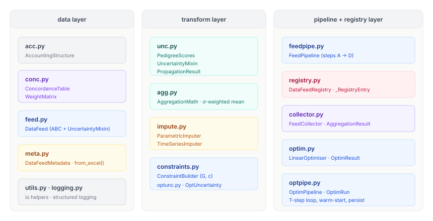

# pySUTO

**Python Supply–Use Table Optimiser**

A modular Python framework for constructing, reconciling, and propagating uncertainty through material flow accounts derived from heterogeneous data sources. pySUTO takes raw statistical data feeds, maps them onto a common accounting structure, aggregates across sources with inverse-variance weighting, imputes missing values, and solves a supply–use constrained linear optimisation problem — all while tracking uncertainty end-to-end from raw data quality scores to final edge estimates.

---

## Table of contents

1. [Overview](#overview)
2. [Three-stage architecture](#three-stage-architecture)
3. [Module reference](#module-reference)
4. [Mathematical foundations](#mathematical-foundations)
5. [Workflow](#workflow)
6. [File structure](#file-structure)
7. [Testing strategy](#testing-strategy)
8. [Installation](#installation)

---

## Overview

Supply–use tables and material flow accounts are assembled from multiple data sources that differ in classification, temporal resolution, regional scope, and data quality. pySUTO addresses three interrelated problems:

- **Heterogeneous classifications** — raw data uses different sector taxonomies, regional aggregations, and time resolutions. A concordance layer maps every source edge onto a common root accounting structure via a sparse weight matrix.
- **Multi-source uncertainty** — each data source carries a pedigree quality score (Laner et al. 2016) that translates into a coefficient of variation. Uncertainty is propagated through every transformation step using Gaussian error propagation.
- **Physical consistency** — supply must equal use for every node and every material parameter efficiency must be respected. A linear optimiser with σ-weighted objective enforces these constraints while staying as close as possible to the aggregated data, with full uncertainty quantification on the optimised values.

---

## Three-stage architecture

The package is organised into three sequential stages. Each stage has a clear input, a clear output, and its own persistence layer.

### Stage diagram


### Data flow


### Stage 1 — Feed pipeline

Runs once per data source. Reads metadata (including pedigree quality scores) from an Excel sidecar, builds a concordance table that maps source edges to root edges, assembles a sparse weight matrix, applies it to the source flow vector, and propagates uncertainty. Results are persisted in the `DataFeedRegistry`.

**Inputs:** raw flow data, classification mapping tables, Excel metadata file  
**Outputs per feed:** weight matrix `W`, root flow vector `F_root`, standard deviation `σ_root`, metadata sidecar

### Stage 2 — Collection, aggregation, and imputation

Runs once across a selected set of registered feeds. Three sub-steps:

#### 2a — Collection (`FeedCollector`)

`FeedCollector` selects feeds from the registry by feed ID (or by specific feed instance) and aligns each feed's `F_root` and `σ_root` onto the common edge index. Feeds that do not cover a given root edge contribute NaN at that position. The result is a pair of stacked matrices:

- **F** ∈ ℝ^(N_f × N_r) — raw per-feed observations, NaN where not covered
- **Σ** ∈ ℝ^(N_f × N_r) — per-feed standard deviations, NaN where not covered

Selection is by feed ID string (latest registered version is used by default). A specific version or instance can be selected by passing a `(feed_id, version)` tuple.

#### 2b — Aggregation (`AggregationMath`)

`AggregationMath` builds the normalised inverse-variance weight matrix **Ω** and computes:

```
f_agg[j] = Σ_k  Ω[k,j] · F[k,j]      (inverse-variance weighted mean)
σ_agg[j] = 1 / sqrt(Σ_k  1/σ[k,j]²)  (combined uncertainty, always ≤ min σ_k)
```

Both operations are vectorised as a single matrix product over all root edges simultaneously (see [Mathematical foundations](#mathematical-foundations)). **Ω** itself is a complete provenance record: column j gives the fractional contribution of every feed to root edge j.

Edges covered by no feed remain NaN in `f_agg` and are passed to the imputation step.

#### 2c — Imputation pipeline (`ImputationEngine`)

`ImputationEngine` manages an ordered pipeline of imputers. Each imputer receives the current state `(f_agg, σ_agg, missing_mask)`, attempts to fill remaining NaN entries, propagates uncertainty through its fill formula, and appends to the shared `ImputationLog`. Multiple imputers chain: the second imputer only sees edges still NaN after the first, and so on.

#### Parameter types and the edge-pair schema

All parametric imputation rests on a bidirectional linear constraint between two edges, called **edge A** and **edge B**:

```
f_b = coeff × f_a    (when A is observed and B is missing)
f_a = f_b / coeff    (when B is observed and A is missing)
```

The imputer resolves which direction applies at runtime from the missing mask. Both edges are identified by the 8-dimensional accounting-structure selector — all values are root-system coordinates (names from the Sector_Entity, Region, Valuation, and Time sheets):

```
(sector_from, entity_from, region_from,
 sector_to,   entity_to,   region_to,
 time, valuation)
```

A-selector fields accept a specific value or `*` (wildcard, matches any admissible value). B-selector fields additionally accept `same` (binds to the value resolved for the corresponding A field in each matched edge pair).

Two named types standardise the most common patterns (Pauliuk et al. 2019):

**Concentration** (data category 3 — intensive object property): links the same `(from_id, to_id, time)` pair across two valuations. All B fields are `same` except `b_valuation`. Because a commodity sector (e.g. `Concentrate/Flow`) appears in both supply edges (as from-node) and use edges (as to-node), two rows are needed — one with the sector in `a_sector_from`, one in `a_sector_to` — sharing the same value and uncertainty.

**Efficiency** (data category 4 — intensive process property / yield factor): links a USE edge (input into a process) to a SUPPLY edge (output from the same process). The process node appears as `(a_sector_to, a_entity_to)` in the USE edge and as `(b_sector_from, b_entity_from)` in the SUPPLY edge. Region and time are `same`. If `a_region_from = *`, the same efficiency applies globally.

**Uncertainty** is specified in one of three modes:

| Mode | Fields | σ |
|---|---|---|
| `sd` | `value_sd` | used directly |
| `min_max` | `value_min`, `value_max` | (max − min) / 4 |
| `pedigree` | five Laner et al. scores 1–4 (`reliability`, `completeness`, `temporal_correlation`, `geographical_correlation`, `other_correlation`) | `PedigreeScores(...).total_cv() × value_nominal` |

The `epsilon` field adds relative model uncertainty in quadrature: σ²_j += (ε · f_j)². Physical bounds `bound_lower` / `bound_upper` clip filled values.

The parameter CSV template with full column reference and example rows for all types is in `data/input/params/params_template.csv`.

**Built-in imputers (registered in order):**

| Imputer | Method | Uncertainty |
|---|---|---|
| `ParametricImputer` | Bidirectional edge-pair constraints; CSV loading or lambda relations | Gaussian: `σ²_j = coeff² · σ²_i + (ε · f_j)²` |
| `FormulaImputer` | Directed multi-source balance equations; region/time-correlated source selection; physical clip | Gaussian: `σ²_j = Σ coeff_i²·σ²_i + (ε·f_j)²`; pre-clip σ retained on clipped fills |
| `TimeImputer` | Window-based temporal interpolation / extrapolation | Weighted Gaussian: `σ²_j = Σ_i w_i² σ²_i · γ(gap)` |

Additional imputers can be created by subclassing `BaseImputer` and implementing a single `impute()` method.

##### ParametricImputer

Resolves parameter definitions into bidirectional edge-pair constraints and fills missing edges. Two instantiation modes are supported:

**Load from CSV** (recommended for concentration and efficiency parameters):

```python
imputer = ParametricImputer.from_csv(
    "data/input/params/copper_params.csv",
    acc_struct=acc,
)
```

The loader resolves each row's A- and B-selector fields against `acc_struct.edge_index`, expands wildcards and `same` bindings into concrete `(edge_a_id, edge_b_id, coeff, σ)` quadruples, and converts uncertainty to σ:
- `min_max`: σ = (max − min) / 4
- `pedigree`: σ = `PedigreeScores(...).total_cv() × value_nominal`

**Lambda relations** (for custom or cross-type relations not covered by the CSV schema):

```python
ParametricRelation(
    description="Scrap return ≈ 0.12 × primary production (same region, same time)",
    target=lambda ei: (ei.sector_from == "SR") & (ei.sector_to == "FU"),
    sources=lambda ei: (ei.sector_from == "Cathode") & (ei.sector_to == "FU"),
    coefficients=[0.12],
    epsilon=0.25,
)
```

Each `ParametricRelation` specifies:
- **target** — a predicate over `edge_index` identifying which edges to fill
- **sources** — list of root edge IDs (or predicates) whose values drive the fill
- **coefficients** — the linear weights α_i (sum need not equal 1)
- **epsilon** — optional relative residual uncertainty (fraction of `f_j`), added in quadrature

Uncertainty propagation (both modes): σ²_j = Σ_i α_i² σ²_i + (ε · f_j)²

All fills are logged to `ImputationLog` with the `param_id` from the CSV row (None for lambda relations).

##### FormulaImputer

Fills missing edges using **directed multi-source balance equations**. Where `ParametricImputer` handles pairwise bidirectional constraints, `FormulaImputer` handles cases where a target edge is computed from several source edges with region-correlated selection, wildcard summation, and a physical clip.

Three building blocks:

**`ParamRef`** — references a value from a loaded params CSV:

```python
ParamRef(param_id="conc_ore_supply", transform="inverse")
# resolves to 1 / value_nominal of the named parameter at runtime
```

`transform="identity"` (default) uses the value directly; `transform="inverse"` takes its reciprocal. Useful when a supply edge is in CC valuation and must be converted to Mass via a concentration parameter before the balance is applied.

**`SourceTerm`** — one additive term in the formula:

```python
SourceTerm(
    selector=lambda ei: ...,          # predicate over edge_index → bool mask
    coefficient=1.0,                   # float or ParamRef; negative = subtraction
    region_binding="from_matches_target_from",  # see below
    time_binding=True,                 # if True: source.time must equal target.time
    aggregate="sum",                   # "single" (expect one match) or "sum" (sum all)
)
```

`region_binding` constrains which region the source edge must be in relative to the matched target edge:

| Value | Constraint |
|---|---|
| `"none"` | no region constraint |
| `"from_matches_target_from"` | `source.from_region == target.from_region` |
| `"from_matches_target_to"` | `source.from_region == target.to_region` |
| `"to_matches_target_from"` | `source.to_region == target.from_region` |
| `"to_matches_target_to"` | `source.to_region == target.to_region` |

**`FormulaRelation`** — directed multi-source balance equation:

```python
FormulaRelation(
    description="...",
    target=lambda ei: ...,    # predicate identifying the target edges to fill
    terms=[...],              # list[SourceTerm]; f_target = Σ coeff_i × f_source_i
    clip_lower=0.0,           # physical lower bound (None = no clip)
    clip_upper=None,          # physical upper bound
    epsilon=0.0,              # relative model uncertainty added in quadrature
)
```

**Domestic use example** — for every region and every traded intermediate flow, domestic use = total supply minus all exports, clipped at zero:

```python
domestic_matte = FormulaRelation(
    description="Domestic Matte use: Smelting output minus exports, clipped at zero",
    target=lambda ei: (
        (ei.sector_from == "Matte") & (ei.entity_from == "Flow") &
        (ei.sector_to   == "CFR")   & (ei.entity_to   == "Process") &
        (ei.valuation   == "Mass")
    ),
    terms=[
        # Total Matte produced by Smelting in the same region
        SourceTerm(
            selector=lambda ei: (
                (ei.sector_from == "Smelting") & (ei.entity_from == "Process") &
                (ei.sector_to   == "Matte")    & (ei.entity_to   == "Flow") &
                (ei.valuation   == "Mass")
            ),
            coefficient=1.0,
            region_binding="to_matches_target_from",  # supply's to_region == target's from_region
            aggregate="single",
        ),
        # All Matte exports from the same region (summed over all destinations)
        SourceTerm(
            selector=lambda ei: (
                (ei.sector_from == "Matte") & (ei.entity_from == "Flow") &
                (ei.entity_to   == "Flow")  &   # Flow→Flow = cross-region trade edge
                (ei.valuation   == "Mass")
            ),
            coefficient=-1.0,
            region_binding="from_matches_target_from",  # export origin == target's from_region
            aggregate="sum",
        ),
    ],
    clip_lower=0.0,
    epsilon=0.05,
)

engine.register(FormulaImputer(relations=[domestic_matte]))
```

The same pattern generalises to any tradable intermediate flow (Concentrate, CSXEW, etc.) by swapping sector names.

**Uncertainty propagation:** for a linear formula with terms `(coeff_i, f_i, σ_i)`:

```
σ²_target = Σ_i  coeff_i² × σ²_i  +  (ε × f_target)²
```

If the pre-clip value is negative and the result is clipped to `clip_lower`, the fill is logged with `method="formula_clipped"` and `sigma_after` carries the pre-clip σ as a conservative uncertainty estimate.

##### TimeImputer

Fills NaN edges by temporal interpolation or extrapolation using a configurable sliding window. Parameters:

- **window** — number of time periods to look back and forward (symmetric by default; `window_before` / `window_after` can differ)
- **method** — `"linear"` (weighted linear interpolation, weights ∝ 1/gap), `"locf"` (last-observation-carried-forward), `"nocb"` (next-observation-carried-backward), `"mean"` (unweighted average within window)
- **min_obs** — minimum number of non-NaN observations required within the window to attempt a fill (default 1)
- **gap_inflation** — σ multiplier per time-step gap; accounts for the fact that extrapolation uncertainty grows with the size of the gap (default 1.0 = no inflation; `sqrt(gap)` is a common choice)

For linear interpolation between two observations at gap g: the interpolated value at fractional position t is `f_t = (1-t)·f_a + t·f_b`, and the propagated uncertainty is `σ²_t = (1-t)²·σ²_a + t²·σ²_b`. Edge-specific `gap_inflation` is applied multiplicatively to σ_t.

##### ImputationLog

Every fill is recorded in the `ImputationLog`, a per-edge provenance table with columns:

| Column | Type | Description |
|---|---|---|
| `edge_id` | int | Root edge index |
| `step` | int | Pipeline step index (0 = first registered imputer) |
| `method` | str | `"parametric"`, `"formula"`, `"formula_clipped"` (clipped to bound), `"time_linear"`, `"locf"`, etc. |
| `source_edges` | list[int] | Edge IDs used as inputs |
| `coefficients` | list[float] | Weights applied to source values |
| `f_before` | float | NaN (edge was missing before fill) |
| `f_after` | float | Filled value |
| `sigma_before` | float | NaN (edge was missing before fill) |
| `sigma_after` | float | Propagated σ |
| `description` | str | Human-readable description from the relation or method |
| `param_id` | str \| None | Key from the parameter CSV row; None for lambda-based relations |

The log is attached to `AggregationResult` and persisted alongside it. Combined with **Ω** from the aggregation step, this gives a complete per-data-point audit trail: for every root edge, you know exactly which feeds contributed (and with what weight) or which imputation rule filled it and from which sources.

**Inputs:** feed IDs, registry  
**Outputs:** `AggregationResult` with `f_agg [N_r]`, `σ_agg [N_r]`, weight matrix **Ω**, `ImputationLog`

### Stage 3 — Linear optimisation

Runs as a loop over T timesteps. `ConstraintBuilder` assembles the constraint matrix `G` and right-hand-side vector `c` from the accounting structure (supply = use balances) plus user-defined parametric relations. `LinearOptimiser` solves the σ-weighted least-squares problem with equality constraints. Each timestep is warm-started from the previous solution. `OptUncertainty` propagates input uncertainty into the optimised solution via the KKT sensitivity Jacobian. All results are collected into an `OptimRun` and persisted.

**Inputs:** `AggregationResult`, accounting structure, parametric relations  
**Outputs per timestep:** `OptimResult` with `F_opt [E]`, `σ_opt [E]`, residuals, solver status  
**Outputs per run:** `OptimRun` with full provenance trace

---

## Module reference



### Stage 1 modules

| File | Classes | Responsibility |
|---|---|---|
| `acc.py` | `AccountingStructure` | Node/edge index, supply–use topology, parametric relations; uses `scipy.sparse` COO/CSR |
| `conc.py` | `ConcordanceTable`, `WeightMatrix` | src→root edge mapping, sparse W matrix (scipy.sparse CSR) |
| `feed.py` | `DataFeed` (ABC) | Base class; owns `weight_matrix` (CSR), pedigree, `F_src`, persistence |
| `feedpipe.py` | step functions, `run_feed_pipeline` | Orchestrates steps A→D for a single feed; delegates to `DataFeedRegistry` |
| `unc.py` | `PedigreeScores`, `UncertaintyMixin`, `PropagationResult` | Laner et al. pedigree → CV; Gaussian error propagation through W (scipy.sparse) |
| `meta.py` | `DataFeedMetadata` | Parses Excel sidecar; stores identification, pedigree scores, provenance, computed outputs |
| `registry.py` | `DataFeedRegistry`, `_RegistryEntry` | Persistent JSON index + per-feed metadata.json, pickle, result.npz |
| `utils.py` | `_NpEncoder`, io helpers | JSON serialisation, numpy-safe dump/load |
| `logging.py` | — | Structured run logging |

### Stage 2 modules

| File | Classes | Responsibility |
|---|---|---|
| `collector.py` | `FeedCollector`, `AggregationResult` | Select and load feeds; align F and Σ matrices onto common edge index |
| `agg.py` | `AggregationMath` | Build **Ω**; compute `f_agg = 1ᵀ(Ω ⊙ F)` and `σ_agg`; coverage mask |
| `impute.py` | `ImputationEngine`, `BaseImputer`, `ParametricImputer`, `FormulaImputer`, `TimeImputer`, `ParametricRelation`, `FormulaRelation`, `SourceTerm`, `ParamRef`, `ImputationLog` | Ordered imputation pipeline; per-edge provenance logging; uncertainty propagation per fill |

### Stage 3 modules

| File | Classes | Responsibility |
|---|---|---|
| `constraints.py` | `ConstraintBuilder` | Assemble G and c from supply–use balances and parametric relations |
| `optim.py` | `LinearOptimiser`, `OptimResult` | σ-weighted equality-constrained least squares; warm-start |
| `optunc.py` | `OptUncertainty` | KKT sensitivity-based uncertainty propagation for constrained optimum |
| `optpipe.py` | `OptimPipeline`, `OptimRun` | T-step loop with warm-start; collect and persist results |

---

## Mathematical foundations

### Pedigree → coefficient of variation

Following Laner et al. (2016). Each data source carries five quality indicator scores s ∈ {1,2,3,4}.

**Reliability** (non-zero even at the best score, since even perfectly documented data carries residual uncertainty):

$$\mathrm{CV}_\mathrm{rel} = a \cdot e^{\,b\, s_\mathrm{rel}}, \qquad a = 0.75,\quad b = 1.105$$

**All other indicators** (zero at score 1, i.e. no additional uncertainty when the indicator is fully met):

$$\mathrm{CV}_i = a_i \cdot e^{\,b\,(s_i - 1)}, \qquad b = 1.105$$

Sensitivity parameter $a_i$: not sensitive $= 0.375$, medium sensitive $= 0.75$, highly sensitive $= 1.5$.

**Total CV** (quadrature sum — assumes independence across indicators):

$$\mathrm{CV}_\mathrm{tot} = \sqrt{\mathrm{CV}_\mathrm{rel}^2 + \mathrm{CV}_\mathrm{comp}^2 + \mathrm{CV}_\mathrm{temp}^2 + \mathrm{CV}_\mathrm{geo}^2 + \mathrm{CV}_\mathrm{other}^2}$$

### Stage 1 — Concordance error propagation

The weight matrix $\mathbf{W} \in \mathbb{R}^{N_\mathrm{src} \times N_\mathrm{root}}$ maps source edges to root edges, assembled as a `scipy.sparse.csr_matrix`. For a dataset with uniform $\mathrm{CV}_\mathrm{tot}$ across all source edges:

$$\boldsymbol{\Sigma}_\mathrm{src} = \mathrm{CV}_\mathrm{tot}^2 \cdot \mathrm{diag}(\mathbf{f}_\mathrm{src}^2)$$

$$\mathbf{f}_\mathrm{root} = \mathbf{W}^\top \mathbf{f}_\mathrm{src}$$

$$\boldsymbol{\Sigma}_\mathrm{root} = \mathbf{W}^\top \boldsymbol{\Sigma}_\mathrm{src}\, \mathbf{W} = \mathrm{CV}_\mathrm{tot}^2 \cdot \mathbf{W}^\top \mathrm{diag}(\mathbf{f}_\mathrm{src}^2)\, \mathbf{W}$$

$$\boldsymbol{\sigma}_\mathrm{root} = \mathrm{CV}_\mathrm{tot} \cdot \sqrt{(\mathbf{W} \odot \mathbf{W})^\top \mathbf{f}_\mathrm{src}^2} \qquad \text{(element-wise } \mathbf{W}^2\text{)}$$

In scipy.sparse code, $\mathbf{W} \odot \mathbf{W}$ is formed by squaring the `.data` array of a copy of the CSR matrix (no densification). The diversification property guarantees $\mathrm{CV}_\mathrm{root} \leq \mathrm{CV}_\mathrm{src}$ for every root edge.

### Stage 2a — Aggregation across N_f feeds

After Stage 1, each feed k has produced a root-edge observation vector **f**_k ∈ ℝ^(N_r) and a standard deviation vector **σ**_k ∈ ℝ^(N_r). Entries are NaN for root edges not covered by feed k.

**Data matrix and variance matrix**

Stack feed observations and variances row-wise:

$$\mathbf{F} \in \mathbb{R}^{N_f \times N_r}, \qquad F_{kj} = f_{\mathrm{root},k}[j] \quad (\text{NaN if feed } k \text{ has no observation at } j)$$

$$\mathbf{V} \in \mathbb{R}^{N_f \times N_r}, \qquad V_{kj} = \sigma_k^2[j] \quad (\text{NaN where } \mathbf{F} \text{ is NaN})$$

**Unnormalised inverse-variance weights**

$$P_{kj} = \frac{1}{V_{kj}} = \frac{1}{\sigma_k^2[j]} \qquad (0 \text{ where } V_{kj} \text{ is NaN or zero})$$

**Normalised weight matrix $\boldsymbol{\Omega} \in \mathbb{R}^{N_f \times N_r}$**

Each column $j$ sums to 1 over the feeds that observe edge $j$:

$$\Omega_{kj} = \frac{P_{kj}}{\displaystyle\sum_{k} P_{kj}} = \frac{1/\sigma_k^2[j]}{\displaystyle\sum_{k} 1/\sigma_k^2[j]}$$

**Aggregated flow vector as a matrix product**

Writing $\mathbf{1} \in \mathbb{R}^{N_f}$ for a column vector of ones, the inverse-variance weighted mean over all root edges simultaneously is:

$$\boxed{\mathbf{f}_\mathrm{agg} = \mathbf{1}^\top (\boldsymbol{\Omega} \odot \mathbf{F}) \;\in\; \mathbb{R}^{N_r}}$$

For each root edge $j$ this reduces to $f_\mathrm{agg}[j] = \sum_k \Omega_{kj} \cdot F_{kj}$. Edges covered by only one feed receive that feed's value unchanged ($\boldsymbol{\Omega}_{:,j}$ has a single non-zero entry of 1). Edges covered by no feed remain NaN and are passed to the imputation step.

In numpy: `f_agg = np.nansum(Omega * F, axis=0)` (equivalent to the matrix product when NaN entries in $\boldsymbol{\Omega}$ are replaced with 0 before summing).

**Aggregated uncertainty**

$$\sigma_\mathrm{agg}[j] = \frac{1}{\displaystyle\sqrt{\sum_k P_{kj}}} = \frac{1}{\displaystyle\sqrt{\sum_k 1/\sigma_k^2[j]}}$$

$\sigma_\mathrm{agg}[j] \leq \min_k \sigma_k[j]$: combining feeds never increases uncertainty.

**NaN handling (coverage)**

- A root edge $j$ is **covered** if at least one feed has a non-NaN observation there.
- Covered edges: $f_\mathrm{agg}[j]$ and $\sigma_\mathrm{agg}[j]$ are finite; column $j$ of $\boldsymbol{\Omega}$ sums to 1.
- Uncovered edges: $f_\mathrm{agg}[j] = \mathrm{NaN}$; passed to `ImputationEngine`.

The matrix $\boldsymbol{\Omega}$ is a full provenance record: row $k$ gives feed $k$'s fractional contribution to every root edge.

### Stage 2b — Imputation uncertainty propagation

The imputation pipeline propagates uncertainty through each fill using first-order Gaussian error propagation. The key invariant: every filled edge has a well-defined $\sigma_\mathrm{agg}[j]$ after each imputation step, enabling downstream stages to treat imputed and observed edges uniformly.

#### Parametric imputation

A relation fills target edge $j$ as a linear combination of source edges $\{i_1, \dots, i_m\}$:

$$f_j = \sum_{l=1}^{m} \alpha_l \cdot f_{i_l}$$

Gaussian propagation (assuming independence between sources):

$$\sigma^2_j = \sum_{l=1}^{m} \alpha_l^2 \cdot \sigma^2_{i_l} + \bigl(\varepsilon \cdot f_j\bigr)^2$$

The second term ($\varepsilon$ = `epsilon`, a user-supplied fraction) encodes the structural uncertainty in the relation itself — the fact that the parametric formula is an approximation. It inflates $\sigma_j$ even when source uncertainties are small.

#### Time imputation — linear interpolation

Between two observations $(f_a, \sigma_a)$ at time $t_a$ and $(f_b, \sigma_b)$ at time $t_b$, with a gap of $g = t_b - t_a$ time periods, the interpolated value at position $t_a + s \cdot \Delta t$ (fractional position $\lambda = s/g \in [0,1]$) is:

$$f_j = (1-\lambda)\,f_a + \lambda\,f_b$$

$$\sigma^2_j = (1-\lambda)^2\,\sigma^2_a + \lambda^2\,\sigma^2_b$$

A **gap inflation** factor $\gamma(g)$ is then applied to account for model uncertainty growing with gap size. The default is $\gamma(g) = \gamma_0^g$ (multiplicative per period), where $\gamma_0 = $ `gap_inflation` (default 1.0 = no inflation).

#### Time imputation — extrapolation (LOCF / NOCB)

Last-observation-carried-forward at gap $g$:

$$f_j = f_a, \qquad \sigma_j = \sigma_a \cdot \gamma_0^g$$

The gap inflation grows $\sigma$ exponentially with the extrapolation distance, reflecting increasing uncertainty the further the estimate is from the last observation.

#### Pipeline chaining

Steps are applied in registration order. After step $s$, let $\mathcal{M}_s$ denote the set of still-missing edges. Step $s+1$ only touches $\mathcal{M}_s$; it reads the current $(f, \sigma)$ values of already-filled edges (including those filled by earlier steps) as valid inputs. This means a `ParametricImputer` registered after a `TimeImputer` can use time-filled values as sources.

### Stage 3 — Constrained optimisation objective

Minimise the $\sigma$-weighted distance from the aggregated estimate subject to physical balance constraints:

$$\min_{\mathbf{f}} \; (\mathbf{f} - \mathbf{f}_\mathrm{agg})^\top \boldsymbol{\Sigma}_\mathrm{agg}^{-1} (\mathbf{f} - \mathbf{f}_\mathrm{agg}) \qquad \text{subject to} \quad \mathbf{G}\mathbf{f} = \mathbf{c}$$

where $\boldsymbol{\Sigma}_\mathrm{agg} = \mathrm{diag}(\boldsymbol{\sigma}_\mathrm{agg}^2)$, $\mathbf{G}$ encodes supply–use balances and parametric efficiency constraints, and $\mathbf{c}$ holds the corresponding totals.

### Optimised uncertainty via KKT sensitivity

The closed-form optimum for equality-constrained WLS:

$$\mathbf{f}_\mathrm{opt} = \mathbf{f}_\mathrm{agg} + \boldsymbol{\Sigma}_\mathrm{agg}\mathbf{G}^\top \!\left(\mathbf{G}\boldsymbol{\Sigma}_\mathrm{agg}\mathbf{G}^\top\right)^{-1} (\mathbf{c} - \mathbf{G}\mathbf{f}_\mathrm{agg})$$

Jacobian of $\mathbf{f}_\mathrm{opt}$ with respect to $\mathbf{c}$:

$$\mathbf{J} = \frac{\partial \mathbf{f}_\mathrm{opt}}{\partial \mathbf{c}} = \boldsymbol{\Sigma}_\mathrm{agg}\mathbf{G}^\top \!\left(\mathbf{G}\boldsymbol{\Sigma}_\mathrm{agg}\mathbf{G}^\top\right)^{-1}$$

Propagated uncertainty on the optimised solution:

$$\boldsymbol{\Sigma}_\mathrm{opt} = \mathbf{J}\,\boldsymbol{\Sigma}_c\,\mathbf{J}^\top, \qquad \boldsymbol{\sigma}_\mathrm{opt} = \sqrt{\mathrm{diag}(\boldsymbol{\Sigma}_\mathrm{opt})}$$

where $\boldsymbol{\Sigma}_c = \mathrm{diag}(\boldsymbol{\sigma}_\mathrm{agg}^2)$ is the uncertainty in the constraint right-hand sides inherited from the aggregation step.

---

## Workflow

```python
# ── Stage 1: one feed pipeline run per data source ─────────────────────────

registry = DataFeedRegistry(odir="data/proc/feed/registry")
registry.load_index()

for feed_id, excel_path, raw_df, F_src in feed_configs:
    wm, meta, result = run_feed_pipeline(
        excel_path=excel_path,
        raw_df=raw_df,
        acc_struct=acc,
        sector_map_df=...,
        region_map_df=...,
        time_map_df=...,
        valuation_map_df=...,
        var_map_df=...,
        F_src=F_src,
        registry=registry,
        feed_id=feed_id,
        aux_col="Supply_Use",
        allow_unmatched_edges=True,
    )
    # registry.json, metadata.json, <feed_id>.pkl, result.npz written automatically

# ── Stage 2a: select and align feeds ───────────────────────────────────────

collector = FeedCollector(registry=registry, acc_struct=acc)

# Select by ID — latest registered version used automatically
collector.select(["baci", "crude_ore"])

# Or select a specific version:
# collector.select([("baci", 1), "crude_ore"])

agg_result = collector.aggregate()
# agg_result.f_agg    [N_r]       inverse-variance weighted mean
# agg_result.sigma_agg[N_r]       combined uncertainty
# agg_result.Omega    [N_f × N_r] provenance weight matrix
# agg_result.coverage [N_r] bool  True where at least one feed has data

# ── Stage 2b: imputation pipeline ──────────────────────────────────────────

# Define parametric relations
scrap_return = ParametricRelation(
    description="Scrap return ≈ 12 % of cathode→FU flow (same region, same time)",
    target=lambda ei: (ei.sector_from == "SR") & (ei.sector_to == "FU"),
    sources=lambda ei: (ei.sector_from == "Cathode") & (ei.sector_to == "FU"),
    coefficients=[0.12],
    epsilon=0.25,
)

engine = ImputationEngine(acc_struct=acc)

# Concentration and efficiency parameters from CSV
engine.register(ParametricImputer.from_csv(
    "data/input/params/copper_conc_params.csv", acc_struct=acc))
engine.register(ParametricImputer.from_csv(
    "data/input/params/copper_efficiency_params.csv", acc_struct=acc))

# Lambda-based custom relation
engine.register(ParametricImputer(relations=[scrap_return]))

# Balance equations for domestic use of traded flows
engine.register(FormulaImputer(relations=[domestic_matte]))

# Temporal gap fill as last resort
engine.register(TimeImputer(window=5, method="linear", gap_inflation=1.05))

agg_result = engine.run(agg_result)
# agg_result.f_agg updated in-place for imputed edges
# agg_result.imputation_log: complete per-edge fill record

# Inspect provenance for a specific edge:
log = agg_result.imputation_log
print(log.for_edge(edge_id=42))
# → method="parametric", source_edges=[1305], coefficients=[0.12], sigma_after=0.031

# ── Stage 3: optimise over T timesteps ──────────────────────────────────────

cb  = ConstraintBuilder(acc_struct=acc,
                        parametric_relations=acc.parametric_relations)
opt = LinearOptimiser(acc_struct=acc)
unc = OptUncertainty()

pipeline = OptimPipeline(
    acc_struct=acc,
    registry=registry,
    constraint_builder=cb,
    optimiser=opt,
    unc=unc,
)

run = pipeline.run(
    agg_result=agg_result,
    timesteps=list(range(2010, 2024)),
)

# run.results[t] → OptimResult with F_opt, σ_opt, residuals, solver_status
# run is persisted automatically to the registry
```

---

## File structure

```
pysuto/
├── __init__.py            public re-exports only
│
├── acc.py                 AccountingStructure  (scipy.sparse COO/CSR)
├── conc.py                ConcordanceTable · WeightMatrix  (scipy.sparse CSR)
├── feed.py                DataFeed (ABC)  ← weight_matrix typed as csr_matrix
├── feedpipe.py            step_A/B/C/D functions · run_feed_pipeline  ── Stage 1
├── unc.py                 PedigreeScores · UncertaintyMixin · PropagationResult
├── meta.py                DataFeedMetadata  (Excel sidecar + computed outputs)
├── registry.py            DataFeedRegistry · _RegistryEntry  (JSON index)
├── utils.py               _NpEncoder · io helpers
├── logging.py             structured run logging
│
├── collector.py           FeedCollector · AggregationResult             ─┐
├── agg.py                 AggregationMath  (Ω · f_agg · σ_agg)          │ Stage 2
├── impute.py              ImputationEngine · BaseImputer                 │
│                          ParametricImputer · FormulaImputer             │
│                          TimeImputer                                     │
│                          ParametricRelation · FormulaRelation            │
│                          SourceTerm · ParamRef · ImputationLog         ─┘
│
├── constraints.py         ConstraintBuilder                             ─┐
├── optim.py               LinearOptimiser · OptimResult                  │ Stage 3
├── optunc.py              OptUncertainty                                  │
└── optpipe.py             OptimPipeline · OptimRun                      ─┘
```

**Import direction is strictly one-way:**

```
acc  →  conc  →  feed  →  feedpipe
unc  ─────────────────────────────┘ (mixin, no upward imports)
meta → registry
collector → agg → impute → constraints → optim → optunc → optpipe
utils / logging ← imported by any layer, import nothing from pysuto
```

Nothing in the data layer (`acc`, `conc`, `feed`) imports from the registry or pipeline layers. `utils.py` and `logging.py` have no pysuto-internal imports. This makes every module independently testable.

---

## Testing strategy

Each layer has a dedicated unit test file that can be run in isolation using the shared fixtures in `conftest.py`.

| Test file | Scope | Key fixture |
|---|---|---|
| `test_pedigree.py` | CV formulas, score validation, invariant CV_root ≤ CV_src | none — pure numpy |
| `test_concordance.py` | Weight imputation, sum-to-one, src index, CSR shape | `mock_acc_struct` |
| `test_weightmatrix.py` | W construction, apply(), scipy.sparse round-trip pickle | `mock_acc_struct`, `W_dense` |
| `test_collector.py` | Feed alignment, NaN coverage mask, Ω column sums to 1 | `mock_registry`, `mock_acc` |
| `test_aggregation.py` | Ω construction, `f_agg = 1ᵀ(Ω⊙F)`, σ_agg ≤ min σ_k, NaN coverage | `F_src`, `sigma_src` |
| `test_imputation.py` | ParametricImputer fill, TimeImputer linear/locf, log completeness, σ propagation, pipeline chaining | `agg_result_partial` |
| `test_constraints.py` | G assembly, supply=use rows, parametric rows | `mock_acc_struct` |
| `test_optimiser.py` | Feasibility, residuals near zero, warm-start delta | `G`, `c`, `F_agg` |
| `test_optunc.py` | σ_opt ≤ σ_agg invariant, Jacobian shape | `G`, `Sigma_diag` |
| `test_registry.py` | Round-trip save/load, summary_df, overwrite guard | temp directory |
| `test_workflow.py` | Full three-stage integration run, provenance trace | all fixtures |

---

## Installation

```bash
# clone
git clone https://github.com/your-org/pySUTO.git
cd pySUTO

# install in editable mode with dev dependencies
pip install -e ".[dev]"

# run tests
pytest tests/ -v
```

**Core dependencies:** `numpy`, `pandas`, `scipy`

**Optional:** `matplotlib` for diagnostic plots of feed uncertainty distributions

---

## References

Laner, D., Rechberger, H., & Astrup, T. (2016). A novel approach to characterize data uncertainty in material flow analysis and its application to plastics flows in Austria. *Journal of Industrial Ecology*, 20(5), 1050–1063.

Lenzen, M., Wood, R., & Wiedmann, T. (2009). Matrix balancing under conflicting information. *Economic Systems Research*, 22(1), 1–23.
