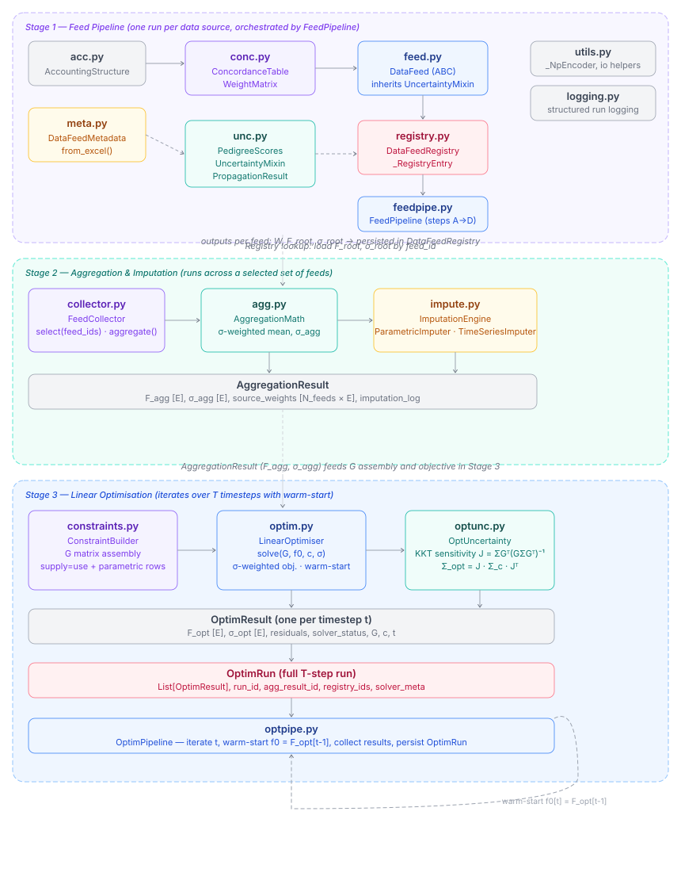
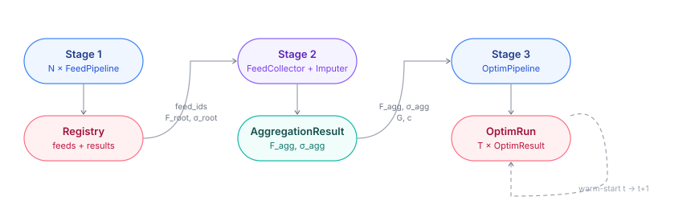

# pySUTO

**Python Supply–Use Table Optimiser**

A modular Python framework for constructing, reconciling, and propagating uncertainty through material flow accounts derived from heterogeneous data sources. pySUTO takes raw statistical data feeds, maps them onto a common accounting structure, aggregates across sources with inverse-variance weighting, imputes missing values, builds a constrained linear system, and solves a σ-weighted QP — tracking uncertainty end-to-end from raw pedigree scores to the final optimum.

> Contributors / LLM assistants: see [CLAUDE.md](CLAUDE.md) for behavioural rules.

---

## Table of contents

1. [Overview](#overview)
2. [Architecture](#architecture)
   - [Stage 1 — Datafeed](#stage-1--datafeed)
   - [Stage 2 — Aggregation & Imputation](#stage-2--aggregation--imputation)
   - [Stage 3 — Constraint building](#stage-3--constraint-building)
   - [Stage 4 — Solver](#stage-4--solver)
   - [Stage 5 — Posterior uncertainty propagation](#stage-5--posterior-uncertainty-propagation)
3. [Module reference](#module-reference)
4. [Workflow](#workflow)
5. [File structure](#file-structure)
6. [Testing](#testing)
7. [Installation](#installation)
8. [Glossary](#glossary)
9. [References](#references)

---

## Overview

Supply–use tables and material flow accounts are assembled from multiple data sources that differ in classification, temporal resolution, regional scope, and data quality. pySUTO addresses three interrelated problems:

- **Heterogeneous classifications** — raw data uses different sector taxonomies, regional aggregations, and time resolutions. A concordance layer maps every source edge onto a common root accounting structure via a sparse weight matrix.
- **Multi-source uncertainty** — each data source carries a pedigree quality score (Laner et al. 2016) that translates into a coefficient of variation. Uncertainty is propagated through every transformation step using Lp / power-mean error propagation.
- **Physical consistency** — supply must equal use for every node and every material-parameter efficiency must be respected. A linear-equality / inequality QP enforces these constraints while staying as close as possible to the aggregated data, with full uncertainty quantification on the optimised values.

The package is organised into **five sequential stages**: datafeed assembly (per source), aggregation + imputation (across sources), constraint building, constrained optimisation, and posterior uncertainty propagation. Each stage has a clear input, a clear output, and its own persistence layer.

---

## Architecture

> **Note:** the diagrams under `figs/` currently depict the previous 3-stage layout and are being regenerated to reflect the 4-stage layout described below.





| Stage | Module(s) | Input | Output |
|---|---|---|---|
| 1 — Datafeed | `feedpipe.py`, `feed.py`, `conc.py`, `unc.py`, `meta.py`, `registry.py` | raw flow data + Excel sidecar | `DataFeedRegistry` entries: `W`, `F_root`, `σ_root` |
| 2 — Aggregation & Imputation | `collector.py`, `agg.py`, `impute.py` | selected feed IDs | `AggregationResult`: `f_agg`, `σ_agg`, `Ω`, `ImputationLog` |
| 3 — Constraint building | `constraints.py` | `AggregationResult` | `ConstraintRun`: `G`, `c(t)`, `σ_c(t)`, bounds |
| 4 — Solver | `solver.py` | `ConstraintRun` | `OptimResult` per timestep |
| 5 — Posterior uncertainty | `uncprop.py` | `OptimRun` + upstream `ConstraintRun` | `UncPropResult`: `σ_a*(t)`, `lower(t)`, `upper(t)` |

---

### Stage 1 — Datafeed

**What this stage does.** Runs once per data source. Reads metadata (including pedigree quality scores) from an Excel sidecar, builds a concordance table mapping source edges to root edges, assembles a sparse weight matrix, applies it to the source flow vector, and propagates pedigree-derived uncertainty through the concordance map. Results land in the `DataFeedRegistry`.

**Inputs:** raw flow data, classification mapping tables, Excel metadata file.
**Outputs per feed:** weight matrix `W`, root flow vector `F_root`, standard deviation `σ_root`, metadata sidecar.

#### Math

##### Pedigree → coefficient of variation

Following Laner et al. (2016). Each data source carries five quality indicator scores $s \in \{1,2,3,4\}$.

**Reliability** (non-zero even at the best score):

$$\mathrm{CV}_\mathrm{rel} = a \cdot e^{\,b\, s_\mathrm{rel}}, \qquad a = 0.75,\quad b = 1.105$$

**All other indicators** (zero at score 1):

$$\mathrm{CV}_i = a_i \cdot e^{\,b\,(s_i - 1)}, \qquad b = 1.105$$

Sensitivity parameter $a_i$: not sensitive $= 0.375$, medium sensitive $= 0.75$, highly sensitive $= 1.5$.

**Total CV** (quadrature sum — assumes independence across indicators):

$$\mathrm{CV}_\mathrm{tot} = \sqrt{\mathrm{CV}_\mathrm{rel}^2 + \mathrm{CV}_\mathrm{comp}^2 + \mathrm{CV}_\mathrm{temp}^2 + \mathrm{CV}_\mathrm{geo}^2 + \mathrm{CV}_\mathrm{other}^2}$$

##### Power-mean (Lp) uncertainty propagation

All Stage 1 / Stage 2 σ propagation steps share a single global power-mean (Lp) combiner with exponent $p \in [1.1, 1.5]$, default $p = 1.3$. For a list of contributions $\{x_i\}$:

$$\mathrm{Lp}(\{x_i\};\, p) \;=\; \left(\sum_i |x_i|^p\right)^{1/p}.$$

$p = 2$ recovers the legacy Gaussian-quadrature formulas exactly. Smaller $p$ weights large terms relatively less, which suppresses σ inflation in fan-in regimes where the per-source independence assumption is structurally violated. The exponent is a constructor kwarg on every consumer (`AggregationMath`, every `BaseImputer`, `ConstraintEngine`); init scripts pass the same value to all of them.

##### Concordance error propagation

The weight matrix $\mathbf{W} \in \mathbb{R}^{N_\mathrm{src} \times N_\mathrm{root}}$ maps source edges to root edges as a `scipy.sparse.csr_matrix`. The point estimate is

$$\mathbf{f}_\mathrm{root} = \mathbf{W}^\top \mathbf{f}_\mathrm{src}.$$

Uncertainty is propagated in **CV-invariant** form. For each root edge $j$, the normalized fan-in shares from per-source absolute contributions are

$$A_{ij} = \bigl|W_{ij}\, f_{\mathrm{src},i}\bigr|, \qquad \omega_{ij} = \frac{A_{ij}}{\sum_k A_{kj}} \quad\Bigl(\sum_i \omega_{ij} = 1\Bigr),$$

and

$$\mathrm{CV}_\mathrm{root}[j] \;=\; \mathrm{CV}_\mathrm{src} \cdot \left(\sum_i \omega_{ij}^p\right)^{1/p}, \qquad \boldsymbol{\sigma}_\mathrm{root}[j] \;=\; \mathrm{CV}_\mathrm{root}[j] \cdot |\mathbf{f}_\mathrm{root}[j]|.$$

For $p \geq 1$ the power-mean of normalized weights is at most 1, so the **diversification invariant** $\mathrm{CV}_\mathrm{root}[j] \leq \mathrm{CV}_\mathrm{src}$ holds for every root edge.

#### Classes

- **`AccountingStructure`** ([acc.py](src/pysuto/acc.py)) — root node/edge index, supply–use topology, per-edge bounds, structural edge masks (`supply_edge_mask`, `use_edge_mask`, `sb_edge_mask`, `tradable_edge_mask`) consumed by `MassBalanceBuilder` / `FlatPriorImputer`.
- **`ConcordanceTable` / `WeightMatrix`** ([conc.py](src/pysuto/conc.py)) — src→root edge mapping and the sparse CSR weight matrix.
- **`DataFeed`** ([feed.py](src/pysuto/feed.py)) — ABC owning a `weight_matrix`, pedigree scores, `F_src`, and persistence hooks.
- **`PedigreeScores` / `UncertaintyMixin` / `PropagationResult`** ([unc.py](src/pysuto/unc.py)) — pedigree→CV computation and Lp / power-mean error propagation through `W`.
- **`DataFeedMetadata`** ([meta.py](src/pysuto/meta.py)) — parses the Excel sidecar.
- **`DataFeedRegistry`** ([registry/feed.py](src/pysuto/registry/feed.py)) — JSON index + per-feed metadata, pickle, and result.npz on disk.
- **`run_feed_pipeline` / `step_A..D`** ([feedpipe.py](src/pysuto/feedpipe.py)) — orchestrates the four-step pipeline (read metadata → build concordance → assemble W → apply + propagate).

#### Key parameters

| Parameter | Default | Effect |
|---|---|---|
| `p` (power-mean) | `1.3` | Tail-weight in σ propagation; `p=2` ≡ Gaussian quadrature |
| pedigree scores | 1–4 per indicator | Map to CV via Laner et al. exponential |
| `allow_unmatched_edges` | `True` | Whether `feedpipe` tolerates source edges not in the concordance table |

#### Use case

```python
registry = DataFeedRegistry(odir="data/proc/feed/registry")
registry.load_index()

wm, meta, result = run_feed_pipeline(
    excel_path="data/input/feeds/baci_2022.xlsx",
    raw_df=baci_df,
    acc_struct=acc,
    sector_map_df=sector_map, region_map_df=region_map,
    time_map_df=time_map, valuation_map_df=valuation_map, var_map_df=var_map,
    F_src=F_src,
    registry=registry,
    feed_id="baci",
    aux_col="Supply_Use",
    allow_unmatched_edges=True,
)
```

The registry now contains `registry.json`, `metadata.json`, `<feed_id>.pkl`, and `result.npz`.

---

### Stage 2 — Aggregation & Imputation

**What this stage does.** Selects a set of registered feeds, aligns each feed's `F_root` and `σ_root` onto the common edge index, builds the inverse-variance weight matrix `Ω`, aggregates across feeds, and runs an ordered imputation pipeline to fill any edges still uncovered. Every fill is recorded in an `ImputationLog`.

**Inputs:** feed IDs (or `(feed_id, version)` tuples), registry.
**Outputs:** `AggregationResult` with `f_agg [N_r]`, `σ_agg [N_r]`, `Ω [N_f × N_r]`, `coverage [N_r]`, `ImputationLog`.

> Uses [power-mean (Lp) uncertainty propagation](#power-mean-lp-uncertainty-propagation) and [pedigree→CV](#pedigree--coefficient-of-variation) from Stage 1.

#### Math

##### Aggregation across $N_f$ feeds

After Stage 1, each feed $k$ has produced a root-edge observation vector $\mathbf{f}_k \in \mathbb{R}^{N_r}$ and a standard-deviation vector $\boldsymbol{\sigma}_k \in \mathbb{R}^{N_r}$. Entries are NaN for root edges not covered by feed $k$.

Stack:

$$\mathbf{F} \in \mathbb{R}^{N_f \times N_r}, \qquad F_{kj} = f_{\mathrm{root},k}[j] \quad (\text{NaN if not observed})$$

$$V_{kj} = \sigma_k^2[j], \qquad P_{kj} = 1/V_{kj} \quad (0 \text{ where } V \text{ is NaN or zero})$$

Normalised weight matrix (each column sums to 1):

$$\Omega_{kj} = \frac{P_{kj}}{\sum_{k} P_{kj}} = \frac{1/\sigma_k^2[j]}{\sum_{k} 1/\sigma_k^2[j]}$$

Aggregated flow vector as a single matrix operation:

$$\boxed{\mathbf{f}_\mathrm{agg} = \mathbf{1}^\top (\boldsymbol{\Omega} \odot \mathbf{F}) \;\in\; \mathbb{R}^{N_r}}$$

For each root edge $j$ this reduces to $f_\mathrm{agg}[j] = \sum_k \Omega_{kj} F_{kj}$. Aggregated uncertainty uses the Lp combine over the inverse-variance-weighted per-feed contributions:

$$\sigma_\mathrm{agg}[j] \;=\; \left( \sum_k |\Omega_{kj}\, \sigma_k[j]|^p \right)^{1/p}.$$

At $p = 2$ this reduces to $1/\sqrt{\sum_k 1/\sigma_k^2[j]}$. For $p \in [1, 2]$, $\sigma_\mathrm{agg}[j] \leq \max_k \sigma_k[j]$ always holds; the $\sigma_\mathrm{agg} \leq \min_k \sigma_k$ invariant is exact at $p = 2$ and held tightly for $p \approx 1.3$ in practice. Edges covered by no feed remain NaN and are passed to the imputation step.

##### Imputation — parametric

A `ParametricRelation` fills target edge $j$ as a linear combination of source edges $\{i_1, \dots, i_m\}$ with coefficients $\alpha_l$:

$$f_j = \sum_{l=1}^{m} \alpha_l \cdot f_{i_l}$$

$$\sigma_j \;=\; \left( \sum_{l=1}^{m} |\alpha_l \cdot \sigma_{i_l}|^p \;+\; |\sigma_\mathrm{param}|^p \;+\; |\varepsilon \cdot f_j|^p \right)^{1/p}$$

The fill always uses bare $\alpha_l$. σ propagation uses bare $\alpha_l$ in the **forward CSV branch (A→B)** and in **lambda relations**. The **backward CSV branch (B→A)** is the only place where $1/\alpha$ is replaced by the [regularized sensitivity](#regularized-sensitivity) below — this caps σ amplification when $1/\alpha \gg 1$ (the ore-grade-inverse case).

The $\varepsilon$ (`epsilon`) term encodes structural uncertainty in the relation itself. $\sigma_\mathrm{param}$ is the per-row σ from the CSV (omitted for lambda relations).

##### Regularized sensitivity

The backward branch passes the inverse multiplier $\beta = 1/\alpha$ through:

$$s(\beta;\, q,\,\alpha_{\min}) \;=\; \frac{|\beta|}{\bigl(|\beta|^q + \alpha_{\min}^q\bigr)^{1/q}}.$$

Defaults: $q = 3$, $\alpha_{\min} = 0.05$. Behaviour:
- $|\beta| \gg \alpha_{\min}$: $s(\beta) \to 1$, so $s(\beta)\cdot\sigma_b$ cannot grow beyond $\sigma_b$.
- $|\beta| \ll \alpha_{\min}$: $s(\beta) \to |\beta|/\alpha_{\min}$ — a relative floor on the effective sensitivity.

##### Imputation — formula

For a `FormulaRelation` with directed terms $(\alpha_i, f_i, \sigma_i)$:

$$f_\mathrm{target} = \sum_i \alpha_i \cdot f_i, \qquad \sigma_\mathrm{target} = \left( \sum_i |\alpha_i \cdot \sigma_i|^p + |\varepsilon \cdot f_\mathrm{target}|^p \right)^{1/p}$$

If a pre-clip value lies outside `[clip_lower, clip_upper]`, the fill is logged with `method="formula_clipped"` and `sigma_after` carries the pre-clip σ as a conservative estimate.

##### Imputation — time

Linear interpolation between observations at $(t_a, f_a, \sigma_a)$ and $(t_b, f_b, \sigma_b)$ with gap $g = t_b - t_a$ and fractional position $\lambda \in [0,1]$:

$$f_j = (1-\lambda)\,f_a + \lambda\,f_b, \qquad \sigma_j = \bigl( |(1-\lambda)\sigma_a|^p + |\lambda\sigma_b|^p \bigr)^{1/p} \cdot \gamma_0^{\,g}$$

LOCF/NOCB at gap $g$: $f_j = f_a$, $\sigma_j = \sigma_a \cdot \gamma_0^{\,g}$. The multiplicative `gap_inflation` factor $\gamma_0$ grows σ with extrapolation distance.

##### Imputation — flat prior (final fallback)

For every residual NaN edge: $f_j = 0$, $\sigma_j = \mathrm{CV}(j) \cdot \mathrm{scale}(j)$.

**CV — coverage-aware per-mask interpolation.** The mask is the **first matching** of `supply` / `use` / `tradable` / `sb` (drawn from `AccountingStructure` edge masks); each mask carries a pair $(\mathrm{cv}_\text{lo}, \mathrm{cv}_\text{hi})$ in `flat_prior_cv.csv`, and the CV is interpolated by the **coverage density** of the edge's $(\text{sector\_from}, \text{region\_from})$ neighbourhood:

$$\rho(j) = \frac{|\{i \in (\text{sector\_from}, \text{region\_from})(j) \,:\, \text{coverage}[i]\}|}{|\{i \in (\text{sector\_from}, \text{region\_from})(j)\}|}, \qquad \mathrm{CV}(j) = \mathrm{cv}_\text{lo}[\mathrm{mask}(j)] + (\mathrm{cv}_\text{hi} - \mathrm{cv}_\text{lo})\,(1 - \rho(j))$$

Data-rich neighbourhoods (ρ ≈ 1) get the tight $\mathrm{cv}_\text{lo}$; data-poor ones get the loose $\mathrm{cv}_\text{hi}$. Unmatched edges fall through to `default_cv` with no density modulation. Legacy CSVs with a single `cv` column are still accepted (treated as $\mathrm{cv}_\text{lo}=\mathrm{cv}_\text{hi}$).

**scale — 3-level cascade.** Cascading fallback so an edge whose narrow group has no observed flow still receives a meaningful scale:

1. mean $|f_\mathrm{agg}|$ over $(\text{sector\_from}, \text{entity\_from}, \text{region\_from}, \text{valuation})$ — the original narrow group;
2. if (1) is empty, mean $|f_\mathrm{agg}|$ over $(\text{sector\_from}, \text{valuation})$ — broader fallback;
3. if (2) is also empty, the global median of finite, non-zero $|f_\mathrm{agg}|$.

Only finite, non-zero values count at every level, so upstream-imputed zeros never pull the scale to zero. The previous single-level rule collapsed σ to 0 on ~40 k copper edges, which then pinned them at $\sigma_a = 10^{-6}$ via the constraints-side floor (see [REP/analysis_optim_const_copper_…_20260513_112419.md](REP/analysis_optim_const_copper_20260513_091054_65b9133e_20260513_112419.md)).

#### Classes

- **`FeedCollector`** ([collector.py](src/pysuto/collector.py)) — `.select([feed_id, ...])`, `.aggregate(p=…)`; aligns each feed onto the common edge index and returns an `AggregationResult`.
- **`AggregationMath`** ([agg.py](src/pysuto/agg.py)) — vectorised $\Omega$, `f_agg`, `σ_agg` over the full `[N_f × N_r]` matrices.
- **`ImputationEngine`** ([impute/](src/pysuto/impute/)) — orders an `.register()`-list of imputers; each imputer's `.prepare(acc_struct)` is called at registration so shared lookup structures only build once.
- **`BaseImputer`** ([impute/](src/pysuto/impute/)) — ABC; subclass and implement `.impute(...)` to add a new fill method.
- **`ParametricImputer`** — bidirectional edge-pair constraints from a CSV (`.from_csv(...)`) or `ParametricRelation` lambdas; covers concentration (data category 3) and efficiency (data category 4) parameters.
- **`FormulaImputer`** — directed multi-source balance equations with region/time-correlated source selection and a physical clip. Building blocks: `ParamRef`, `SourceTerm`, `FormulaRelation`.
- **`TimeImputer`** — sliding-window temporal interpolation/extrapolation; `method ∈ {"linear","locf","nocb","mean"}`.
- **`FlatPriorImputer`** — final-fallback flat prior keyed by `AccountingStructure` edge masks; register **last**.
- **`ImputationLog`** — per-edge provenance table: `edge_id`, `step`, `method`, `source_edges`, `coefficients`, `f_before/after`, `sigma_before/after`, `description`, `param_id`.
- **`AggregationResult`** ([agg.py](src/pysuto/agg.py)) — dataclass holding `f_agg`, `sigma_agg`, `Omega`, `F`, `Sigma`, `feed_ids`, `coverage`, plus `imputation_log` and `imputation_metadata` once imputation has run.

#### Key parameters

| Parameter | Default | Where | Effect |
|---|---|---|---|
| `p` | `1.3` | every imputer + `FeedCollector.aggregate` | Lp exponent |
| `q` | `3.0` | `ParametricImputer` | Sharpness of backward-branch sensitivity knee |
| `alpha_min` | `0.05` | `ParametricImputer` | Effective-sensitivity floor for inverse multipliers |
| `cv_cap` | `inf` | `ParametricImputer` | Optional hard cap on per-fill CV |
| `epsilon` | per relation | `ParametricRelation` / `FormulaRelation` | Relative residual uncertainty added in quadrature |
| `window`, `gap_inflation` | `5`, `1.0` | `TimeImputer` | Look-back/forward range; per-step σ multiplier |
| `default_cv` | required | `FlatPriorImputer` | CV applied to edges that match no listed mask (no density modulation) |
| `cv_lo`, `cv_hi` (per mask) | from `flat_prior_cv.csv` | `FlatPriorImputer` | Tight / loose endpoints of the coverage-density interpolation `cv_lo + (cv_hi − cv_lo)·(1 − ρ)` |

#### Use cases

**Aggregation across two registered feeds:**

```python
collector = FeedCollector(registry=registry, acc_struct=acc)
collector.select(["baci", "crude_ore"])
agg_result = collector.aggregate(p=1.3)
# agg_result.f_agg, agg_result.sigma_agg, agg_result.Omega, agg_result.coverage
```

**Parametric imputation with both CSV parameters and a lambda relation:**

```python
engine = ImputationEngine(acc_struct=acc)

engine.register(ParametricImputer.from_csv(
    "data/input/params/copper_conc_params.csv", acc_struct=acc,
    p=1.3, q=3.0, alpha_min=0.05,
))

scrap_return = ParametricRelation(
    description="Scrap return ≈ 12% of cathode→FU flow",
    target=lambda ei: (ei.sector_from == "SR") & (ei.sector_to == "FU"),
    sources=lambda ei: (ei.sector_from == "Cathode") & (ei.sector_to == "FU"),
    coefficients=[0.12],
    epsilon=0.25,
)
engine.register(ParametricImputer(relations=[scrap_return], p=1.3))
engine.register(TimeImputer(window=5, method="linear", gap_inflation=1.05, p=1.3))
engine.register(FlatPriorImputer.from_csv(
    "data/input/params/flat_prior_cv.csv", acc_struct=acc,
    default_cv=0.3, p=1.3,
))

agg_result = engine.run(agg_result)
# agg_result.f_agg updated in-place; agg_result.imputation_log records every fill
```

#### Diagnostics

`AggDiagnostic` (post-aggregation, pre-imputation) and `ImpDiagnostic` (post-imputation per-step trajectories) live in [diag/](src/pysuto/diag/). Both expose `.summary()` and `.plot(odir=...)`. `AggDiagnostic` must be constructed *before* `engine.run(...)` because imputation mutates `f_agg`/`sigma_agg` in place.

Both accept an optional `acc_struct=` argument so that diag panels can stratify per-edge quantities by year:

- `AggDiagnostic(agg_result, acc_struct=acc).plot(odir=...)` emits an additional `agg_root_by_year.png` — two panels (log10|f_root|, log10 σ_root) with viridis-coloured step-outline histograms per timestep and a year colorbar. Pools over all feeds.
- `ImpDiagnostic(agg_result, acc_struct=acc).plot(odir=...)` overlays the fully-observed year 1995's raw distribution as a black dashed reference curve on the F-root and CV panels of `imputation_steps.png` — the target shape that imputed steps should approximate. The CV panel uses a log10 axis with vertical reference lines at CV = 0.1, 1, 10, 100. The `imputation_timeseries.png` figure only renders an imputed × marker when the (from, to, valuation) series has ≥1 raw observation in [t-3, t-1] AND ≥1 raw observation in [t+1, t+3] — a defensive guard so non-bilateral fills (e.g. legacy locf/nocb) never appear.

Diag output filenames are plain plot names (`imputation_steps.png`, `agg_distributions.png`, …); the run id is already encoded in the parent folder (`data/proc/imp/<run_id>/diag/`).

---

### Stage 3 — Constraint building

**What this stage does.** Translates the aggregated `f_agg` + `sigma_agg` into a sparse constraint matrix `G ∈ ℝ^(M×E)` with per-row right-hand side `c(t)` and uncertainty `σ_c(t)`, partitioned by cone type (zero / nonneg / free). `G` is time-invariant; `c(t)` and `σ_c(t)` are assembled per timestep.

**Inputs:** `AggregationResult`, `AccountingStructure`, optional CSV files (sum / ratio / bound parameters).
**Outputs:** `ConstraintRun` with `G [M×E]`, `c(t) [M]`, `σ_c(t) [M]`, flow bounds `u`/`l [E]`, and a `row_meta` DataFrame describing each row.

> Uses [power-mean (Lp) uncertainty propagation](#power-mean-lp-uncertainty-propagation) from Stage 1.

#### Math

Five built-in constraint types populate rows of `G`:

| # | Type | Form | Cone | σ_c |
|---|---|---|---|---|
| 1 | Hard mass balance | $\sum_\text{in} a_i - \sum_\text{out} a_i = 0$ | Zero | 0 |
| 2 | Soft sum | $\sum_i \alpha_i a_i = c_k + \varepsilon_k$ | Free | user-specified |
| 3 | Soft ratio | $a_i - r \cdot a_j = \varepsilon_k$ | Free | from params CSV |
| 4 | Hard ratio bound | $a_i - r_u a_j \le 0$, $-a_i + r_l a_j \le 0$ | Non-neg | 0 |
| 5 | Hard flow bound | $a_i \le u_i$, $-a_i \le -l_i$ | Non-neg | 0 |

**Type 1 (mass balance).** One row per balanced `(Flow|Process)` node × time pair, with `SB` (open-boundary) nodes excluded. Derived automatically from the four boolean edge masks on `AccountingStructure`.

**Type 2 (soft sum).** σ_c modes: `sd` (absolute), `fraction_of_flow` (fraction of node-flow magnitude from `f_agg`), `p_mean` (Lp combine over `_rhs_ids` σ_agg using the global Lp exponent).

**Type 3 (soft ratio).** $r$ is `value_nominal` from the params CSV; σ_c follows the three uncertainty modes (`sd`, `min_max`, `pedigree`) shared with `ParametricImputer`. The same CSV file thus serves both stages.

**Type 4 / Type 5.** Hard inequalities, σ_c = 0. When a ratio-bound row sets `agg=true`, `RatioBoundBuilder` sums every matched a-side edge into one G row and every matched b-side edge into another, scoped per `(time, valuation)` bucket — used for stock-change bounds where the relevant numerator and denominator are sums over source regions (see [data/input/params/stock_bounds/current/params.csv](data/input/params/stock_bounds/current/params.csv)).

**Prior regularisation.** Before persisting the `ConstraintRun`, the engine applies an Lp regularisation to both edge-level σ_a and free-cone row-level σ_c:

$$\sigma_a'[i] = \left( |\sigma_a[i]|^p + |\mathrm{CV}_a^\mathrm{min} \cdot a_0[i]|^p + |\sigma_a^\mathrm{floor}|^p \right)^{1/p}$$

$$\sigma_c'[k] = \left( |\sigma_c[k]|^p + |\mathrm{CV}_c^\mathrm{min} \cdot c[k]|^p + |\sigma_c^\mathrm{floor}|^p \right)^{1/p} \quad (\text{free rows only})$$

Defaults: $\mathrm{CV}_a^\mathrm{min} = \mathrm{CV}_c^\mathrm{min} = 0.05$, $\sigma_a^\mathrm{floor} = 10^{-6}$, $\sigma_c^\mathrm{floor} = 10^{-3}$, $p = 1.3$. Hard rows keep σ_c = 0 unchanged. The $\mathrm{CV}^\mathrm{min}$ term *is* the relative floor (a misreading of an earlier REP claimed it was missing); the absolute floor is the numerical safety net.

**Ordering.** σ_a regularisation runs *before* `build_dynamic` propagates σ_a → σ_c via the Lp combine over `_rhs_ids`, so the regularised σ_a flows into σ_c. This is deliberate: the relative term $\mathrm{CV}_a^\mathrm{min} \cdot |a_0|$ is a modelling claim about how tightly we believe σ_a, not a numerical guard, so it *should* propagate to σ_c. The absolute floor $\sigma_a^\mathrm{floor}$ is the actual safety net — once the FlatPriorImputer's 3-level scale cascade is in place (see Stage 2) it should essentially never fire on imputer-filled edges, so its presence does not distort downstream uncertainty propagation.

**Per-timestep deactivation of soft sum rows.** Each `SumConstraintBuilder` spec carries a `time` field (the year baked into `constraint_id`); `from_csv` specs with wildcard `time` are stored as `time=None`. When `ConstraintEngine.run` calls `build_dynamic(t)` for a given timestep, rows whose `spec["time"]` does not match `t` are *deactivated* by setting `c=0` and `σ_c = SIGMA_C_INACTIVE` (default `1e10`); time-agnostic rows (`time=None`) stay active for every `t`. Hard rows (mass balance, ratio bound, flow bound) are always active across all timesteps since they encode global structural invariants. The σ_c sentinel makes the row's objective contribution $(1/\sigma_c)^2 \approx 10^{-20}$ — effectively unenforced — without touching `G` or the cone structure. `ClarabelSolver.solve_all` rebuilds the QP Hessian `P` per timestep so the per-t σ_c entries actually take effect (Clarabel's `solver.update(P=…, q=…, b=…)`).

#### Classes

- **`ConstraintEngine`** ([constraints/](src/pysuto/constraints/)) — `.register(builder)` then `.run(agg_result, timesteps=…)`; persists to a `ConstraintRunRegistry`.
- **`BaseConstraintBuilder`** — ABC; subclass and implement `build_static(...)` / `build_dynamic(...)`.
- **`MassBalanceBuilder`** — type 1 (auto-derived from `acc_struct`).
- **`SumConstraintBuilder`** — type 2; `.from_acc_struct(acc, sigma_fraction=…)` for auto-derived or `.from_csv(...)` for hand-written rows.
- **`RatioConstraintBuilder`** — type 3 (`.from_csv(...)`).
- **`RatioBoundBuilder`** — type 4 (`.from_csv(...)`).
- **`FlowBoundsBuilder`** — type 5 (only edges with non-default bounds produce rows).
- **`ConstraintBlock`** — internal container for one builder's rows.
- **`ConstraintRun`** — bundle of `G`, `row_meta`, `a0`, `sigma_a`, `u`, `l`, `timestep_data[t] = {"c", "sigma_c"}`. `row_meta` carries `[constraint_id, type, is_hard, cone_type, time]`; the `time` column is the year the row belongs to (set at spec construction by each builder) or `None` for time-agnostic rows (e.g. wildcard CSV constraints). When every row's non-zeros lie inside its own time bucket (the **no cross-time coupling** invariant), the engine also stores a per-t partition `G_blocks[t]` / `edge_cols_by_t[t]` (persisted under `blocks/`); Stage 4's block solver consumes it to solve one ~30× smaller QP per year.
- **`ConstraintRunRegistry`** — disk layout under `data/proc/const/{run_id}/` (G.npz, row_meta.parquet, a0.npy, sigma_a.npy, u.npy, l.npy, `timesteps/t_{year}.npz`).

#### Key parameters

| Parameter | Default | Effect |
|---|---|---|
| `sigma_a_cv_min` | `0.05` | Relative CV floor in the σ_a Lp regularisation (`0.05·|a₀|`) |
| `sigma_a_abs_floor` | `1e-6` | Absolute numerical floor for σ_a (safety net; the FlatPrior scale cascade should keep this dormant) |
| `sigma_c_cv_min` | `0.05` | Relative CV floor for free-row σ_c (`0.05·|c|`) |
| `sigma_c_abs_floor` | `1e-3` | Absolute numerical floor for free-row σ_c |
| `p` | `1.3` | Lp exponent for σ_a / σ_c regularisation |
| `storage_dir` | `"data/proc/const"` | Registry root |

#### Use case

```python
const_engine = ConstraintEngine(acc_struct=acc)
const_engine.register(MassBalanceBuilder())
const_engine.register(SumConstraintBuilder.from_acc_struct(acc, sigma_fraction=0.05))
const_engine.register(SumConstraintBuilder.from_csv(
    "data/input/params/sum_constraints.csv", acc_struct=acc))
const_engine.register(RatioConstraintBuilder.from_csv(
    "data/input/params/copper_params.csv", acc_struct=acc))
const_engine.register(RatioBoundBuilder.from_csv(
    "data/input/params/copper_params.csv", acc_struct=acc))
const_engine.register(FlowBoundsBuilder())

constraint_run = const_engine.run(
    agg_result=agg_result,
    timesteps=[str(t) for t in range(2010, 2024)],
    agg_id="copper_agg_v0",
)
```

A `ConstDiagnostic` plot suite (in [diag/](src/pysuto/diag/)) can be triggered via `const_engine.run(..., diag_plot=True)`.

---

### Stage 4 — Solver

**What this stage does.** Loads a persisted `ConstraintRun`, runs a feasibility pre-check on the hard rows, and solves a σ-weighted QP per timestep using Clarabel. Each timestep is warm-started from the previous solution by setting `a_0(t) = F_opt(t-1)` and reusing Clarabel's solver state via `solver.update(P=…, q=…, b=…)` (only `A` is time-invariant; `P` is rebuilt each year because σ_c on free rows can vary).

**Inputs:** `ConstraintRun` run ID (loaded from `data/proc/const/`).
**Outputs per timestep:** `OptimResult` plus solver telemetry (`objective`, `iterations`, `solve_time_s`, `solver_status`, full `convergence` dict, optional `iter_history`). The array shapes depend on the solve path — the **block path** (the default for partitioned runs) stores **year-local** slices, the **legacy** full-G path stores full-length vectors; see [Per-t block solve & year-local persistence](#per-t-block-solve--year-local-persistence).

#### Math

##### The (P*) problem

$$\min_{\mathbf{a},\,\boldsymbol{\varepsilon}} \quad (\mathbf{a} - \mathbf{a}_0(t))^\top \Sigma_a^{-1} (\mathbf{a} - \mathbf{a}_0(t)) \;+\; \boldsymbol{\varepsilon}^\top \Sigma_c(t)^{-1} \boldsymbol{\varepsilon}$$

$$\text{s.t.} \quad \mathbf{G}\,\mathbf{a} - \boldsymbol{\varepsilon} = \mathbf{c}(t), \qquad \mathbf{l} \leq \mathbf{a} \leq \mathbf{u}$$

| Symbol | Meaning |
|---|---|
| $\mathbf{a}$ | All flow values (one per root edge × time slice) |
| $\mathbf{a}_0$ | Prior — `f_agg` from Stage 2 at $t=0$; `F_opt(t-1)` for $t > 0$ |
| $\Sigma_a$ | Diagonal of σ_a² (regularised in Stage 3) |
| $\boldsymbol{\varepsilon}$ | Slack on free-cone rows; zero by construction on hard rows |
| $\Sigma_c(t)$ | Diagonal of σ_c²(t) on free rows; **may vary per timestep** (e.g. `SumConstraintBuilder` per-year row activation via `SIGMA_C_INACTIVE`; `fraction_of_flow` mode) |
| $\mathbf{G}$ | Constraint matrix from Stage 3 (time-invariant) |
| $\mathbf{c}(t)$ | Per-timestep RHS from `timestep_data[t]["c"]` |
| $\mathbf{l}, \mathbf{u}$ | Per-edge bounds from `AccountingStructure` |

##### Clarabel standard form

Clarabel solves $\min_x \tfrac12 x^\top P x + q^\top x$ s.t. $A x + s = b$, $s \in \mathcal{K}$. Stack the decision variable $x = [\mathbf{a};\, \boldsymbol{\varepsilon}]$. The transform:

$$P(t) = 2\begin{bmatrix} \Sigma_a^{-1} & 0 \\ 0 & \Sigma_c(t)^{-1} \end{bmatrix} \quad \text{(upper triangle only, CSC format)}$$

$$q(t) = \begin{bmatrix} -2\,\Sigma_a^{-1}\mathbf{a}_0(t) \\ \mathbf{0} \end{bmatrix}, \qquad A = \begin{bmatrix} \mathbf{G}_\text{free} & -\mathbf{I} \\ \mathbf{G}_\text{zero} & \mathbf{0} \\ \mathbf{G}_\text{nonneg} & \mathbf{0} \end{bmatrix}, \qquad b(t) = \begin{bmatrix} \mathbf{c}_\text{free}(t) \\ \mathbf{c}_\text{zero}(t) \\ \mathbf{c}_\text{nonneg}(t) \end{bmatrix}$$

Cone order: `ZeroConeT(n_free)` for the soft-equality residual rows (ε is a free decision variable; the row `Gx - ε = c` is itself an exact equality), `ZeroConeT(n_zero)` for hard balance rows, `NonnegativeConeT(n_nonneg)` for bound rows. `A` is time-invariant; `P(t)`, `q(t)`, and `b(t)` change per timestep — `P(t)` because $\Sigma_c$ on free rows may vary (e.g. `SumConstraintBuilder` deactivates rows of other years via `SIGMA_C_INACTIVE`), `q(t)` from the warm-started prior $\mathbf{a}_0(t)$, `b(t)` from $\mathbf{c}(t)$. `solver.update(P=…, q=…, b=…)` refreshes them between timesteps while Clarabel reuses its solver state for $A$.

##### Σ_a conditioning

To bound the condition number of $\Sigma_a^{-1}$, `ClarabelSolver._condition_prior` floors and ceilings σ_a:

$$\text{floor} = \max(\sigma_a^\mathrm{floor,abs},\ \sigma_a^\mathrm{floor,rel} \cdot |a_0|), \qquad \text{ceiling} = \sigma_a^\mathrm{ceiling\_factor} \cdot \max_\mathrm{finite}\sigma_a$$

Defaults give ~12 orders of magnitude — fine for Clarabel with default static + dynamic regularisation.

##### Feasibility pre-check

Before solving, the hard subsystem (zero + nonneg cones + flow bounds) is solved as a pure feasibility QP (`P = εI`, `q = 0`). If Clarabel returns a non-OK status, `ClarabelSolver` raises with a diagnostic that lists the top hard-row offenders by residual.

##### Per-t block solve & year-local persistence

When the `ConstraintRun` carries a per-t partition (`G_blocks`, `edge_cols_by_t` — built in Stage 3 whenever constraints have no cross-time coupling), `solve_all` dispatches to `_solve_all_via_blocks`: each year is solved as an independent QP over only that year's edges (`cols_t`) and rows (`rows_t`), ~30× smaller than the global QP. Because the edge set partitions **disjointly by time**, every edge is solved exactly once — in its own year — so the cross-year warm-start carry is a no-op on this path and the complete `a*` is the disjoint union of the per-period slices.

Each per-t `OptimResult` therefore persists **only that period's solved values**: `F_opt` over `cols_t` `[E_t]`, `residuals` / `c_star` over `rows_t` `[M_t]`, plus the `cols_t` / `rows_t` global-index arrays — with **no cross-year prior placeholders**. (Earlier block runs stored the full `[E]` vector with non-`t` edges frozen at the prior `a_0`; this surfaced the prior mass-balance infeasibility on every *other* year's rows and a spurious bimodal `a` distribution — see [`docs/rep/analysis_opt_20260527_095157_40846da4_20260528_block-solver-massbal-artifact.md`](docs/rep/analysis_opt_20260527_095157_40846da4_20260528_block-solver-massbal-artifact.md).) The legacy full-G path (empty `G_blocks`) keeps full-length `[E]` / `[M]` vectors with `cols_t = rows_t = None`; the npz `cols_t` key is the schema discriminator on load. `SolverDiag` reassembles the disjoint per-period slices into one complete `a*` / `residuals` at load time, so every figure (and the mass-balance residual) reads the true, placeholder-free solution. Loading a pre-fix block run (const has `G_blocks` but the opt npz lacks `cols_t`) emits a `warn_if_prefix_block_run` warning.

#### Classes

- **`ClarabelSolver`** ([solver.py](src/pysuto/solver.py)) — `.load_run(run_id)`, `.feasibility_check(run, t_label)`, `.solve_all(run_id, timesteps=…)`, `.persist(run_id, results, output_dir, …)`.
- **`OptimResult`** ([solver.py](src/pysuto/solver.py)) — per-timestep dataclass: `F_opt`, `eps_opt`, `c_star`, `residuals`, `objective`, `iterations`, `solve_time_s`, `solver_status`, `convergence`, optional `iter_history`, plus `cols_t` / `rows_t` (block path: the global indices the year-local `F_opt` / `residuals` slices live on; `None` on the legacy path).

Solver diagnostics live in [diag/](src/pysuto/diag/) (`SolverDiag`); see the module docstring for the full plot catalogue. Posterior uncertainty (`σ_a*`, confidence intervals) is produced by [Stage 5](#stage-5--posterior-uncertainty-propagation) (`KalmanUncProp` in [uncprop.py](src/pysuto/uncprop.py)).

#### Key parameters

| Parameter | Default | Effect |
|---|---|---|
| `const_dir` | `"data/proc/const"` | Where `ClarabelSolver` looks up `ConstraintRun`s |
| `sigma_a_floor_abs` | `1e-8` | Absolute σ_a floor (Σ_a conditioning) |
| `sigma_a_floor_rel` | `1e-5` | Relative σ_a floor (× $|a_0|$) |
| `sigma_a_ceiling_factor` | `1e5` | Ceiling = factor × max finite σ_a |
| `sigma_c_floor` | `1e-9` | σ_c floor for free rows |
| `tol_feas` / `tol_gap_abs` / `tol_gap_rel` | `1e-8` | Clarabel tolerances |
| `max_iter` | `200` | Clarabel iteration cap |
| `feasibility_check_first_only` | `True` | Check only `t=0` for feasibility (much faster) |
| `verbose_first_solve` | `True` | Print Clarabel iteration log for `t=0` only |

#### Use case

```python
solver = ClarabelSolver(const_dir="data/proc/const")
results = solver.solve_all(
    run_id="copper_const_v0",
    timesteps=[str(t) for t in range(2010, 2024)],
    feasibility_check_first_only=True,
)
# results[t] is an OptimResult with F_opt, eps_opt, residuals, …
optim_run_id = solver.persist(
    run_id="copper_const_v0",
    results=results,
    output_dir="data/proc/opt",
    label="copper",
)
```

---

### Stage 5 — Posterior uncertainty propagation

**What this stage does.** Loads a persisted Stage-4 `OptimRun` plus its upstream `ConstraintRun`, then computes the marginal posterior standard deviation `σ_a*(t)` and a Gaussian `(1-α)` confidence interval per edge × timestep. The Cholesky pattern of `S(t) = G·diag(σ²_a)·Gᵀ + diag(σ²_c(t))` is analyzed once (G is time-invariant) and the numeric factor is refreshed per timestep because σ_c is time-variant.

**Inputs:** `opt_run_id` (Stage 4 output; the upstream `const_run_id` is discovered from its sidecar).
**Outputs:** `UncPropResult` with `per_timestep[t] = {sigma_a_star, lower, upper, diagnostics}`. On the block path these arrays are **year-local** (over `cols_t`, matching the Stage-4 `OptimResult`) and carry `cols_t`; the legacy path keeps full-length `[E]` arrays with `cols_t = None`.

> Uses the same σ-conditioning rules the solver applied (see [`_conditioning.py`](src/pysuto/_conditioning.py)) so that the posterior is mathematically consistent with the `a*` returned by Stage 4.

#### Math

##### Closed-form posterior covariance (Approach A)

For the reconciliation QP with prior $a_0 \sim \mathcal{N}(\bar a_0, \Sigma_a)$, soft RHS $c_s \sim \mathcal{N}(\bar c_s, \Sigma_c)$, hard equalities $G_h a = c_h$, and slack ε on the soft block:

$$\min_{a,\varepsilon}\ \tfrac{1}{2}(a - a_0)^\top \Sigma_a^{-1}(a - a_0) + \tfrac{1}{2}\varepsilon^\top \Sigma_c^{-1}\varepsilon \quad \text{s.t.}\quad G_h a = c_h,\ G_s a + \varepsilon = c_s.$$

Stacking $G = [G_h;\, G_s]$ and $\Sigma_c^{\mathrm{full}} = \mathrm{blkdiag}(\mathbf{0}_{m_h},\, \Sigma_c)$, the interior KKT system collapses to

$$\boxed{\;\Sigma_{a^*} = \Sigma_a - \Sigma_a G^\top S^{-1} G \Sigma_a, \qquad S = G\Sigma_a G^\top + \Sigma_c^{\mathrm{full}}.\;}$$

##### Marginal diagonal via Cholesky

For diagonal $\Sigma_a = \mathrm{diag}(\sigma^2_a)$, the per-edge variance reduces to

$$\boxed{\;\sigma^2_{a^*,i}(t) = \sigma^2_{a,i}\,\big(1 - \sigma^2_{a,i}\,\|L(t)^{-1} g_i\|_2^2\big), \quad S(t) = L(t)L(t)^\top, \quad g_i = \text{col}_i(G).\;}$$

The CHOLMOD backend computes $\|L^{-1} g_i\|^2$ column-block at a time; the scipy fallback computes the equivalent quadratic form $g_i^\top S^{-1} g_i$ via `splu` (≈ 2× the work, no symbolic-pattern reuse).

Posterior std and confidence interval:

$$\sigma_{a^*,i}(t) = \sqrt{\max(\sigma^2_{a^*,i}(t), 0)}, \qquad [\text{lower}_i,\, \text{upper}_i] = \max\!\big(a^*_i(t) - z\,\sigma_{a^*,i}(t),\, l_i\big) \ \text{up to}\ \min\!\big(a^*_i(t) + z\,\sigma_{a^*,i}(t),\, u_i\big), \qquad z = \Phi^{-1}(1 - \alpha/2).$$

##### Hard rows and the `Σ_c^full` block structure

σ_c on hard rows is forced to **exact zero** before the per-t Cholesky (see [`condition_sigma_c(hard_mask=...)`](src/pysuto/_conditioning.py)); soft rows receive a numerical floor only. This preserves the $\Sigma_c^{\mathrm{full}} = \mathrm{blkdiag}(\mathbf{0}_h,\, \Sigma_{c,s})$ structure the derivation relies on. Hard-balanced edges then produce **zero-width** CIs (`lower = a* = upper`) — this is the correct, expected behaviour.

##### Sanity invariants (checked in tests)

- **Monotonicity:** $\sigma^2_{a^*,i} \leq \sigma^2_{a,i}$ for every $i$.
- **PSD-ness:** $\sigma^2_{a^*,i} \geq 0$ (clipped after the variance update).
- **Hard residual:** $\|G_h a^*\|_\infty < 10^{-6}$ — verified via the `max_resid_hard` diagnostic.
- **Byron (1978) limit:** as $\Sigma_c \to 0$, the formula collapses to the classical hard-only reduction.

#### Classes

- **`BaseUncProp`** ([uncprop.py](src/pysuto/uncprop.py)) — ABC with a single abstract method `compute(opt_run_id, alpha) → UncPropResult`. Future concretes (`MCUncProp`, `BoundedKalmanUncProp`, `KKTSensitivityUncProp`) slot in as siblings.
- **`KalmanUncProp`** ([uncprop.py](src/pysuto/uncprop.py)) — closed-form GLS concrete using sparse Cholesky. Cross-stage discovery (`opt_run_id` → `const_run_id` via the opt sidecar) happens inside `.compute()`; persistence via `.persist(result, opt_run_id, label)`.
- **`UncPropResult` / `UncPropTimestep`** ([uncprop.py](src/pysuto/uncprop.py)) — return dataclasses. `UncPropTimestep` holds `(sigma_a_star, lower, upper, diagnostics, cols_t)` per t (block path year-local over `cols_t`; legacy full-length with `cols_t = None`); `a*` is **not** stored — readers join on the upstream `opt_run_id`.
- **`UncPropRunRegistry`** ([registry/uncprop.py](src/pysuto/registry/uncprop.py)) — Stage-5 output registry; harmonized run-id (`uncprop_<ts>_<code>`), per-t `.npz`, diagnostics in sidecar.
- **`condition_prior` / `condition_sigma_c`** ([_conditioning.py](src/pysuto/_conditioning.py)) — shared helpers also used by `ClarabelSolver`, guaranteeing that uncprop applies the same σ_a floor / ceiling rules the solver applied.

#### Key parameters

| Parameter | Default | Effect |
|---|---|---|
| `alpha` (passed to `.compute()`) | `0.05` | CI level — Gaussian quantile $z = \Phi^{-1}(1-\alpha/2)$ |
| `block_size` | `1024` | Column-block size for the triangular solve; trades memory ↔ Python-loop overhead |
| `sigma_a_floor_abs` | `1e-8` | Same as `ClarabelSolver` (matched for prior consistency) |
| `sigma_a_floor_rel` | `1e-5` | Same as `ClarabelSolver` |
| `sigma_a_ceiling_factor` | `1e5` | Same as `ClarabelSolver` |
| `sigma_c_floor` | `1e-9` | Floor on soft-row σ_c; hard rows are forced to exact zero regardless |

#### Use case

```python
from pysuto.uncprop import KalmanUncProp

prop = KalmanUncProp(
    opt_dir     = "data/proc/opt",
    const_dir   = "data/proc/const",
    uncprop_dir = "data/proc/uncprop",
)
result          = prop.compute(opt_run_id, alpha=0.05)
uncprop_run_id  = prop.persist(result, opt_run_id, label="copper")

# result.per_timestep["2020"].sigma_a_star  → posterior std (year-local [E_t] on
#                                             the block path; full [E] on legacy)
# result.per_timestep["2020"].lower / upper → clipped to [l, u] (same shape)
# result.per_timestep["2020"].cols_t        → global edge index of the slice (block path)
# result.per_timestep["2020"].diagnostics   → trace_prior, trace_post,
#                                             max_resid_hard, psd_min_diag
```

#### Optional dependency

Posterior covariance leans on sparse Cholesky with symbolic-pattern reuse across timesteps. Install `scikit-sparse` (CHOLMOD wrapper) for the fast path:

```bash
pip install -e ".[uncprop]"      # adds scikit-sparse
```

Without it, `KalmanUncProp` falls back to `scipy.sparse.linalg.splu` — same answers, ~2× the per-timestep cost, no symbolic-pattern caching.

#### Caveats

The v1 module is **bound-blind**: at edges where `a* = l` with positive dual, the marginal σ_a* is an overestimate. A future `BoundedKalmanUncProp` concrete will augment G with active-set rows from the solver dual `z*` and refactor. Per the spec (`docs/rep/plans/stage3_posterior_uncertainty_approach_A.md` §6), the closed form is also the **Laplace approximation** of the true posterior — acceptable for tightly-distributed flows but increasingly approximate for wide log-normal pedigree tails.

See [`docs/rep/plans/stage5_uncprop_integration_plan.md`](docs/rep/plans/stage5_uncprop_integration_plan.md) for the full integration plan and the v1 scope cuts.

---

## Module reference

> Contributors / LLM assistants: see [CLAUDE.md](CLAUDE.md) for behavioural rules.

| File | Public API | Responsibility |
|---|---|---|
| [acc.py](src/pysuto/acc.py) | `AccountingStructure` | Root node/edge index, supply–use topology, structural edge masks (`supply_edge_mask`, `use_edge_mask`, `sb_edge_mask`, `tradable_edge_mask`), per-edge bounds. |
| [conc.py](src/pysuto/conc.py) | `ConcordanceTable`, `WeightMatrix` | src→root edge mapping; sparse CSR `W`. |
| [feed.py](src/pysuto/feed.py) | `DataFeed` (ABC) | Owns `weight_matrix`, pedigree, `F_src`, persistence. |
| [feedpipe.py](src/pysuto/feedpipe.py) | `run_feed_pipeline`, `step_A_read_metadata`/`_B_build_concordance`/`_C_build_weight_matrix`/`_D_apply_and_propagate`, `register_feed` | Stage 1 orchestration. |
| [unc.py](src/pysuto/unc.py) | `PedigreeScores`, `UncertaintyMixin`, `PropagationResult` | Pedigree→CV (Laner et al.); Lp / power-mean propagation through `W`. |
| [meta.py](src/pysuto/meta.py) | `DataFeedMetadata` | Parses the Excel sidecar. |
| [registry/](src/pysuto/registry/) | `BaseOutputRegistry`, `DataFeedRegistry`, `ImputationRunRegistry`, `ConstraintRunRegistry`, `OptimRunRegistry`, `UncPropRunRegistry`, `_RegistryEntry`, `make_run_id`, `build_sidecar` | Harmonized output registries (Stages 1–5); shared run-id pattern + sidecar schema. **Subpackage layout:** `base.py`, `feed.py`, `imputation.py`, `constraint.py`, `optim.py`, `uncprop.py`, `_sidecar.py`. |
| [input_registry.py](src/pysuto/input_registry.py) | `InputRegistry`, `InputRegistries` | Per-kind versioned snapshot store for `feed`, `acc`, `params` inputs; hardlink dedup; auto-bump on content-hash change. |
| [utils.py](src/pysuto/utils.py) | `_NpEncoder`, io helpers | JSON serialisation, numpy-safe dump/load. |
| [logging.py](src/pysuto/logging.py) | `get_logger` | Structured run logging. |
| [collector.py](src/pysuto/collector.py) | `FeedCollector` | Select feeds, align onto common edge index, produce `AggregationResult`. |
| [agg.py](src/pysuto/agg.py) | `AggregationMath`, `AggregationResult` | Build `Ω`, compute `f_agg`, `σ_agg`, coverage. |
| [impute/](src/pysuto/impute/) | `ImputationEngine`, `BaseImputer`, `ParametricImputer`, `FormulaImputer`, `TimeImputer`, `FlatPriorImputer`, `ParametricRelation`, `FormulaRelation`, `SourceTerm`, `ParamRef`, `ImputationLog`, `ImputationMetadata` | Ordered imputation pipeline; per-edge provenance logging. **Subpackage layout:** `engine.py`, `base.py`, `parametric.py`, `formula.py`, `time.py`, `flat_prior.py`. |
| [constraints/](src/pysuto/constraints/) | `ConstraintEngine`, `BaseConstraintBuilder`, `MassBalanceBuilder`, `SumConstraintBuilder`, `RatioConstraintBuilder`, `RatioBoundBuilder`, `FlowBoundsBuilder`, `ConstraintBlock`, `ConstraintRun` | Plugin constraint pipeline; persists to `data/proc/const/` via `ConstraintRunRegistry` (lives in [registry/](src/pysuto/registry/)). **Subpackage layout:** `engine.py`, `base.py`, `mass_balance.py`, `sum.py`, `ratio.py`, `flow_bound.py`, `run.py`. |
| [solver.py](src/pysuto/solver.py) | `ClarabelSolver`, `OptimResult` | σ-weighted QP via Clarabel; warm-start across timesteps. |
| [uncprop.py](src/pysuto/uncprop.py) | `BaseUncProp`, `KalmanUncProp`, `UncPropResult`, `UncPropTimestep` | Stage-5 posterior uncertainty via sparse Cholesky; persists to `data/proc/uncprop/` via `UncPropRunRegistry`. |
| [_conditioning.py](src/pysuto/_conditioning.py) | `condition_prior`, `condition_sigma_c` | Shared σ_a / σ_c conditioning rules — guarantees uncprop sees the same effective prior the solver did. |
| [diag/](src/pysuto/diag/) | `FeedDiagnostics`, `AggDiagnostic`, `ImpDiagnostic`, `ConstDiagnostic`, `OptimDiagnostics`, `SolverDiag` | Cross-stage diagnostic plot suites. **Subpackage layout:** `feed.py`, `agg.py`, `imp.py`, `const.py`, `optim.py`, `solver.py`, `_plot.py`. |

---

## Workflow

> **Global tuning knobs live in [`config/config.yaml`](config/config.yaml).** Init scripts call `cfg = load_config()` and pass the resolved values as kwargs (`p`, `q`, `alpha_min`, `default_cv`, time-imputer settings, Stage 3 σ floors). Modules keep their existing kwarg signatures, so library use (tests, REPL) still works with module defaults.

```python
from pysuto.acc import AccountingStructure
from pysuto.collector import FeedCollector
from pysuto.config import load_config
from pysuto.feedpipe import run_feed_pipeline
from pysuto.registry import DataFeedRegistry
from pysuto.input_registry import InputRegistries
from pysuto.impute import (
    ImputationEngine, ParametricImputer, ParametricRelation,
    FormulaImputer, TimeImputer, FlatPriorImputer,
)
from pysuto.constraints import (
    ConstraintEngine, MassBalanceBuilder, SumConstraintBuilder,
    RatioConstraintBuilder, RatioBoundBuilder, FlowBoundsBuilder,
)
from pysuto.solver import ClarabelSolver
from pysuto.uncprop import KalmanUncProp
from pysuto.diag import AggDiagnostic, ImpDiagnostic

cfg           = load_config()           # config/config.yaml
P_PROP        = cfg.propagation.p       # global Lp exponent
Q_REG         = cfg.propagation.q       # ParametricImputer backward-branch knee sharpness
ALPHA_MIN_REG = cfg.propagation.alpha_min  # ParametricImputer inverse-multiplier floor

# ── Stage 0: initialise the input registries (scan-and-bump) ─────────────
# Walks data/input/{feed,acc,params}/<id>/current/ and bumps any id whose
# load-bearing files have changed since the last registered version.
inputs = InputRegistries.initialize(root="data/input")

# ── Stage 1: one feed pipeline run per data source ────────────────────────
registry = DataFeedRegistry(odir="data/proc/feed/registry")
registry.load_index()

for feed_id, raw_df, F_src in feed_configs:
    feed_dir = inputs.feed.resolve(feed_id)        # path to <id>/v{latest}/
    parents  = {
        "inputs": {
            "acc":  inputs.acc.entry("copper"),    # {id, version, date, code, label}
            "feed": inputs.feed.entry(feed_id),
        },
        "upstream": {},
    }
    wm, meta, result, entry = run_feed_pipeline(
        excel_path     = str(feed_dir / "meta.xlsx"),
        raw_df         = raw_df,
        acc_struct     = acc,
        sector_map_df  = ..., region_map_df = ...,
        time_map_df    = ..., valuation_map_df = ..., var_map_df = ...,
        F_src          = F_src,
        registry       = registry,
        feed_id        = feed_id,
        aux_col        = "Supply_Use",
        allow_unmatched_edges = True,
        parents        = parents,
    )

# ── Stage 2: aggregation + imputation ─────────────────────────────────────
collector = FeedCollector(registry=registry, acc_struct=acc)
collector.select(["baci", "crude_ore"])           # input feed-ids → latest run wins
agg_result = collector.aggregate(p=P_PROP)

agg_diag = AggDiagnostic(agg_result, acc_struct=acc, label="copper")
agg_diag.summary()

# Config-table-driven imputer registration: every binding resolves its
# params.csv through the input registry, so the run's sidecar records the
# exact (param_id, version) that fed each fill.
IMP_BINDINGS = [
    ("eff",        ParametricImputer, dict(p=P_PROP, q=Q_REG, alpha_min=ALPHA_MIN_REG)),
    ("ore_grade",  ParametricImputer, dict(p=P_PROP, q=Q_REG, alpha_min=ALPHA_MIN_REG)),
    ("conc",       ParametricImputer, dict(p=P_PROP, q=Q_REG, alpha_min=ALPHA_MIN_REG)),
    ("flat_prior", FlatPriorImputer,  dict(p=P_PROP, default_cv=0.3)),
]
engine = ImputationEngine(acc_struct=acc)
param_refs = []
for param_id, Builder, kwargs in IMP_BINDINGS:
    csv_path = inputs.params.resolve(param_id) / "params.csv"
    engine.register(Builder.from_csv(str(csv_path), acc_struct=acc, **kwargs))
    param_refs.append(inputs.params.entry(param_id))

# Optional: lambda-driven FormulaImputer (no params.csv).
engine.register(FormulaImputer(relations=[domestic_matte], p=P_PROP))
engine.register(TimeImputer(window=5, method="linear", gap_inflation=1.05, p=P_PROP))

agg_result = engine.run(agg_result)
agg_diag.plot(odir="data/proc/imp/copper/diag", show=False)
ImpDiagnostic(agg_result, acc_struct=acc, label="copper").plot(odir="data/proc/imp/copper/diag")

from pysuto.registry import ImputationRunRegistry
imp_registry = ImputationRunRegistry(storage_dir="data/proc/imp")
imp_run_id = imp_registry.register(
    agg_result,
    label    = "copper baseline",
    parents  = {
        "inputs": {"acc": inputs.acc.entry("copper"), "params": param_refs},
        "upstream": {"feed_run_ids": [s["feed_run_id"] for s in collector.selected]},
    },
    imputers = engine.imputers,
)

# ── Stage 3: build the constraint system ──────────────────────────────────
const_engine = ConstraintEngine(acc_struct=acc, p=P_PROP)
const_engine.register(MassBalanceBuilder())
const_engine.register(SumConstraintBuilder.from_acc_struct(acc, sigma_fraction=0.05))

# Two builders consume the same param_id ("conc", "eff").
CONST_BINDINGS = [
    ("conc",         RatioConstraintBuilder, {}),
    ("eff",          RatioConstraintBuilder, {}),
    ("conc",         RatioBoundBuilder,      {}),
    ("eff",          RatioBoundBuilder,      {}),
    ("stock_bounds", RatioBoundBuilder,      {}),   # agg=true rows; |Σ a| ≤ k·Σ b
]
for param_id, Builder, kwargs in CONST_BINDINGS:
    const_engine.register(Builder.from_csv(
        str(inputs.params.resolve(param_id) / "params.csv"),
        acc_struct=acc, **kwargs))
const_engine.register(FlowBoundsBuilder())

constraint_run = const_engine.run(
    agg_result = agg_result,
    timesteps  = [str(t) for t in range(2010, 2024)],
    label      = "copper",
    parents    = {
        "inputs": {
            "acc":    inputs.acc.entry("copper"),
            "params": [inputs.params.entry("conc"), inputs.params.entry("eff"),
                       inputs.params.entry("stock_bounds")],
        },
        "upstream": {"imp_run_id": imp_run_id},
    },
)
# Persists to data/proc/const/<const_run_id>/ where const_run_id is
# const_<YYYYMMDD_HHMMSS>_<8-char-uuid>.

# ── Stage 4: solve per timestep ───────────────────────────────────────────
solver = ClarabelSolver(const_dir="data/proc/const")
results = solver.solve_all(
    run_id=constraint_run.run_id,
    timesteps=[str(t) for t in range(2010, 2024)],
    feasibility_check_first_only=True,
)
optim_run_id = solver.persist(
    run_id=constraint_run.run_id,
    results=results,
    output_dir="data/proc/opt",
    label="copper",
)
# results[t].F_opt   → optimised flow vector (block path: year-local over cols_t)
# results[t].eps_opt → slack on free-cone rows
# results[t].residuals = G_t @ F_opt - c_t   (≈0 on hard rows, ≈ε on free rows)
# results[t].cols_t / rows_t → global indices of the year-local slices (None on legacy)

# ── Stage 5: posterior uncertainty propagation ───────────────────────────
prop = KalmanUncProp(
    opt_dir     = "data/proc/opt",
    const_dir   = "data/proc/const",
    uncprop_dir = "data/proc/uncprop",
)
uncprop_result = prop.compute(optim_run_id, alpha=0.05)
uncprop_run_id = prop.persist(uncprop_result, optim_run_id, label="copper")
# uncprop_result.per_timestep[t].sigma_a_star  → (E,) posterior std
# uncprop_result.per_timestep[t].lower / upper → (E,) Gaussian CI, clipped to [l, u]
```

### Output run-id format

All four stages mint run-ids using one harmonized pattern:

```
{stage}_{YYYYMMDD_HHMMSS}_{8-char-uuid4-hex}
```

`stage ∈ {feed, imp, const, opt}`.  No label, feed-id, acc-id, or parent
run-id is embedded — the label lives only in the registry, and parent
references live in the per-run sidecar `metadata.json`.

### Per-run sidecar `metadata.json`

Every run writes a self-contained sidecar at `<run_dir>/metadata.json`:

```jsonc
{
  "run_id":     "imp_20260518_143055_b7e2f3a1",
  "stage":      "imp",
  "label":      "copper baseline",
  "created_at": "2026-05-18T14:30:55Z",
  "parents": {
    "inputs": {                                     // input-registry refs
      "acc":    {"id": "copper", "version": 2, "date": "...", "code": "...", "label": "..."},
      "params": [{"id": "conc", "version": 2, ...}, ...]
    },
    "upstream": {                                   // upstream output runs
      "feed_run_ids": ["feed_20260518_141055_aaaa1111", ...]
    }
  },
  "stage_config":  { ... },
  "stage_summary": { ... }
}
```

The top-level `registry.json` per stage is a trimmed index:
`{run_id, stage, label, created_at}` per entry.  Everything richer is in
the sidecar.

### Input registry (`data/input/`)

Three kinds (`feed`, `acc`, `params`), each with its own per-kind
`registry.json`:

```
data/input/<kind>/
├── registry.json
└── <id>/
    ├── current/      ← live working copy; user edits here
    ├── v1/           ← snapshot; unchanged files = hardlinks back
    └── v2/
```

When `InputRegistries.initialize()` runs at the top of any init script,
the registry hashes the *load-bearing* files in each `<id>/current/`
and compares against the latest registered version.  If anything
changed, `v_{N+1}/` is materialised — with **hardlinks** for files
unchanged from the prior version, fresh copies for files that changed.

Load-bearing files per kind:

| Kind | Load-bearing files |
|---|---|
| `params/<id>/` | `params.csv` |
| `acc/<id>/` | `root.ods`, `bounds.ods`, `rules.ods` |
| `feed/<id>/` | per-feed declared list; default = "every file in `current/` not matching `*.bib` / `*.md`" |

Downstream runs record `(id, version)` in their sidecar
`parents.inputs.*` so any output run-id can be traced back to the exact
input-bytes that produced it.

---

## File structure

```
pysuto/
├── __init__.py            (currently empty — modules are imported directly)
│
├── acc.py                 AccountingStructure  (scipy.sparse COO/CSR)
├── conc.py                ConcordanceTable · WeightMatrix  (scipy.sparse CSR)
├── feed.py                DataFeed (ABC)
├── feedpipe.py            step_A/B/C/D · run_feed_pipeline                ─┐
├── unc.py                 PedigreeScores · UncertaintyMixin                │ Stage 1
├── meta.py                DataFeedMetadata                                  │
├── registry/              BaseOutputRegistry · DataFeedRegistry            │
│   ├── base.py             ImputationRunRegistry · ConstraintRunRegistry    │
│   ├── feed.py             OptimRunRegistry · UncPropRunRegistry            │
│   ├── imputation.py       _RegistryEntry · make_run_id · build_sidecar     │
│   ├── constraint.py                                                        │
│   ├── optim.py                                                             │
│   ├── uncprop.py                                                           │
│   └── _sidecar.py                                                          │
├── input_registry.py      InputRegistry · InputRegistries                  │  Stages 0–5
├── _conditioning.py       condition_prior · condition_sigma_c              │
├── utils.py               _NpEncoder · io helpers                          │
├── logging.py             structured run logging                          ─┘
│
├── collector.py           FeedCollector                                   ─┐
├── agg.py                 AggregationMath · AggregationResult              │ Stage 2
├── impute/                ImputationEngine · BaseImputer                    │
│   ├── engine.py           ParametricImputer · FormulaImputer · TimeImputer  │
│   ├── base.py             FlatPriorImputer · ParametricRelation             │
│   ├── parametric.py       FormulaRelation · SourceTerm · ParamRef           │
│   ├── formula.py          ImputationLog · ImputationMetadata                │
│   ├── time.py                                                               │
│   └── flat_prior.py                                                       ─┘
│
├── constraints/           ConstraintEngine · BaseConstraintBuilder        ─┐ Stage 3
│   ├── engine.py           MassBalanceBuilder · SumConstraintBuilder         │
│   ├── base.py             RatioConstraintBuilder · RatioBoundBuilder        │
│   ├── mass_balance.py     FlowBoundsBuilder                                 │
│   ├── sum.py              ConstraintBlock · ConstraintRun                   │
│   ├── ratio.py                                                              │
│   ├── flow_bound.py                                                         │
│   └── run.py                                                              ─┘
│
├── solver.py              ClarabelSolver · OptimResult                    ─┐ Stage 4
│                                                                            │
├── uncprop.py             BaseUncProp · KalmanUncProp                     ─┐ Stage 5
│                          UncPropResult · UncPropTimestep                   │
│                                                                            │
└── diag/                  FeedDiagnostics · AggDiagnostic · ImpDiagnostic  ─┐
    ├── feed.py             ConstDiagnostic · OptimDiagnostics · SolverDiag   │
    ├── agg.py                                                                │
    ├── imp.py                                                                │
    ├── const.py                                                              │
    ├── optim.py                                                              │
    ├── solver.py                                                             │
    └── _plot.py                                                            ─┘
```

**Import direction is strictly one-way:**

```
acc  →  conc  →  feed  →  feedpipe
unc  ───────────────────────────────  (mixin, no upward imports)
meta  →  registry
collector  →  agg  →  impute  →  constraints  →  solver  →  uncprop
_conditioning  ←  solver, uncprop          (shared σ-conditioning helper)
diag           ──── consumer; never imported into the data layer
utils / logging  ←  imported by any layer, import nothing from pysuto
```

> The `src/pysuto/` tree also contains legacy subpackages — `obs/`, `opt/`, `const/`, `weight/`, `datafeed/` — that pre-date the canonical flat-module layout above. They are **not** part of the active pipeline and are pending audit/removal.

---

## Testing

Each layer has a dedicated test file in `tests/`. Shared fixtures live in `conftest.py`.

| Test file | Scope |
|---|---|
| [test_accounting_structure.py](tests/test_accounting_structure.py) | `AccountingStructure` index, masks, bounds |
| [test_conc.py](tests/test_conc.py) | Concordance and `WeightMatrix` construction / sparse round-trip |
| [test_unc.py](tests/test_unc.py) | Pedigree → CV formulas; CV-invariant Lp propagation invariants |
| [test_feedpipe.py](tests/test_feedpipe.py) | Stage 1 orchestration end-to-end |
| [test_registry.py](tests/test_registry.py) | `DataFeedRegistry` save/load/round-trip |
| [test_collector.py](tests/test_collector.py) | Feed alignment, NaN coverage mask, `Ω` column sums |
| [test_agg.py](tests/test_agg.py) | `Ω` construction, `f_agg = 1ᵀ(Ω⊙F)`, σ_agg invariants |
| [test_imputation.py](tests/test_imputation.py) | ParametricImputer, TimeImputer, FlatPriorImputer; log completeness; σ propagation; pipeline chaining |
| [test_constraints.py](tests/test_constraints.py) | All five constraint builders; `G` time-invariance; `ConstraintRunRegistry` round-trip |
| [test_solver.py](tests/test_solver.py) | Clarabel transform, feasibility pre-check, warm-start, per-timestep solve |
| [test_solver_diag.py](tests/test_solver_diag.py) | `SolverDiag` plot smoke test |
| [test_uncprop.py](tests/test_uncprop.py) | `KalmanUncProp` closed-form 2×2, PSD/monotonicity, Byron limit, CHOLMOD symbolic-factor reuse, registry round-trip, CI clipping, end-to-end `compute(opt_run_id)` |

Run with `pytest tests/ -v`.

---

## Installation

```bash
git clone https://github.com/your-org/pySUTO.git
cd pySUTO
pip install -e .
pytest tests/ -v
```

**Core dependencies (from `pyproject.toml`):** `numpy`, `pandas`, `scipy`, `pyarrow`, `clarabel`.

**Implicit optional:** `matplotlib` — required only by [diag/](src/pysuto/diag/) for plotting; not listed in `pyproject.toml`.

---

## Glossary

Pick the bold term; the listed `_Avoid_` aliases are ambiguous and should not be used.
Definitions are code-verified against [acc.py](src/pysuto/acc.py),
[conc.py](src/pysuto/conc.py), [param_relation.py](src/pysuto/param_relation.py), and
[constraints/](src/pysuto/constraints/).

### Domain vocabulary

**Node**:
A `(sector, entity, region)` triple — one point in the accounting structure.

**Edge** ≡ **flow**:
"Edge" and "flow" are **synonyms** throughout pySUTO — one atomic directed quantity between two
nodes, addressed by the 8-tuple
`(time, valuation, region_from, entity_from, sector_from, region_to, entity_to, sector_to)`.
Its value `a` is the magnitude in a single valuation.
_Note:_ lowercase "flow" (= edge) is distinct from the capitalised **`Flow` entity** (a
commodity node — see Entity); disambiguate by capitalisation.

**Entity** (`entity_from` / `entity_to`):
The structural *kind* of a node — a class, one of `Process | Flow | SB`. `Process` + `Flow`
are the industrial system; `SB` is the system boundary. (The `Flow` entity is a
commodity/product node — not to be confused with "flow" meaning an edge.)
_Avoid_: "node type" (collides with the constraint-row `type` column).

**Sector** (`sector_from` / `sector_to`):
The named *instance* within an entity kind — the copper-chain classification (`Ore`, `Matte`,
`Cathode`, `SR`, `FU`, …). "Cathode" is a sector; its entity says whether that node is a
`Process` or a `Flow`.

**Region**:
The geography of a node. An edge is **domestic** (same region both ends) unless it is a
tradable use edge.

**Valuation**:
The measurement basis of a flow. In the copper model: `Mass` (gross tonnage) and `CC` (copper
content), both in kt; the framework also admits money / energy bases. A mass-balance row is
**per-valuation** (Mass balances with Mass, CC with CC). Bases are bridged by intensive-
property relations: `CC = concentration × Mass`.
_Avoid_: "price basis" (valuation is not monetary-only here).

**Supply–Use Table (SUT)** / industrial system:
The `Process` + `Flow` nodes, recording per (region, time, valuation) which processes
*produce* which flows (supply) and which *consume* which flows (use). Supply = Use is enforced
per node by hard mass balance.

**Supply edge**:
A `(sector_from, sector_to)` pair in `supply_pairs`; structurally **Process → Flow** (a
process produces a commodity).

**Use edge**:
A pair in `use_pairs`; structurally **Flow → Process**, and **Flow → final-demand category**.
Only `Flow` origins can be "used"; the `tradable` mask is what permits a use edge to cross
regions.

**SB (system boundary)**:
A user-defined boundary entity, **excluded from mass balance** (an open source/sink).
An **SB-input edge** (`entity_from == "SB"`) feeds the system, e.g. crude ore from nature → a
process. An **SB-output edge** (`entity_to == "SB"`) lets the system deliver to the boundary,
e.g. cathode → stock addition or out to another system. The built-in `sb` mask flags
SB-*output* edges only.

**Tradable**:
A mask marking which edges may be **traded across regions**; every other edge is **domestic**
(same-region). Only meaningful on use edges.

**Final-demand category**:
A destination sector where flows terminate: `FU` (Final Use), `MESC` (Metal Exchange Stock
Change), `USC` (User Stock Change).

**Root** (root edge / root accounting structure):
The canonical internal **data model** of this system — the common index every external feed is
fitted onto. **Source / src edge** = an edge in a feed's own classification, *before*
concordance maps it onto root via `W` (`f_root = Wᵀ f_src`).
_Avoid_: "common structure" (ambiguous about which side is canonical).

**Control total**:
A Type-2 **soft-sum** constraint (`Σ aᵢ = c + ε`, free cone) whose RHS `c(t)` is an externally
published total — here ICSG production + usage, per year — that a defined edge-set must sum to.
**ROW (Rest-Of-World) totals are not imposed** (ROW-excluded). Internal edge consistency is
*not* a control total — that is the job of hard mass balance.
_Avoid_: "anchor", "coherence soft-sum" (the latter was a removed mechanism).

**Data-category typology** (Pauliuk et al. 2019):
The four parameter kinds, split **extensive** vs **intensive**. *Extensive* (kt magnitudes):
**flows** (individual edges) and **totals of flows** (aggregates, e.g. ICSG control totals).
*Intensive* (per-unit ratios relating flows): **concentration** (category 3) and **efficiency**
(category 4) — these two are the `ParametricImputer` edge-pair relations.

**Prior `a₀`**:
The best-estimate flow vector the QP stays close to: `f_agg` at the first timestep, and the
previous year's optimum thereafter (warm start).

### Pipeline & process vocabulary

The stage verbs and the cross-cutting machinery that runs them.

**Datafeed** (feed):
One external data source. Stage 1 runs once per datafeed, producing a weight matrix `W`, a
root flow vector `F_root`, and `σ_root` into the `DataFeedRegistry`. The `DataFeed` class.

**Concordance**:
The classification mapping that fits a feed's **source (src)** edges onto **root** edges,
encoded as the sparse weight matrix `W` (`f_root = Wᵀ f_src`).

**Fan-in / fan-out**:
The two concordance shapes. *Fan-in* = many source edges combine into one root edge — the σ
**diversification invariant** `CV_root ≤ CV_src` lives here. *Fan-out* = one source edge is
distributed across several root edges (a mapping that classifies only one endpoint).

**Aggregation**:
Stage 2 — combining multiple feeds' observations of the *same* root edge by inverse-variance
weights `Ω` into a single `f_agg` / `σ_agg`.

**Imputation**:
Stage 2 — filling root edges that **no feed covered**, via an ordered pipeline of imputers;
every fill is recorded in the `ImputationLog`.

**Imputer**:
One fill method — `Parametric`, `Formula`, `Time`, or `FlatPrior`; a `BaseImputer` subclass.

**Coverage**:
A boolean per root edge — did *any* feed observe it? Decides what aggregation can use and what
imputation must fill.

**Constraint building**:
Stage 3 — compiling `f_agg` / `σ_agg` into the sparse constraint matrix `G` plus per-timestep
right-hand side `c(t)` and `σ_c(t)`.

**Builder**:
One constraint-row generator — `MassBalance`, `Sum`, `Ratio`, `RatioBound`, or `FlowBounds`.

**Solver**:
Stage 4 — the σ-weighted QP solved per timestep with Clarabel (`ClarabelSolver`), producing
the optimised flow vector `a*`.

**Posterior uncertainty propagation**:
Stage 5 — the closed-form posterior standard deviation `σ_a*` and confidence intervals.

**Engine** ≡ **pipeline**:
The orchestrator for a stage — it holds a registered, ordered list of plugins and runs them
(`ImputationEngine`, `ConstraintEngine`). "Engine" and "pipeline" are used interchangeably.

**Register** / **plugin**:
`.register(...)` appends an imputer or builder to an engine; each stage is a plugin pipeline.

**Chaining**:
Running plugins in **registration order** so each consumes the previous one's output. Imputers
mutate `f` / `σ` **in place**, so order matters — e.g. `FlatPrior` is registered **last** as
the final fallback.

**Lp / power-mean combine**:
The single σ combiner used by every stage — `lp_combine({xᵢ}, p) = (Σ|xᵢ|ᵖ)^(1/p)`. `p = 2`
recovers Gaussian quadrature; the project default `p = 1.3` damps fan-in σ inflation.

**Pedigree → CV**:
The Laner et al. (2016) map from five 1–4 quality scores to a coefficient of variation — the
origin of every feed's σ.

**Hard** vs **soft** (constraint):
**Hard** ⇔ `σ_c = 0` — exact, lands in the zero or nonneg cone, no slack. **Soft** ⇔
`σ_c > 0` — carries a slack `ε` in the free cone, penalised by `1/σ_c²` in the objective.

**Cone** (`zero` / `nonneg` / `free`):
The Clarabel cone a constraint row lands in — `zero` (hard equality), `nonneg` (hard
inequality / bound), `free` (soft equality with slack `ε`).

**Warm start**:
Seeding the prior `a₀(t)` for a timestep with the previous year's optimum `a*(t−1)`.

**Run** / **run-id**:
One persisted execution of a stage, keyed `{stage}_{YYYYMMDD_HHMMSS}_{uuid}`
(`stage ∈ {feed, imp, const, opt, uncprop}`).

**Registry**:
A per-stage store of runs. The **input registry** versions the input *bytes*
(feed / acc / params, hardlink-deduped); each **output registry** records a run plus its
sidecar.

**Sidecar** (`metadata.json`):
A run's self-contained provenance record — `parents.inputs` (input-registry refs) and
`parents.upstream` (parent run-ids).

**Diagnostic** (diag):
A per-stage plot suite that consumes a run's output (`AggDiagnostic`, `SolverDiag`, …); never
imported into the data layer.

### Solver / time-partition vocabulary

Project-specific terms for the time-partitioned solve.

**Period slice** (`a*(t)`):
The optimised flow values for a single period — the `cols_t` edges (those whose
`time == t`). This is what a per-t block-path file stores. Shape `[E_t]`, not `[E]`.
_Avoid_: "the per-t F_opt vector" (ambiguous — used to mean the full `[E]` vector
with placeholders), "yearly solution vector".

**Complete `a*`**:
The full flow solution over all `[E]` edges, formed by the **disjoint union** of
every period slice (each edge is solved exactly once, in its own year). Assembled
on demand by consumers (e.g. `SolverDiag`); never stored as a single per-t array.
_Avoid_: "the global F_opt", "the full vector" (collides with the legacy full-G output).

**Cross-year placeholder**:
A non-`t` edge value left at the prior `a_0` inside a per-t file. The pre-fix block
path stored these; they caused the spurious mass-balance deviation and bimodal `a`
distribution. Year-local persistence removes them entirely.
_Avoid_: "warm-start carry" (that's a separate, legitimate mechanism).

**Block path** vs **legacy path**:
*Block path* = `_solve_all_via_blocks`, used when the `ConstraintRun` carries a
per-t partition (`G_blocks`); produces year-local output. *Legacy path* =
`_solve_all_legacy`, used when `G_blocks` is empty; produces full-`[E]` output.
The npz `cols_t` key discriminates the two on load.
_Avoid_: "per-t solver" / "global solver" (both solve per timestep — the
distinction is *partitioned* vs *full-G*, not per-t vs not).

**No cross-time coupling** (invariant):
The property that every constraint row's non-zeros lie within a single time
bucket, so `G` partitions cleanly into `G_blocks[t]`. The Stage-3 partition raises
if this is violated.
_Avoid_: "time independence".

*Example.* "Why does the 1995 file's mass balance look enormous?" — "That's a
pre-fix block run: the file holds 1995's **period slice** plus **cross-year
placeholders** for every other year, and the residual was taken over the full
`G`. Re-solve and it stores only the period slice; the **complete `a***`** is
reassembled by the diag when it needs the whole picture."

---

## References

Laner, D., Rechberger, H., & Astrup, T. (2016). A novel approach to characterize data uncertainty in material flow analysis and its application to plastics flows in Austria. *Journal of Industrial Ecology*, 20(5), 1050–1063.

Lenzen, M., Wood, R., & Wiedmann, T. (2009). Matrix balancing under conflicting information. *Economic Systems Research*, 22(1), 1–23.

Pauliuk, S., Heeren, N., Berrill, P., Fishman, T., Nistad, A., Tu, Q., Wolfram, P., & Hertwich, E. G. (2019). Global scenarios of resource and emission savings from material efficiency in residential buildings and cars. *Nature Communications*, 12, 5097. *(cited for the data-category 3/4 intensive property typology used in `ParametricImputer`)*
