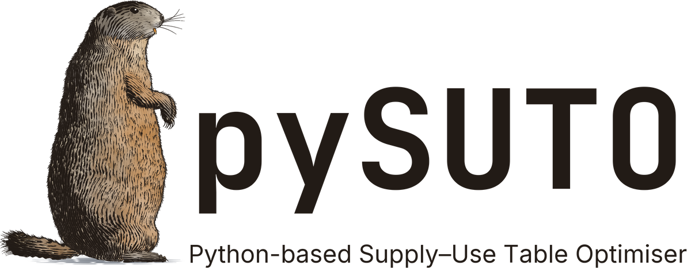

<p align="center">
  <picture>
    <source media="(prefers-color-scheme: dark)" srcset="figs/logo/pysuto-logo-dark.png">
    
  </picture>
</p>

<p align="center">
  <a href="https://pypi.org/project/pysuto/"></a>
</p>

> ⭐ If pySUTO is useful to your work, please leave a star on [GitHub](https://github.com/florihu/pySUTO) — it helps others find the project.
>
> 🏷️ Filing an [issue](https://github.com/florihu/pySUTO/issues/new)? Please give it a label — `bug`, `enhancement`, `documentation` or `question` — so it lands in the right queue; the maintainer then sets its triage state (`needs-triage`, `ready-for-agent`, …).

A modular Python framework for constructing, reconciling, and propagating uncertainty through material flow accounts derived from heterogeneous data sources. pySUTO takes raw statistical data feeds, maps them onto a common accounting structure, aggregates across sources with inverse-variance weighting, imputes missing values, builds a constrained linear system, and solves a σ-weighted QP — tracking uncertainty end-to-end from raw pedigree scores to the final optimum.

> Contributors / LLM assistants: see [CLAUDE.md](CLAUDE.md) for behavioural rules.


---

## Install

```bash
pip install pysuto
pip install "pysuto[tutorial]"     # adds Jupyter, Plotly and Kaleido, for the notebooks
plotly_get_chrome -y               # once: Kaleido needs Chrome to write the Sankey PNGs
```

Python 3.9 or newer is required. The core dependencies are `numpy`, `pandas`, `scipy`, `pyarrow`, `clarabel`, `pyyaml`, `openpyxl` and `matplotlib` (only [diag/](src/pysuto/diag/) plots with it).

**From a checkout** (development, the copper application, the tests):

```bash
git clone https://github.com/florihu/pySUTO.git
cd pySUTO
pip install -e ".[dev]"
python -m pytest tests/            # about 5 min; in a git worktree, prefix PYTHONPATH=src
```

Bit-identity of the stored arrays is claimed in the environment pinned by [environment-reference.yml](environment-reference.yml) (linux-64): `conda env create -f environment-reference.yml && conda activate pysuto-ref`. [environment.yml](environment.yml) builds a development environment on any platform.

---

## Quickstarts

**1. The tutorial.** Eleven notebooks run the six-stage pipeline on a small synthetic toy case in about 1.5 h. The last chapter writes a case of your own outside the package and runs it. The chapter list is in [tutorial/README.md](src/pysuto/tutorial/README.md).

```bash
pysuto tutorial pysuto-tutorial    # copies the notebooks and the params template
cd pysuto-tutorial && jupyter lab 00_world.ipynb
```

**2. The toy chain.** One command runs all six stages on the toy case. It needs no data and takes about 25 s. Each stage runs in a fresh child process.

```bash
python -m pysuto run --case toy --data-dir toy-data
```

`--case` takes a bundled alias (`toy`, `toy_coproduct`), a dotted module on `sys.path` or a file path (`./my_case.py`); each names a module that declares a `CASE`. `--from` and `--to` select a slice of the chain (`feed`, `imp`, `const`, `opt`, `uncprop`, `psut`). The run trees appear under `toy-data/proc/<stage>/<run_id>/`; the logs are in `toy-data/logs/`. pySUTO ships no study case (ADR 0047).

**3. The copper chain.** This runs only from a checkout that holds the licensed source data under `data/input/raw`. It also needs the input tables that carry no licence yet (see *How to cite*). The repository holds neither.

```bash
python scripts/acc.py --id copper
# by hand, once: the BACI parse, the gross registration of BACI and icsg_clean.py --to-feed
python -m pysuto run --case scripts/copper.py --data-dir data
```

The by-hand steps and their order are in [docs/architecture.md](docs/architecture.md) (*Stage 1*). Keep 3 GB of disk free: one constraint run takes about 0.85 GB. The solve takes about 2 min on 8 cores; start the chain in the background.

---

## How it works

Supply–use tables and material flow accounts are assembled from multiple data sources that differ in classification, temporal resolution, regional scope, and data quality. pySUTO addresses three interrelated problems:

- **Heterogeneous classifications** — raw data uses different sector taxonomies, regional aggregations, and time resolutions. A concordance layer maps every source edge onto a common root accounting structure via a sparse weight matrix.
- **Multi-source uncertainty** — each data source carries a pedigree quality score (Laner et al. 2016) that translates into a coefficient of variation. Uncertainty is propagated through every transformation step using Lp / power-mean error propagation.
- **Physical consistency** — supply must equal use for every node and every material-parameter efficiency must be respected. A linear-equality / inequality QP enforces these constraints while staying as close as possible to the aggregated data, with full uncertainty quantification on the optimised values.

The package is organised into **six sequential stages**: datafeed assembly (per source), aggregation + imputation (across sources), constraint building, constrained optimisation, posterior uncertainty propagation, and PSUT/PIOT construction. Each stage has a clear input, a clear output, and its own persistence layer. A **sweep** re-runs Stages 2–4 once per knob point and records the points as one run (see [Pipeline and knobs](docs/workflow.md#pipeline-and-knobs)).

| Stage | Does | Persists |
|---|---|---|
| 1 Feed | Maps each raw source onto the common account with its pedigree-based σ. | `feed_…` |
| 2 Aggregate and impute | Pools the feeds by inverse variance and fills the edges no feed covers. | `imp_…` |
| 3 Constraints | Builds the sparse linear system (mass balance, sums, ratios, bounds). | `const_…` |
| 4 Solver | Solves one σ-weighted QP per period with Clarabel. | `opt_…` |
| 5 Uncertainty | Propagates the posterior σ of every flow (closed form). | `uncprop_…` |
| 6 PSUT | Writes the solved flows as a tidy supply-use table; Sankeys and a derived input-output view. | `psut_…` |

**Workflow** — data flow through the six stages, with the sweep beside the Stages 2–4 it re-runs:

```
┌────────────────────────────────────────────────────────────────────────┐
│  Raw inputs (per source)                                               │
│  flow data · classification maps · Excel pedigree sidecar              │
│  AccountingStructure (root index · edge masks · bounds)                │
└──────┬─────────────────────────────────────────────────────────────────┘
       │
       ▼
┌────────────────────────────────────────────────────────────────────────┐
│  STAGE 1 — Datafeed   ·   scripts/*_feed.py                            │
│  run_feed(FeedSpec)  (step_A → B → C → D → register)                   │
│  in  : raw flows + pedigree + concordance                              │
│  out : W · F_root · σ_root   →   DataFeedRegistry                      │
└──────┬─────────────────────────────────────────────────────────────────┘
       │  feed_ids                                                          ┌────────────┐
       ▼                                                                    │ SWEEP      │
┌────────────────────────────────────────────────────────────────────────┐  │ scripts/   │
│  STAGE 2 — Aggregation & Imputation   ·   collect_aggregate_impute.py  │◄─┤  sweep.py  │
│  FeedCollector → AggregationMath → ImputationEngine                    │  │ Pipeline · │
│  cascade→fixpoint : Trade → Network → Parametric(conc,ore_grade)       │  │  Sweep     │
│  then terminal    : Time → Share (net stock) → FlatPrior               │  │            │
│  in  : feed_ids                                                        │  │ in : base  │
│  out : AggregationResult (f_agg · σ_agg · Ω · coverage · imp_log)      │  │  chain (its│
└──────┬─────────────────────────────────────────────────────────────────┘  │  feed runs │
       │  agg_result                                                        │  pinned) · │
       ▼                                                                    │  axes      │
┌────────────────────────────────────────────────────────────────────────┐  │            │
│  STAGE 3 — Constraint building   ·   scripts/constraints.py            │◄─┤ per point: │
│  ConstraintEngine.register(builders).run()                             │  │  chain 2–4 │
│  builders : MassBalance(hard) · ScaleTotal(soft)                       │  │  with knob │
│           · Ratio conc,eff (soft ratioeq)                              │  │  overrides;│
│           · RatioBound conc,eff,stock (hard) · FlowBounds(hard)        │  │  reuses the│
│  in  : AggregationResult                                               │  │  runs it   │
│  out : ConstraintRun (G · row_meta · a0 · σ_a · l,u · c(t),σ_c(t))     │  │  shares    │
└──────┬─────────────────────────────────────────────────────────────────┘  │            │
       │  const_run_id                                                      │ out: sweep │
       ▼                                                                    │  run ·     │
┌────────────────────────────────────────────────────────────────────────┐  │  manifest  │
│  STAGE 4 — Solver   ·   scripts/run_solver.py                          │◄─┤ → sweep_   │
│  Solver.solve_all()  (one QP per timestep; warm or cold prior)         │  │   diag.py  │
│  in  : ConstraintRun                                                   │  │            │
│  out : OptimResult per t (F_opt · ε · residuals · telemetry)           │  │            │
└──────┬─────────────────────────────────────────────────────────────────┘  └────────────┘
       │  opt_run_id   (Stages 5 and 6 each read it, never each other)
       ├──────────────────────────────────────┐
       ▼                                      ▼
┌──────────────────────────────────┐  ┌──────────────────────────────────┐
│ STAGE 5 — Posterior uncertainty  │  │ STAGE 6 — PSUT/PIOT builder      │
│ uncertainty_propagation.py       │  │ scripts/psut.py                  │
│ KalmanUncProp.compute()          │  │ PSUT: blocks · aggregate         │
│ (closed-form GLS · sparse Chol.) │  │       · sankey · to_piot         │
│ in : OptimRun (+ ConstraintRun)  │  │ in : OptimRun (a* = F_opt)       │
│ out: UncPropResult per t         │  │      + acc via provenance chain  │
│      σ_a* · lower · upper · diag │  │ out: PsutRun (parquet/period) ·  │
│                                  │  │      PIOT · footprints · ew-MFA  │
└──────────────────────────────────┘  └──────────────────────────────────┘
```

Every artefact carries a value and its σ. Hard rows hold exactly; soft rows are priced by σ. The mathematics of each stage is in [docs/architecture.md](docs/architecture.md).

### What the framework assumes

Commitments of pySUTO that a second case cannot change through data or parameters, each with its source (`method.md` is [docs/manuscript/method.md](docs/manuscript/method.md)).

1. The prior is Gaussian with a diagonal Σ_a: no covariance between edges (`method.md` §3.1.6, Eq. 2).
2. Feeds combine by inverse variance, and every σ composition is one power-mean rule, default p = 1.3 in every consumer (`method.md` §3.1.2, Eq. 1).
3. Hard rows hold exactly; soft rows are priced by σ_c⁻² (`method.md` §3.1.6, Eq. 2).
4. One QP per period; no row couples two periods, enforced at build time (GLOSSARY "No cross-time coupling").
5. No stage before Stage 6 drops σ: every inter-stage artefact carries value and σ together (`method.md` §3.1.1).
6. A source edge's outgoing weights in W sum to one (a guard rejects a projection more than 1 % off the matched raw total); fan-in diversifies, fan-out leaves the CV unchanged (`method.md` §3.1.3).
7. Pedigree scores map to a CV by the Laner (2016) exponential model, the five indicators summed in quadrature ([docs/architecture.md](docs/architecture.md), *Pedigree → coefficient of variation*).
8. An edge no feed or imputer covers is a flat prior at value 0 with a large σ (σ = 1e6 in copper and the toy), a noisy zero; the framework never guesses a value (`method.md` §3.1.4).
9. Imputation fills are write-once and logged with method, source edges and coefficients (`method.md` §3.1.4).
10. A satellite flow carries a value but sits outside its node's balance (GLOSSARY "Satellite flow").
11. Stage 6 propagates point estimates only; Stage-5 σ is not carried into the tables in v1 (ADR 0007).
12. Results are year-local: a period slice is `[E_t]`, scattered through `cols_t` before any `G @ F` (GLOSSARY "Period slice").

Copper's modelling choices, each measured against a rejected alternative, are in Table 2 of the manuscript ([docs/manuscript/method.md](docs/manuscript/method.md) §3.2.7), not here.

The SI ([docs/manuscript/si.md](docs/manuscript/si.md)) states the equations of the pipeline's structure and σ propagation, S1–S8; it is not a complete list of the code's σ rules. The parametric-fill, recipe, time-interpolation, flat-prior, ratio, scale-total and net-stock-seed σ rules, `_reg_sensitivity` and `Solver.objective_at` carry their equations in [docs/architecture.md](docs/architecture.md) and the ADRs only.

---

## Where things are

| What | Where |
|---|---|
| Library | [src/pysuto/](src/pysuto/): the six stages, the registries, the solver, [diag/](src/pysuto/diag/) (diagnostics). It knows no study case. |
| Application (copper) | [scripts/](scripts/): the case, the feeds and builders, the stage drivers, the sweeps, the reports. See [scripts/README.md](scripts/README.md). |
| Tooling | [tools/](tools/): input status, issue audit, run pruning, tutorial refresh. |
| Tests | [tests/](tests/); [tests/copper/](tests/copper/) holds the tests that need the copper application. Run them with `python -m pytest tests/` (never bare `pytest`). |
| Tutorial | [src/pysuto/tutorial/](src/pysuto/tutorial/): the toy case and the eleven notebooks. |
| Architecture and modules | [docs/architecture.md](docs/architecture.md): the stages, their mathematics, the module reference, the import direction. |
| Workflow | [docs/workflow.md](docs/workflow.md): the driver walk-through, run ids, sidecars, input registries, knobs, sweeps. |
| Vocabulary | [GLOSSARY.md](GLOSSARY.md). |
| Method and results | [docs/manuscript/](docs/manuscript/): `method.md`, `si.md` and the results. |
| Records | [docs/adr/](docs/adr/) (decisions), [docs/rep/](docs/rep/) (analyses of runs), [docs/history/](docs/history/) (closed rounds), [scripts/explo/](scripts/explo/) (the scripts behind the records). |
| Contributors | [CLAUDE.md](CLAUDE.md) (rules), [CODING_STANDARDS.md](CODING_STANDARDS.md), [docs/agents/](docs/agents/), [CHANGELOG.md](CHANGELOG.md). |

---

## How to cite

To cite pySUTO, use [CITATION.cff](CITATION.cff). GitHub shows it under "Cite this repository".

**Licence.** The code is licensed under the MIT License ([LICENSE](LICENSE)). The hand-authored tables `data/input/acc/`, `data/input/params/{conc,eff}/` and `data/input/mask/` are licensed under CC BY 4.0 ([LICENSE-DATA](LICENSE-DATA)). The other input tables (the feed concordances, metadata and weights, and the parameter tables `icsg_aggregates`, `ore_grade`, `scrap_share`, `stock_bounds` and `stripping_ratio`) carry no licence until their licence check is recorded (#297), so the repository does not hold them; the original source data are not in the repository and stay under their owners' terms.

---

## Links

- Source and issues: <https://github.com/florihu/pySUTO>
- Package: <https://pypi.org/project/pysuto/>
- Architecture: [docs/architecture.md](docs/architecture.md) · Workflow: [docs/workflow.md](docs/workflow.md) · Glossary: [GLOSSARY.md](GLOSSARY.md)
- References (Laner et al. 2016; Lenzen et al. 2009; Pauliuk et al. 2019): [docs/architecture.md](docs/architecture.md#references)
