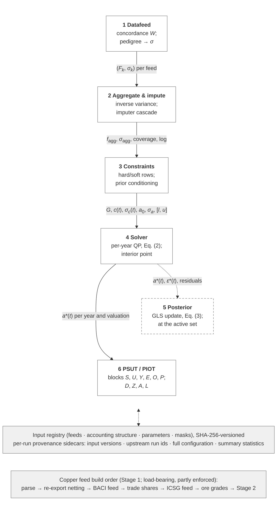
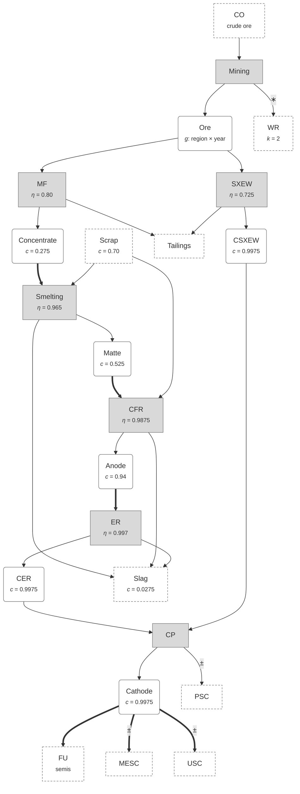

<!--
Method section of the pySUTO model paper. Markdown is the source since
2026-09-30 (converted from main.tex + method.tex on 2026-09-29; the TeX files
were retired). Method is numbered Section 3, as in the paper; equations,
figures and tables keep their numbers. Figures 1 and 2 are Mermaid drawings.
Structure: contribution block (N1–N7, practical significance) / 3.1 framework
(six stages, each closing with its copper instance) / 3.2 application to copper /
3.3 evaluation / 3.4 availability. The limitations of the application (formerly
3.2.8) moved to the Discussion, Section 5.5, on 2026-11-12. Section 3.3 opens with the
research questions of the Introduction (introduction.md) and how each is answered;
the pre-registered items A1–B3 are their expected answers, met or not met.

Drafted as bullet points throughout on 2026-11-12 (Section 3.3's protocol since
2026-11-10), like the Results: one fact per bullet, with its quantity, valuation,
window and base, then its ADR or section. The bullets are the author's scaffold for
the prose; prose follows once the content is agreed. Conventions:
  **Rule.**       what the framework does, for any case
  **Why.**        the reason, usually the failure the rule prevents (measured)
  **Copper.**     the copper instance and its numbers
  → Nk            the bullet is evidence for contribution Nk of the block at the top
  verify:         inline HTML comments starting "verify:" mark comparative or
                  bibliographic claims that need a source check before they go into
                  prose; none is in the evidence yet.
Word budgets of the later prose (approx.): contribution block 350 (or move to the
Introduction's last paragraph) / 3.1 1,400 / 3.2 1,250 / 3.3 600 / 3.4 150.

Corrected on 2026-11-12 while converting: Figure 1 said Stage 5 was "not run on
copper" (it runs on the reference chain, uncprop_20261029_090754_0446e784); the
concordance matrix W was missing from Stage 1; SI Table S13 lists 44 decision
records (0001–0044), not 39 (the SI's own text says 43, also a slip); the software
size is re-counted on main 24a37e9 (80 modules, 29,700 lines, 1,798 collected tests;
was 22,052 / 68 / 1,284); "no transformation may drop sigma" now excludes Stage 6,
which carries point estimates.

Every number is from the reference chain, the final chain of the
manuscript-ready-3 milestone (#111's ICSG zero-revision fix),
  opt_20261022_112855_928da10c <- const_20261022_111531_df61bf5c
  <- imp_20261022_111102_1b49a2b3
  <- feed_icsg_20261022_110826_8a031806 (icsg v18, trade_shares v41),
     feed_baci_20261022_110715_fdf3b4ac (baci v33, netted from gross v28),
     feed_crude_ore_20260603_095651_558f7369 (crude_ore v3);
  acc copper v4; params conc v10, eff v4, stripping_ratio v2, ore_grade v8,
  stock_bounds v6, scrap_share v3; PSUT psut_20261029_095807_61a70a1a,
re-derived from the run sidecars and arrays on 2026-10-29 (manuscript-ready-3
milestone) with scripts/report/manuscript_numbers.py; the limitation numbers
(Section 3.2.8 until 2026-11-12, now Discussion 5.5 in discussion.md) from the same
script on the same run, the cited REPs (#31/#96 via
#97, #95, #98, #111) and #81's intervals (scripts/report/table3_intervals.py).
Stage-4 iterations and times re-read from the opt sidecar on 2026-11-12
(solve_wall_s 534.85). N7's reproduction is ADR 0034's measurement
(opt_20261112_092114_c8cb8b74 at acc copper v5, bit-identical in imp, const, opt).
Common-set comparisons are against the base re-solved at the
ADR 0039 tolerance (opt_20260930_093914_523d57d7) and the base as originally
solved (opt_20260916_124721_c4d1d944). A number attributed to an ADR or a
round is that record's own measurement. Stage-5 (posterior) numbers are from
uncprop_20261029_090754_0446e784 on the same chain (issue #27, ADR 0044), the
calibration and ablation (#87) from it and uncprop_20261029_095641_3837af29.
"ADR nnnn" points to docs/adr/ in the repository and to SI Table S13.

Positioning paragraph (state of the art) for the Introduction (moved out of
Method on 2026-09-24; the contribution block below is its Method-side counterpart):
  This design joins two strands that industrial ecology software has kept
  separate. System-definition frameworks such as ODYM (Pauliuk & Heeren
  2020) and the general socioeconomic-metabolism data model (Pauliuk et al.
  2019) structure material-system data but do not reconcile it; the
  constrained-balancing lineage of AISHA, large-scale matrix balancing and
  the PIOLab (Geschke et al. 2011, 2019; Lenzen et al. 2009; Wieland et al.
  2022) reconciles large accounts but does not carry per-source data quality
  through to the result. pySUTO does both by treating sigma as a first-class
  artifact of every stage, and reaches the physical input-output table
  (Suh 2004; Wieland et al. 2022) only at the end, as a derived view of the
  reconciled account.
  (Geschke et al. 2011/2019 and Pauliuk et al. 2019 are not in refs.bib yet.)
-->

# pySUTO: uncertainty-carrying compilation and reconciliation of physical supply–use tables

*(Method section draft — working title)*

## 3 Method

- Section [3.1](#sec-framework) describes the generic framework stage by stage; each stage closes with its copper instance.
- Section [3.2](#sec-application) gives the copper parametrisation and the modelling decisions needed to read the results.
- Section [3.3](#sec-evaluation) states how each research question of Section [1](#sec-intro) is answered: the quantities the Results report, the expected answers fixed before the numbers were read, and the sensitivity protocol.
- Section [3.4](#sec-availability) states what is available for replication.

**What is new, and how it differs from existing approaches.**

<!-- Each item: what pySUTO does / what the nearest existing approach does / where Method shows it. -->

- **N1 Uncertainty from source to posterior.** Each source's $\sigma$ is set once, from its pedigree, and one composition rule (Eq. [1](#eq-lp)) carries it through concordance, aggregation, imputation and prior conditioning into the weights of the reconciliation; Stage 5 returns the posterior $\sigma$ of every edge and of any total (Sections [3.1.2](#sec-uncertainty)–[3.1.7](#sec-stage5)).
  - System-definition frameworks structure material-system data but do not reconcile it ([Pauliuk and Heeren, 2020](#ref-pauliuk2020odym)).
  - Large-scale matrix balancing weights the adjustment by source reliability at the balancing step ([Lenzen et al., 2009](#ref-lenzen2009matrix); [Wieland et al., 2022](#ref-wieland2022piolab)). <!-- verify: whether the PIOLab/AISHA carries per-source sigma through its concordances and reports a posterior sigma per flow; cite Geschke et al. 2011 (AISHA) once in refs.bib -->
- **N2 Data reconciliation at the scale of a multi-regional account, with inequalities.** $\sigma$-weighted least-squares reconciliation with error propagation is established in material flow analysis ([Cencic and Rechberger, 2008](#ref-cencic2008stan)) <!-- verify: STAN's typical system size and whether it handles inequality constraints (bands, non-negativity) -->.
  - pySUTO reconciles 854,460 edges against 1,687,230 constraint rows, 1,226,444 of them hard, among them one-sided ratio bands and one non-negativity row per edge that may not be negative (Section [3.1.5](#sec-stage3)).
  - It extends the closed-form generalised-least-squares posterior of [Byron (1978)](#ref-byron1978), derived for equality constraints, to the inequality-constrained optimum by linearising the problem at its active set (ADR 0044; Section [3.1.7](#sec-stage5)).
- **N3 Two valuations reconciled in one account.** Every edge exists in gross mass and in contained copper, linked per product by a concentration row, so trade statistics (gross mass) and industry statistics (copper content) constrain the same flows (Sections [3.1.5](#sec-stage3), [3.2.1](#sec-system)). <!-- verify: whether this is new against STAN's layers and the PIOLab; if not, present it as a design choice, not a contribution -->
- **N4 The solver's termination is part of the estimate.** The stopping rule is reported and tested like a modelling choice.
  - Stopped at the relative duality gap of $10^{-3}$, the interior-point solver left loosely weighted flows hundreds of kilotonnes from the optimum; Chile's concentrate export retention read 0.66 instead of 0.97 (ADR 0039's measurement).
  - The reference run solves for the defects $d = a - a_0$ to a gap of $10^{-8}$ (Section [3.1.6](#sec-stage4)).
- **N5 Reconciliation as an audit of the sources.** The residuals point at an identity and a source; a contradiction is fixed at the input, never by loosening $\sigma$ (ADR 0019; Sections [3.2.3](#sec-icsg)–[3.2.4](#sec-baci)). In copper this found, among others:
  - 11,558 kt CC of mine production that never existed, from a misparsed yearbook block (ADR 0035);
  - 115,854 kt of concentrate exports booked in kilograms as tonnes, rebuilt to 390 kt (ADR 0033);
  - 70 Mt of scrap counted twice over 30 years by booking two nested yearbook series (ADR 0030).
- **N6 Every modelling choice is measured.** Each choice is a decision record with the run that measured its rejected alternative (Table [2](#tab-choices); SI Table S13). Expectations about the result are fixed before the numbers are read, and the 15 judgement values are swept (Section [3.3](#sec-evaluation)).
- **N7 A generic framework with a declared case.** The library compares framework *roles* (boundary role, content and gross valuation), never a case's labels; a case binds its labels to the roles in its accounting structure (ADR 0034).
  - Copper's labels bound to roles rebuild the copper chain bit for bit in imputation, constraints and solve (ADR 0034's measurement).
  - A synthetic three-region case with a planted ground truth runs all six stages in the test suite (Section [3.1.9](#sec-software)).

**Practical significance for industrial-ecology modellers.**

- **One balanced account, many views.** The output is a reconciled multi-regional physical supply–use table in two valuations with a posterior $\sigma$ per edge; the physical input–output table, footprints, embodied trade and economy-wide MFA indicators are derived from it on demand (Section [3.1.8](#sec-stage6)).
- **Diagnosis, not only a balanced table.** Objective shares by identity, retention by category and the split of deletion into forced and discretionary parts show which source contradicts which (Section [3.3](#sec-evaluation)). In copper, the four regions that carry a third of the scale-total objective are each a documented source contradiction (Section [5.5.2](#sec-disc-limits-copper)).
- **Transfer to other materials.** A new material needs feeds, an accounting structure and parameter tables; the six stages are unchanged (N7).
- **Workstation scale, open stack.** Python with NumPy, SciPy, pandas and the open-source solver Clarabel; Stage 4 reconciles the 30 yearly QPs of copper in 535 s of wall-clock time, its feasibility probe included (Section [3.1.6](#sec-stage4)).
- **Traceable numbers.** Every result traces to a run identifier, its exact input versions and its configuration (Section [3.1.9](#sec-software)).

### 3.1 The pySUTO framework

#### 3.1.1 Architecture

**Rule.**

- Six sequential stages (Figure [1](#fig-pipeline)): (1) datafeed assembly, (2) aggregation and imputation, (3) constraint building, (4) per-year constrained optimisation, (5) posterior uncertainty propagation, (6) supply–use and input–output views.
- Each stage reads the persisted output of its predecessor and writes a registered run of its own (Section [3.1.9](#sec-software)).
- One quantity crosses every interface: for each *edge* — one directed flow between two nodes of the accounting graph, in one period and valuation — a value with its standard deviation $\sigma$. → N1
- No stage before Stage 6 drops $\sigma$; Stage 6 carries point estimates.

**Copper.**

- 1,081 nodes (23 sectors in 47 regions), two valuations, 30 years.
- 14,241 edges per valuation and year, 854,460 in all.

**Figure 1.** The pySUTO pipeline. Six sequential stages transform per-source raw data into reconciled flows and derived tables; every inter-stage artifact carries values and standard deviations together. Solid arrows show the data artifacts handed between stages; Stage 6 reads the reconciled flows $a^*$ of Stage 4 directly. Stage 5 (dashed) runs after the solver on the reconciled flows and feeds no later stage; Stage 6 carries point estimates only (Section [3.1.7](#sec-stage5)). The substrate is the content-hashed input registry and the per-run provenance sidecars that link every result to exact input versions, upstream runs and configuration; the bottom strip is the copper-specific feed build order.

*Redrawn in Mermaid from the TikZ figure in method.tex; the stages run top to bottom.*

#### 3.1.2 Uncertainty treatment

**Rule.**

- Uncertainty enters once, at the source. → N1
- Each feed is scored on five data-quality indicators — reliability, completeness, temporal, geographical and other correlation — on a four-point scale, in the pedigree tradition of [Weidema and Wesnæs (1996)](#ref-weidema1996pedigree).
- The scores map to coefficients of variation (CV) through the exponential model of [Laner et al. (2016)](#ref-laner2016); their quadrature sum is the feed's CV (SI S2).
- Every later $\sigma$ operation instantiates one composition rule, the power-mean combiner, which merges weighted contributions $w_k \sigma_k$ into one standard deviation:

$$
\sigma_{\oplus} \;=\; \Bigl(\sum\nolimits_k \lvert w_k\,
\sigma_k\rvert^{\,p}\Bigr)^{1/p}.
\tag{1}
$$

- At $p = 2$, Eq. (1) is the Gaussian quadrature of independent errors.
- pySUTO uses $p = 1.3$ throughout: less diversification credit, because the contributions that meet on one edge — parallel sources, fanned-in sub-flows, chained imputations — rarely err independently.
- For $p \ge 1$, relative uncertainty never grows under mass-preserving aggregation or disaggregation (SI S2).
- $p$ is a judgement value; the knob sweep varies it over $[1.1, 1.5]$ (Section [3.3](#sec-evaluation); SI Table S22b).

**Why one rule.** The modeller states one dependence assumption, $p$, instead of a separate $\sigma$ rule for each operation, and every $\sigma$ in the account is traceable to it.

#### 3.1.3 Stage 1: Datafeed assembly

**Rule.**

- Each source enters through its own concordance: raw records become directed source edges, projected onto the root accounting structure by a sparse weight matrix $W$.
- The outgoing weights of each source edge sum to one, so every fan-out conserves mass; a guard rejects a projection more than 1% off the matched raw total.
- A record that names one endpoint only is fanned across the matching root edges by external split information — for copper, bilateral trade shares — never by a uniform $1/N$ split.
- **Why:** a uniform split fabricates structure the source does not contain (ADR 0008).
- The feed's pedigree CV attaches here; edges touching the rest-of-world aggregate are re-scored at the worst geographical level (ADR 0003).
- The CV propagates through $W$ by Eq. [(1)](#eq-lp), with the value shares of the contributing source edges as weights: fan-in diversifies, fan-out leaves the CV unchanged. → N1

**Copper.** Three feeds leave Stage 1 (Table [1](#tab-sources)):

- ICSG industry statistics, scores $(2,1,1,1,1)$, CV 0.068 (0.217 on the 5,155 rest-of-world edges);
- BACI bilateral trade, $(3,2,1,1,2)$, CV 0.209 (0.294 on 6,088 edges);
- crude-ore extraction, $(2,3,2,2,2)$, CV 0.104 (0.230 on 28 edges).

#### 3.1.4 Stage 2: Aggregation and imputation

**Rule: aggregation.**

- Where several feeds observe one edge, their values combine by inverse variance; the aggregate's $\sigma$ follows from Eq. [(1)](#eq-lp) with the precision weights (SI S3).
- A coverage mask records which edges any feed observed.
- Bilateral trade legs then receive a size-damped $\sigma = \mathrm{CV}\, a_{\mathrm{ref}}^{\,1-\gamma} a^{\gamma}$, $\gamma = 0.5$, around a fixed per-product reference size $a_{\mathrm{ref}}$.
- **Why:** under a size-blind CV the largest legs are the cheapest to delete per tonne (ADR 0017).

**Copper: coverage.**

- 61,218 edges (7.16% of 854,460) are feed-observed: 32,407 in copper content from ICSG, 27,946 in gross mass from BACI, 865 from the ore series.

**Rule: imputation.** Uncovered edges are filled by plugin imputers in two phases (rules in SI S3).

- *Cascade*, swept in fixed order until a full sweep fills no new edge:
  - seeds bilateral import legs in copper content from their observed gross-mass twin, $f_{\mathrm{CC}} = \mathit{conc} \cdot f_{\mathrm{Mass}}$; → N3
  - closes process recipes: a process's product equals its recovery efficiency times its pooled inputs, secondary inputs and imports included; its residual output receives the complement, except waste rock, a satellite flow that Stage 3 fixes (ADR 0038);
  - applies the concentration, ore-grade and efficiency relations in reverse where only the downstream side is observed, with a regularised sensitivity that damps the inversion of near-zero coefficients.
- *Terminal pass*, once:
  - interpolates linearly in time, on within-region edges only. **Why:** a bilateral trade matrix is complete by construction, so a partner pair absent in a year is an observed zero, not a gap (ADR 0026);
  - seeds the unreported user and exchange stock-change legs at zero, priced like a feed-backed level — 1% of the co-located cathode flow, floored at 0.3 kt — and lets no other imputer write them. **Why:** a signed leg with a loose $\sigma$ is a sink for every contradiction of the cathode balance (ADR 0040);
  - leaves an unreported producer stock change at the zero that the cathode pool's efficiency-free recipe gives it (issue #36);
  - gives every still-empty edge a flat prior, value zero with $\sigma = 10^{6}$: a *noisy zero*, re-anchored in Stage 3.
- Fills are write-once and logged with method, source edges and coefficients.

**Copper: imputation.**

- The cascade converges in two passes.
- Relational and temporal imputation extend informative priors to 112,276 edges (13.14%), mostly by recipe closure and stock-change seeds (SI S12).
- 680,966 edges (79.7%) carry the flat prior.

#### 3.1.5 Stage 3: Constraint building

**Rule.**

- Builder plugins emit the rows of a sparse matrix $G$, each with its year, target $c(t)$ and target uncertainty $\sigma_c(t)$.
- *Hard* rows must hold exactly; *soft* rows may be violated at a cost weighted by $\sigma_c^{-2}$, in the tradition of $\sigma$-weighted accounting-matrix reconciliation ([Byron, 1978](#ref-byron1978); [van der Ploeg, 1982](#ref-vanderploeg1982); [Lenzen et al., 2009](#ref-lenzen2009matrix)) and of data reconciliation in material flow analysis ([Cencic and Rechberger, 2008](#ref-cencic2008stan)).
- A build-time check rejects any row that couples different years, so $G$ partitions into yearly blocks.

**Copper: row families**, in build order (SI S4):

- *Mass balances* (hard), per process and product node, region, year and valuation. Waste rock is excluded from the mining balance as a satellite mass flow, whose mass a hard stripping relation $\mathrm{WR} = k\,\mathrm{Ore}$ sets (ADR 0038).
- *Scale totals* (soft), tying each node's total output to its own aggregated prior, with $\sigma_c = \max(0.01\,\lvert c\rvert,\ 0.3\ \mathrm{kt})$ on feed-backed groups (ADR 0025).
  - They are self-anchored: they add no information but preserve the prior's scale against homogeneous shrinkage (ADR 0006). Stage 5 accounts for this reuse of the prior (Section [3.1.7](#sec-stage5)).
- *Level anchors* (soft) on the observed scrap inputs of smelters and refineries (ADR 0031).
- *Ratio rows* (soft) for concentration, in-situ ore grade and recovery efficiency; the efficiency row pools all inputs of a process. → N3
- *Bands* (hard, one-sided) on the same ratios and on regional scrap shares.
- *Net-stock rows* (soft, zero-centred) on the producer stock change; the user and exchange stock-change legs are held by their prior $\sigma$ alone (ADR 0040).
- *Non-negativity* (hard), one row per edge whose structural lower bound is zero — every edge but those of the three signed stock-change pairs (ADR 0039). → N2
- Upper bounds and the flat-prior zero pin are stored for the feasibility probe only.

**Rule: prior conditioning.**

- Prior $\sigma_a$ is floored through Eq. [(1)](#eq-lp).
- The noisy zeros are re-anchored. **Why:** at $\sigma = 10^{6}$ their prior pull is nil, and the solver could route arbitrary mass through data-free subgraphs.
- The *no-data anchor* sets their $\sigma$ to 5% of the median prior magnitude among their sector–valuation siblings; slag and producer stock change are exempt.
- The extraction chain is exempt only in the 887 region-years where an ore-grade relation sets its magnitude; in a country that mines nothing it is anchored like any other no-data edge (ADR 0013).

**Copper: size.**

- 1,687,230 rows, 56,151–56,296 per year.
- 1,226,444 hard: 39,480 mass balances, 1,410 stripping relations, 598,994 bands, 586,560 non-negativity rows.
- 460,786 soft: 28,972 scale totals and scrap anchors, 431,814 ratio and net-stock rows (SI Table S4).

#### 3.1.6 Stage 4: Solver

**Rule.** Each year is reconciled by one quadratic program over the flows $a$ and the soft residuals $\varepsilon$:

$$
\min_{a,\;\varepsilon}\;
(a - a_0)^{\top} \Sigma_a^{-1} (a - a_0)
\;+\; \varepsilon^{\top} \Sigma_c^{-1} \varepsilon
\quad \text{s.t.} \quad
G_s\, a - \varepsilon = c_s, \qquad
G_h\, a = c_h, \qquad
G_b\, a \le c_b,
\tag{2}
$$

- $a_0$ is the prior; $\Sigma_a = \mathrm{diag}(\sigma_a^2)$ and $\Sigma_c = \mathrm{diag}(\sigma_c^2)$ carry the accumulated uncertainties as inverse-variance weights. → N1
- The rows of $G$ split into soft equalities ($G_s$), hard balances ($G_h$) and hard bands ($G_b$), with $c = c(t)$.
- Clarabel, an interior-point solver for conic programs with quadratic objectives ([Goulart and Chen, 2024](#ref-goulart2024clarabel)), solves it with the three row groups on two zero cones and one non-negative cone (SI S5).
- $G_b$ carries the non-negativity of every flow but the signed stock changes, so a data conflict surfaces as a residual on a soft row or as a flow held at zero, never as a negative flow. → N2
- A pre-solve feasibility probe of the hard subsystem reports the most violated rows on failure; the stored upper bounds act there only.
- A status other than *Solved* or *AlmostSolved* stops the run; there is no fallback.

**Why the bounds are in the QP.**

- Before ADR 0039 the bounds reached only the feasibility probe, and residual mass edges served as signed slack.
- On the last reference run before the change, world waste rock had a posterior of $-257{,}667$ kt against a prior of $+292{,}395$ kt, and 1,108 mass edges of the mine chain sat more than 1 kt below zero (issue #28).
- The reference run has none: its smallest flow outside the three stock changes is $-1.2\times 10^{-8}$ kt.

**Rule: termination.** → N4

- Solved for the flows, the solver's cost is the misfit $\sum z^2$ less the prior-only constant $\sum (a_0/\sigma_a)^2$, which is an order of magnitude larger than the misfit; the relative duality gap is therefore measured against the wrong number.
- A gap of $10^{-3}$, at which every run before ADR 0039 stopped, admitted about 1,000 objective units and left loosely weighted flows hundreds of kilotonnes from the optimum; a gap of $10^{-6}$ still stopped 496–4,362 units above it in every year (SI S5, ADR 0039).
- The reference run therefore solves each year for the defects $d = a - a_0$, whose cost is the misfit itself, to relative and absolute gaps of $10^{-8}$; a year that stalls would be accepted at $10^{-4}$, which none needs.
- Solved this way, each of six probed years came within 0.2 units of a Lagrange-dual lower bound.
- The prior is the cold prior $a_0(t) = f_{\mathrm{agg}}(t)$, the Stage-2 aggregate of the same year.

**Copper.**

- All 30 years return *Solved* in 60–74 iterations and 17–22 s each, 585 s of solve time in all. With the years solved concurrently on eight threads, Stage 4 takes 535 s of wall-clock time, about 7 min of it the first-year feasibility probe (SI Table S6).

#### 3.1.7 Stage 5: Posterior uncertainty propagation

**Rule.** The optimum $a^*$ is a point estimate; Stage 5 restores its distribution. → N1, N2

- The prior is modelled as Gaussian with covariance $\Sigma_a$, the constraints as observations with covariance $\Sigma_c^{\mathrm{full}} = \operatorname{blkdiag}(0, \Sigma_c)$ — zero variance on hard rows.
- Gaussian conditioning gives the closed-form posterior covariance, the generalised-least-squares update of the reconciliation lineage ([Byron, 1978](#ref-byron1978); [van der Ploeg, 1982](#ref-vanderploeg1982)):

$$
\Sigma_{a^*} \;=\; \Sigma_a \;-\; \Sigma_a G^{\top} S^{-1} G\, \Sigma_a,
\qquad S = G\, \Sigma_a G^{\top} + \Sigma_c^{\mathrm{full}}.
\tag{3}
$$

**Rule: linearisation at the active set** (ADR 0044). Eq. [(3)](#eq-posterior) assumes equality constraints, so Stage 5 linearises the QP where it stands:

- a band that binds at $a^*$ ($G a^* - c \ge -10^{-6}$ kt) enters as an equality;
- a binding lower bound pins its edge, $\sigma_{a^*} = 0$;
- slack rows drop out;
- hard rows linearly dependent on the others are dropped.

**Rule: numerics.**

- Only the marginal variances are extracted: each edge's contraction is read off a QR factorisation of the whitened system $[G\,\Sigma_a^{1/2},\ \Sigma_c^{1/2}]$, per year.
- **Why QR:** forming $S$ squares its condition number; with $\sigma_a$ spanning $10^{-8}$ to $10^{6}$ kt, an LU factorisation of $S$ puts the contraction outside $[0, 1]$ on hundreds of edges a year.
- Intervals $a^*_i \pm z\,\sigma_{a^*\!,i}$ are clipped at the structural lower bound (SI S6).
- The $\sigma$ of a total $w^\top a^*$ is not a sum of edge marginals, because the constraints correlate its edges; it comes from the same factorisation, $\mathrm{var}(w^\top a^*) = w^\top \Sigma_a w - (G \Sigma_a w)^\top S^{-1} (G \Sigma_a w)$. Ratios and indices of totals take theirs by the delta method (issue #81).
- Tests enforce monotone shrinkage, positive semidefiniteness and the hard-only limit of [Byron (1978)](#ref-byron1978).

**Copper.**

- Every year completes.
- Per year, 8,492–9,836 edges are pinned at a binding lower bound, 13,406–13,943 bands bind, and 60–102 dependent hard rows are dropped.
- $\sigma_{a^*} \le \sigma_a$ holds on every edge-year.

**Interpretation and calibration** (issue #87).

- The posterior is the estimator's sensitivity under the stated $\sigma$, not a calibrated interval.
- Against the model's own residuals the stated $\sigma$ are too small by $\sqrt{R} \approx 2.3$ on average: Birge ratio $R = \sum z^2/\mathrm{dof} = 5.18$.
- The standardised shifts are not a scaled normal: their core is narrower and their tail heavier than predicted, with 13.1% of the feed-observed contained-copper edges beyond 3 standardised units against 0.27% for $N(0,1)$.
- Intervals in this paper are therefore Birge-scaled, $a^*_i \pm 1.96\sqrt{R}\,\sigma_{a^*\!,i}$, and remain lower bounds in the tail.
- The scale totals, which reuse the prior, carry 0.10 of the 0.93 mass-weighted contraction of the feed-observed contained-copper edges (SI S6).

#### 3.1.8 Stage 6: Supply–use and input–output views

**Rule.**

- Stage 6 materialises $a^*$ as a tidy physical supply–use table: every edge of a period and valuation falls into a supply, use or final-use block or a boundary block (extraction, secondary input, residual output).
- Aggregation over regions and sectors is a pushforward of that table that preserves border crossings.
- The physical input–output table is a derived view, built on demand and never persisted (ADR 0037).
  - The market-share construct $D = S\,\hat{q}^{-1}$ turns each use of a product into an edge between its producer and its consumer ([Miller and Blair, 2009](#ref-millerblair2009)).
  - The industry-by-industry calculus — $Z$, $A = Z\hat{x}^{-1}$, $L = (I-A)^{-1}$, footprints $e\,L\,\hat{y}$, embodied trade, economy-wide MFA indicators, multipliers and structural decomposition — follows [Wieland et al. (2022)](#ref-wieland2022piolab) and [Suh (2004)](#ref-suh2004pio); residual outputs are final outputs ([Altimiras-Martin, 2014](#ref-altimirasmartin2014piot)).
- Stage 6 propagates point estimates only.

**Copper.**

- Waste rock is a satellite flow, so in gross mass the mining process's outputs exceed its crude-ore input by exactly the waste rock (ADR 0038).
- With one producer per product, as in copper, the industry-by-industry construct coincides with the product-by-product one.

#### 3.1.9 Implementation and provenance

**Provenance.**

- Inputs of four kinds — feeds, accounting structure, parameter tables, masks — live in a content-hashed registry: load-bearing files are SHA-256-hashed, any change creates a new immutable version, and runs may pin old ones.
- Each stage writes its outputs under a run identifier with a sidecar recording the exact input versions, the upstream run identifiers, every configuration knob and summary statistics.
- The chain from raw feed to table is thus reconstructable from any run directory ([Pauliuk et al., 2024](#ref-pauliuk2024traceability); [Stodden and Miguez, 2014](#ref-stodden2014best); [Wilkinson et al., 2016](#ref-wilkinson2016fair)).

**Extension and generality.** → N7

- Four extension seams: feeds, imputers, constraint builders and posterior propagators subclass a common interface ([Pauliuk et al., 2015](#ref-pauliuk2015transparency); [Pauliuk, 2020](#ref-pauliuk2020cumulative)).
- A *case* declares a material: its accounting structure, its imputer cascade and constraint builders, and its knob values. The library compares framework roles, never the case's labels (ADR 0034).
- Copper's labels bound to roles rebuild the reference chain bit for bit in imputation, constraints and solve (ADR 0034).
- A second, synthetic case — three regions, generated from a planted ground truth with three noisy feeds — runs all six stages in the test suite. <!-- tutorial case (#59/#60); name it in prose only once the tutorial is published -->

**Knob sweep.**

- A *knob sweep* is one run of the framework: Stages 2–4 are rerun at every point of a seeded Latin hypercube (or a grid) over named driver constants, each point a chain with sidecars of its own.
- The points are scored afterwards from their stored posteriors against the base chain, so an outcome defined later needs no rerun (Section [3.3](#sec-evaluation), SI S15.4).

**Size.** 29,700 lines of Python in 80 modules, with 1,798 tests (main 24a37e9, 2026-11-12). <!-- re-count at submission; scripts/ not included -->

### 3.2 Application to the global copper supply chain

- The framework is parametrised for copper by an accounting structure, three data feeds with their pre-processing, six parameter tables and a set of modelling decisions.
- Each decision is an architecture decision record (ADR) in the repository, with the measurement that motivated it; SI Table S13 lists all 44 (0001–0044). → N6 <!-- check: ADRs 0045 (knob overrides at the driver boundary) and 0046 (accounting structure declared by a spec), both 2026-11, are not in Table S13; add them or say the table stops at 0044 -->

#### 3.2.1 System definition

**Nodes** (Figure [2](#fig-system), SI S8). 23 sectors in each of 47 regions:

- seven processes, from mining to a cathode pool;
- seven products, from ore to cathode;
- nine boundary nodes: crude ore in the ground (extraction side); waste rock, tailings, slag, scrap and producer stock change (socio-economic side); final use (semis fabrication) and user and exchange stock changes (final demand).

**Edges.**

- The 27 sector pairs of the process chain define the edges.
- Four products are traded — concentrate, matte, anode, cathode — so their six use pairs exist between every ordered pair of regions; the other 21 pairs exist within a region only.
- Every edge exists in gross mass (kt) and in contained copper (kt CC), linked per product by a concentration coefficient. → N3
- Only the edges of the three stock-change pairs (CP→PSC, Cathode→USC, Cathode→MESC) may be negative; the solver holds every other edge at or above zero (ADR 0039).
- Waste rock is a satellite flow: it has mass but no copper, sits outside the mining balance, and equals $k = 2$ times the ore mass (ADR 0038).

**Regions and period.**

- The 46 named regions cover every producer the ICSG reports separately.
- A rest-of-world region absorbs 48 ICSG labels and 183 BACI partner codes; BACI's "Other Asia, not elsewhere specified", which is Taiwan's trade, is booked to Taiwan.
- The period is 1995–2024.

**Figure 2.** System definition of the copper account, one region shown. Grey rectangles are processes (with their nominal recovery efficiency $\eta$), rounded boxes products (with their nominal copper content $c$; the ore grade $g$ is region- and year-specific), dashed boxes boundary nodes: crude ore in the ground (extraction), waste rock, tailings, slag, scrap and producer stock change (socio-economic side), and final use and the two stock changes (final demand). The 27 arrows are the sector pairs; double arrows mark the four traded products, whose six use pairs exist between all $47 \times 47$ regions, single arrows exist within each of the 47 regions. $\pm$ marks the three sector pairs whose edges may be negative, the only ones the non-negativity rows of Stage 3 exempt; $\ast$ marks waste rock, a satellite mass flow outside the mining balance, $k = 2$ times the ore mass and free of copper (Section [3.1.5](#sec-stage3)). Every edge exists in gross mass and in copper content: 14,241 edges per valuation and year, 854,460 over 1995–2024.

*Redrawn in Mermaid from the TikZ figure in method.tex; the chain runs top to bottom, and thick arrows stand for the double arrows.*

#### 3.2.2 Data sources

Three sources feed the account (Table [1](#tab-sources)); no further source enters.

- **Industry statistics:** four editions of the ICSG yearbook ([International Copper Study Group, 2005](#ref-icsg2005yearbook), [2014](#ref-icsg2014yearbook), [2023](#ref-icsg2023yearbook), [2025](#ref-icsg2025yearbook)), newest-wins where they overlap; mine, smelter and refinery production, refined usage, secondary feed and stock changes, in copper content.
- **Bilateral trade:** BACI HS92, release V202601 ([Gaulier and Zignago, 2010](#ref-gaulier2010baci); [CEPII, 2026](#ref-cepii2026baci)), for concentrate (HS 260300), matte (740110, 740120), anode (740200) and refined copper (740311, 740312, 740313, 740319); gross mass; cross-region edges only (ADR 0014).
- **Crude-ore extraction:** the materialflows.net series ([Kroiss, 2024](#ref-kroiss2024crudeore)), a price-allocated ore mass to 2022.
  - Every ore grade in the model is therefore on the allocated basis, not a mill-head grade (ADR 0015).
  - After 2022 the last grade is carried forward and the ore mass follows production (ADR 0023).

| Feed (version) | Source and release | Quantity, valuation, edges | Years | Pedigree $(R,C,T,G,O)$ $\to$ CV | Pre-processing (ADR) |
| --- | --- | --- | --- | --- | --- |
| ICSG (v18) | Copper Bulletin Yearbooks 2005, 2014, 2023 and 2025; the newest edition wins where they overlap | mine, smelter and refinery production, refined usage, secondary feed, stock changes; kt Cu $\to$ CC; 32,407 edges | 1995–2024 | $(2,1,1,1,1) \to 0.068$; 0.217 on 5,155 ROW edges | row-label fix (0035), rename collisions summed (0036), one territory one label (0032), SX-EW counted once, production $\to$ consumed input (0021, 0030), usage fanned by trade shares (0002, 0024, 0018), unweighted fans undistributed (0008) |
| BACI (v33) | CEPII BACI HS92 V202601 (January 2026); HS6 260300, 740110, 740120, 740200, 740311, 740312, 740313, 740319 | bilateral trade in tonnes $\to$ kt gross mass; 27,946 edges | 1995–2024 | $(3,2,1,1,2) \to 0.209$; 0.294 on 6,088 ROW edges | zero-quantity rows dropped; quantity rebuilt from value on 874 legs above and 119 below the band (0033); re-exports netted (0027); cross-region edges only (0014) |
| Crude ore (v3) | materialflows.net, global crude metal ore extraction 1970–2022, price-allocated | ore mass in tonnes $\to$ kt on CO→Mining; 865 edges | 1995–2022 | $(2,3,2,2,2) \to 0.104$; 0.230 on 28 ROW edges | allocated basis (0015); grade carried to 2023–24 (0023) |
| *Derived tables (parameter registry)* |  |  |  |  |  |
| Trade shares (v41) | netted BACI $\times$ concentration; ICSG production | fan weights per product, consumer and year; 150,400 rows | 1995–2024 | — | import leg $=$ conc $\cdot$ mass; domestic leg $=$ usage $-$ imports, capped at own production (0024) |
| Ore grade (v8) | ICSG production $\div$ allocated ore mass | in-situ grade, 887 region-years, 35 regions | 1995–2024 | sd $=$ envelope/4 | series envelope $\pm10\%$ as hard band, $\pm20\%$ for carried years (0015, 0023, 0028) |
| Scrap share (v3) | ICSG scrap and concentrate feed | 94 hard bands (smelting and CFR $\times$ 47 regions) | 1995–2024 | — | $[p_5 - 0.05,\ p_{95} + 0.05]$ of the ICSG share where a series exists (44), $[0, 0.25]$ otherwise |
| Stock bounds (v6) | ICSG stock series | 47 soft bands (PSC $\times$ 47) | 1995–2024 | $\sigma = p_{95}/1.645$ | producer stock change over refined-cathode output, on root region labels; the user and exchange stock-change legs carry no band and are held at their prior (ADR 0040) |
| Concentration (v10), efficiency (v4) | [Schlesinger et al. (2022)](#ref-schlesinger2022extractive); [Davenport et al. (2002)](#ref-davenport2002extractive) | 16 concentration and 5 recovery rows | all | sd, or range/4 | pooled recoveries (0005, 0022); one scrap commodity (0012) |
| Stripping ratio (v2) | [Nassar et al. (2022)](#ref-nassar2022rocktometal), Fig. 2, copper operations | 1 row: WR mass $= k \cdot$ ore mass, $k = 2.0$ | all | range 1.5–2.5, $\sigma = 0.25$ | hard relation; waste rock a satellite flow outside the mining balance (0038) |

**Table 1.** Data sources of the copper application and the tables derived from them. Pedigree scores are reliability, completeness, temporal, geographical and other correlation on a 1–4 scale (all sensitivities medium); the CV after the arrow is the feed's, the second value the rest-of-world-penalised CV and the number of edges it applies to. Edge counts are feed-observed edges over 1995–2024. Versions are those of the reference chain; ADR numbers refer to the repository's decision records (SI S11).

#### 3.2.3 Industry statistics: parsing and pre-processing

**Rule.** Defects of the yearbooks that the reconciliation finds are fixed at the input, never by loosening a constraint (SI S9; Table S11 lists them all). → N5

**Three defects that show the pattern.**

- In the 2014 edition the country name sits on the middle row of a block, so a naive parse handed each block's total to the next country: 16 rows and 11,558 kt CC of mine production that never existed (ADR 0035).
- A type renamed between editions is a second stream, not a restatement; summing instead of deduplicating restored 1,038 kt of Zambian primary smelting in 2004–07 (ADR 0036).
- One territory carries one label before any region-keyed step (ADR 0032).

**Production to consumed input.** The account books flows into a process, so production is converted into the input it consumed (ADR 0021):

- smelter output divided by the smelting recovery becomes concentrate and scrap into smelting;
- refined output divided by the electrolytic recovery becomes anode into refining.

**Secondary copper counted once** (ADR 0030).

- Secondary refined production already contains the copper that came through secondary smelters; booking both ICSG series counted 70 Mt of scrap twice over 30 years.
- Direct-to-refinery scrap is therefore $\max\bigl(0,\, S_{\mathrm{ref}} - S_{\mathrm{sm}}\,\eta_{\mathrm{CFR}} \eta_{\mathrm{ER}}\bigr)/ (\eta_{\mathrm{CFR}}\eta_{\mathrm{ER}})$.

**Usage fanned by trade shares** (ADR 0024).

- ICSG usage names only the consumer; each record is fanned across supplying regions by trade shares built from the netted BACI matrix.
- The domestic leg is capped at the region's own production.

#### 3.2.4 Trade statistics: reconstruction and re-export netting

Two corrections rebuild the trade matrix's quantities before it enters; its partner and product mappings are corrected in the concordance (SI Table S11). → N5

**Quantity rebuilt from value** (ADR 0033).

- BACI's quantity field contradicts its own value field on a set of concentrate legs: with the cathode unit value of the same release as the copper price, the value-implied copper fraction leaves the physical band.
- *Above the band:* where both the leg and the exporter-year imply more than 35% copper and the leg is at least 1 kt, the quantity is rebuilt from the intact value, $q = v/(P_{\mathrm{Cu}}\, g_{\mathrm{ref}})$, and the inference is carried in $\sigma$.
  - 874 of 18,105 legs, 54 exporters, 82,250 kt of export mass over 30 years, 58,475 kt of it Chilean.
- *Below the band:* a leg implying less than 2% copper in an exporter-year below 20% is rebuilt downwards, never above its recorded quantity.
  - The leg threshold sits a decade under the band's floor because a traded value is net of payables and treatment charges, so real concentrate trades at 15–20%.
  - This removes kilograms booked as tonnes: 119 legs, 115,854 kt rebuilt to 390 kt over 30 years, 111,809 kt of it Papua New Guinea's exports in 2019–2022.

**Re-export netting** (ADR 0027).

- Bilateral statistics record gross border crossings: a consignment re-exported unchanged through a warehouse economy is counted twice, and the second crossing asks the account for production the hub does not have.
- For each product, hub and year: imports $I$ and exports $X$ from the trade matrix, intake $U$ and production $P$ from the industry statistics, all in copper content. The re-exported volume is

$$
T = \min\bigl(X,\, I,\, \max(R, E)\bigr), \qquad
R = \max(0,\, I-U), \qquad
E = \max(0,\, X-P),
\tag{4}
$$

- $R$ is the surplus-import reading of the same physical fact, $E$ the uncovered-export reading (domestic production is taken to supply exports first).
- $T$ moves from the hub's legs to the direct origin–destination legs in proportion to the observed inbound and outbound shares.
- Re-imports are dropped; the rest-of-world aggregate is never a hub; the caps $T \le X$ and $T \le I$ leave producers with thin industry rows untouched.
- Over 1995–2024 the rule moves 14,217 kt CC.
- Arrivals without a recorded outbound leg stay in a residual ledger for the reconciliation to judge (SI S9).

#### 3.2.5 Ore grade and feed build order

**Ore grade** (ADR 0028).

- Ore is coupled to concentrate through a region-by-year in-situ grade, $g = (\mathrm{Conc}_{\mathrm{CC}}/\eta_{\mathrm{MF}} + \mathrm{SXEW}_{\mathrm{CC}}/\eta_{\mathrm{SXEW}})$ over the allocated ore mass.
- Stated for 887 region-years in 35 mining regions: median 1.12%, 10th–90th percentiles 0.61–2.45%.
- Its hard band is the region's series envelope widened by 10%; its $\sigma$ is stated separately from the band.

**Build order.**

- The feeds are built in a fixed order (Figure [1](#fig-pipeline)): parse, re-export netting, the BACI feed, the trade shares, the ICSG feed, the ore grades, then Stage 2.
- The order is load-bearing: the trade shares read the netted matrix and the ICSG feed's own production.
- Two of its steps refuse an input built against another version: the netting refuses an ICSG input parsed against another BACI version (issue #63), and the ICSG feed refuses trade shares built from another BACI feed run or input version (issue #53); the rest of the order is not enforced. One skipped rebuild cost 6.2 percentage points of scale-total objective.
- On the reference chain every derived input — netted matrix, trade shares, ore grades, stock bounds — is built on the last yearbook and trade corrections (issues #30, #37); none is stale.

#### 3.2.6 Parameters

Six parameter tables carry the physics (SI S10).

**Concentrations** (global).

- Concentrate 0.275, $\sigma$ 0.0375, hard band $[0.20, 0.35]$; matte 0.525 $[0.30, 0.75]$; anode 0.94 $[0.90, 0.98]$; cathodes 0.9975 $[0.995, 1.0]$; slag 0.0275.
- Scrap is one blended commodity, 0.70 in $[0.40, 0.98]$. **Why:** two grade classes on one node would give the solver a free switch (ADR 0012).

**Recovery efficiencies**, the medians of the literature ranges ([Schlesinger et al., 2022](#ref-schlesinger2022extractive); [Davenport et al., 2002](#ref-davenport2002extractive)).

- Flotation 0.80 $[0.70, 0.90]$; leaching 0.725 $[0.60, 0.85]$; smelting 0.965 $[0.95, 0.98]$; converting and fire refining 0.9875 $[0.98, 0.995]$; electrolytic refining 0.997 $[0.995, 0.999]$.
- The last three are *pooled*: a smelter's ratio row relates its matte to concentrate and scrap from every origin; a refinery's relates its cathode to anode from every source region (ADR 0005, 0022).
- **Why pooled:** before refining was pooled, imported anode was an input of no recipe, and the solver deleted 96% of the observed anode trade rather than violate the node. Pooling cut the scale-total objective by 26.4% in one step, the largest single improvement of the study.

**Stripping ratio** (ADR 0038).

- Waste-rock mass per ore mass, one global $k = 2.0$ (range 1.5–2.5), from the copper operations of [Nassar et al. (2022)](#ref-nassar2022rocktometal).
- It enters as a hard relation. **Why:** a soft row left waste rock at $1.04\times$ ore — an edge held only by weak soft terms is never pinned down by the interior-point stopping rule.

**Scrap shares and stocks.**

- Per-region scrap-share bands: the 5th–95th percentiles of the ICSG share, widened by 0.05.
- Producer net-stock rows: bounded at the 95th percentile of observed stock change over refined-cathode output, 2.8%, on the repaired stock series (issue #37).
- User and exchange stock-change legs: no band, held at their prior — a reported change where ICSG reports one at that exchange location, otherwise zero — with $\sigma$ of 1% of the co-located cathode flow or 0.3 kt (ADR 0040).
- **Why:** the previous band (the 95th percentile over a region's own semi use, 910% for the exchange locations Netherlands, Singapore and United Kingdom, times a 100 kt scale floor) priced those legs at $\sigma \approx 553$ kt, and the solver routed 9.7 Mt of unexplained cathode surplus into them over 30 years.

**$\sigma$ scaling of the ratio rows** (ADR 0028 amendment, issue #29).

- The soft ratio rows apply the parameter $\sigma$, given in ratio units, relative to the ratio, $\sigma/\lvert r\rvert$, before a 2% floor; the concentrate row is thus weighted at 13.6%.

#### 3.2.7 Critical modelling choices

- Table [2](#tab-choices) collects the choices needed to read the results, each with the alternative that was measured and rejected. → N6
- Three carry most weight:
  - **Scale totals are self-anchored, not external control totals.** The yearbook figures enter as edge observations with their pedigree $\sigma$, and no total outranks them (ADR 0006). Their 0.3 kt floor applies to feed-backed totals only: a global floor let fabricated small chains grow and cut Chile's concentrate export retention by 8 percentage points (ADR 0025).
  - **$\sigma$ is never loosened to repair a contradiction between sources; the input is fixed instead.** Loosening the fabricated totals collapsed world ore retention from 0.66 to 0.41; loosening contradicted nodes repriced the disagreement while 0.46% of the mass moved (ADR 0016, 0019). → N5
  - **The concentrate grade stays global.** The between-region signal (sd 0.0117) is a third of the $\sigma$ the single row already carries, and half of the deletion a regional grade was meant to relieve is forced by missing export mass, which no grade can repair (ADR 0029).

| Choice | What it does to the copper account | Alternative rejected, and what measured it | ADR |
| --- | --- | --- | --- |
| Recovery efficiencies pooled over all inputs of a process | smelter and refinery recipes close on concentrate plus scrap, and on anode from every source region; one soft ratio row and one hard band per node | per-route rows: imported anode was no recipe input and 96% of observed anode trade was deleted; pooling cut the scale-total objective by 26.4% | 0005, 0022 |
| Scale totals self-anchored to the Stage-2 prior | each node's total output keeps its prior scale; no external total outranks the edge observations | external control totals: covered seven hand-listed families and left every other node to collapse | 0006 |
| 0.3 kt $\sigma$ floor on feed-backed totals only | totals below 30 kt cannot be known better than the feeds report them; fabricated totals keep 1% | global floor: small fabricated chains grew ($p_{90}$ posterior/prior 1.06 $\to$ 2.33), Chile concentrate export retention 0.601 $\to$ 0.523 | 0025 |
| Unweighted fans undistributed; domestic leg capped at own production | a usage record without trade shares is left to imputation; a fan's domestic leg cannot exceed the region's production, the rest goes to import legs | uniform $1/N$ split: fabricated partner structure; uncapped domestic leg: India concentrate cell 112,955 $z^2$ $\to$ 12,353 | 0008, 0018, 0024 |
| No-data anchor at 5% of the sibling median; extraction chain exempt only where an ore-grade relation sets it | noisy zeros are pulled softly to zero at a sector-appropriate scale; a hard balance can still force flow at visible cost | free noisy zero: arbitrary mass routed through data-free subgraphs; a hard zero pin reaches only the feasibility probe; a sector-wide exemption let countries without mines run free mine chains (817 negative mass edges $\to$ 149) | 0013 |
| Waste rock a satellite mass flow, fixed by a hard stripping relation | the mining balance reads crude ore $=$ ore; waste rock is $2\times$ the ore mass and carries no copper; world waste rock $-257{,}667$ kt before ADR 0038, $+124{,}792{,}438$ kt on the reference run | waste rock inside the balance: the slack that absorbed the crude-ore/ore gap, negative in 225 region-years; a soft stripping row: waste rock settled at $1.04\times$ ore | 0038 |
| Lower bounds enforced in the QP; each year solved to its numerical floor | no flow but the three stock changes can be negative | bound-free QP: 1,108 mass edges below zero; termination at a $10^{-3}$ relative gap: objective 9,052 above the optimum in 2015, Chile export retention 0.66 instead of 0.97 | 0039 |
| Scrap is one blended commodity, 0.70 in $[0.40, 0.98]$ | one hard grade band per commodity | two grade classes on one node: the solver switches freely between them | 0012, 0028 |
| Region×year in-situ grades on the allocated-ore basis, carried past 2022; $\sigma$ stated, not band-derived; concentrate grade global | ore and concentrate are coupled per region and year; 2.5 Mt/yr of ore restored in 2023–24; grades are allocated, not mill-head, grades | global 1% grade (Chile 1.66%, impossible); truncating ore at 2022; year-local and narrowed bands (they relocate the deletion); regional concentrate grade (no signal: sd 0.0117 against $\sigma$ 0.0375) | 0015, 0023, 0028, 0029 |
| Bilateral legs never time-interpolated | a partner pair absent in a year is an observed zero | interpolation invented 20,252 kt of trade, 15,266 kt of which the solver kept | 0026 |
| Re-exports re-attributed at feed time | hub crossings become origin–destination legs; 14,217 kt CC moved; hub-class objective $-77\%$ | leaving hubs: phantom refineries in Germany, Korea, France and Portugal; shipped over a failed Chile/Peru retention check (0.636 $\to$ 0.574) | 0027 |
| Size-damped leg $\sigma$ ($\gamma = 0.5$) | large legs relatively tighter, small legs looser; the biggest legs stop being the cheapest to delete | size-blind CV: deleted share rose with leg size; $\gamma = 0.7$ measured and not adopted; an unpinned reference size measured 1.7% worse | 0017 |
| $\sigma$ never loosened to repair a contradiction; defects fixed at the input | the yearbook and trade defects above are corrected before the feeds enter | loosening fabricated totals: world ore retention 0.66 $\to$ 0.41; loosening contradicted nodes: 0.46% of mass moved, collapses untouched | 0016, 0019, 0030, 0032, 0033, 0035, 0036 |
| PIOT as a derived view under the market-share construct | the input–output table is computed from the reconciled PSUT on demand and never persisted | an external IO-library dependency; persisting a second table class | 0007, 0037 |

**Table 2.** Critical modelling choices of the copper application, in pipeline order, with the alternative that was measured and rejected. Objective figures are scale-total $\sum z^2$ over 30 years unless stated; retention is $\sum a^*/\sum a_{\mathrm{prior}}$ of the named category (Section [3.3](#sec-evaluation)). The full list of 44 decisions with their evidence runs is SI Table S13.

### 3.3 Evaluation

**Research questions and expected answers.** → N6

- Each sub-question of Section [1](#sec-intro) is answered by one metric of the reconciled account (definitions in SI S15.2):
  - RQ1, consistency and adjustment: closure of the hard identities (A1), compatibility with the stated $\sigma$ (A2), location (A3) and size (A4) of the adjustment;
  - RQ2, certainty and dependence: posterior contraction and calibration (no expected answer), dependence on termination (A5) and on the judgement values (A6);
  - RQ3, what the account adds: secondary share (B1), concentration (B2), embodied against direct trade (B3).
- For each of A1–B3 an expected answer, with its metric and threshold, was written before the numbers of the reference run were read (A6 with the sweep's design, before the sweep ran); the Results report it as *met* or *not met*, and an answer that departs from the expectation is a finding, not a failure of the reconciliation (SI S15.1).
- The posterior contraction and calibration of RQ2 and the link between contraction and knob sensitivity are exploratory: no answer was fixed for them in advance.

Each run is judged with a fixed set of quantities (formulas in SI S13).

**Defects, residuals, objective share.**

- The *defect* of an edge is $a^* - a_{\mathrm{prior}}$, standardised as $z = (a^* - a_{\mathrm{prior}})/\sigma_a$.
- The *residual* of a soft row is its slack $\varepsilon$, standardised as $z = \varepsilon/\sigma_c$.
- The objective of Eq. [(2)](#eq-qp) is $\sum z^2$ over edges and soft rows; an item's *objective share* $z^2/\sum z^2$ within its family — edge defects, scale-total residuals, soft-ratio residuals — is what it cost the optimiser.
- The ranking of identities by share across years is the primary defect diagnostic. → N5

**Retention and deletion.**

- *Retention* is $\sum a^*/\sum a_{\mathrm{prior}}$ over the edges of one category in one valuation and year: 1 keeps the prior scale, below 1 is deletion.
- Deletion at a mine node splits into a *forced* part, $\sum \max(0,\, P - 0.35X - U)$, and a *discretionary* remainder that $\sigma$ and anchoring can move.
- The forced part is what no optimiser could avoid: copper leaves the node only as domestic intake $U$ or as export mass $X$ at a grade capped at 0.35.

**Comparison protocol.** → N6

- Runs are compared on a *common set*: $\sum z^2$ over the scale-total rows present in every run compared, over all 30 years.
- Every modelling change is measured against its predecessor and the base run of the study and recorded in a report; decisions that are hard to reverse also get a decision record.
- A $\sigma$ or repricing change ships only under a four-item stop rule (SI S13.1): (a) the world retention of ore, concentrate and cathode falls by no more than 0.01; (b) the posterior-to-prior mass ratio of small nodes stays within 0.05; (c) the concentrate export retention of Chile, Peru and Indonesia stays within 0.01; (d) the objective gain sits in the small anchor bands. The mass moved is reported beside it.

**Reference-run values.**

- Common-set objective 700,082: 52.7% below the base run re-solved at the ADR 0039 tolerance (58.0% below the base as originally solved, a figure that mixes the modelling rounds with the solver's termination).
- 8,068 kt CC of mine output is deleted over 30 years in the region-years that lose output, 3,270 kt CC (40.5%) of it forced; gains elsewhere more than offset it, so mine output rises by 4,039 kt CC net.
- World concentrate retention over 1995–2024 is 1.010; 254 region-years sit on the export-grade cap.

**Uncertainty and sensitivity protocol.** Three items answer RQ2: the posterior uncertainty, exploratory, and the termination pair and the knob sweep, against expected answers fixed before their numbers were read (SI S15):

- *Posterior uncertainty.* $\sigma_{a^*}$ of Stage 5 (Section [3.1.7](#sec-stage5)) is the estimator's local sensitivity under the stated $\sigma$, summarised per prior class by the mass-weighted and the median contraction $\kappa$. Its calibration is read from the standardised shifts $z/\sqrt{\kappa}$ of the edge-years not pinned at a bound, with $\kappa \ge 0.01$ and not flat, against $N(0,1)$, and from the Birge ratio $R = \sum z^2/\mathrm{dof}$ per year and over the run; intervals are quoted Birge-scaled.
- *Termination (A5, RQ2).* The base constraint run solved twice, at the former production tolerance (relative gap $10^{-3}$) and at the ADR 0039 tolerance ($10^{-6}$), so only the termination rule differs; the outcome is the change in pooled retention over 1995–2024 per stage of Table S19. → N4
- *Judgement values (A6, RQ2).* A knob sweep of 64 points of a Latin hypercube (seed 20261022) over the 15 driver constants set by judgement (SI Table S22b): $\sigma$-scale knobs log-uniform over a factor two either side of the shipped value, shape knobs uniform over a stated interval, the imputer cascade order shipped or reversed; the structural modes, the values calibrated to data, the conditioning floors and the solver's settings held fixed. Each point is scored against the reference run by the change in pooled retention per stage and per contained-copper category, and by the concentrate export retention of Chile, Peru and Indonesia over 2010–2019, item (c) of the stop rule. → N6
- *Ranking.* Per outcome, the standardised rank regression coefficient (SRRC) where the rank regression explains at least half of the rank variance ($R^2 \ge 0.5$), Spearman's $\rho$ below that; a knob is *influential* at $\lvert\mathrm{SRRC}\rvert \ge 0.2$ under the same condition; the *swing*, the outcome's mean over the top third of the knob's values minus its mean over the bottom third, gives the effect in the outcome's unit.

### 3.4 Data and code availability

- pySUTO is developed at <https://github.com/florihu/pySUTO> and will be archived with a DOI at Zenodo at submission [DOI and licence to be inserted].
- The archive includes the parse and feed scripts, the accounting structure, the parameter tables and every run of the reference chain — the three feed runs, the imputation, constraint and optimisation runs with their sidecars, priors, $\sigma$, constraint tables and results — so every number in this paper can be recomputed or traced to a file.
- BACI is open data and is cited.
- The original ICSG yearbook files and the S&P-derived ore-allocation file are licensed and not shared; the published parse scripts rebuild the feeds from them.
- The scrap-share, stock-change and ore-grade tables are statistics derived from those sources; their release is subject to the same licence check.
- The study uses published statistics only and involved no human participants.

## References

Aleix Altimiras-Martin. Analysing the structure of the economy using physical input–output tables. *Economic Systems Research*, 26(4):463–485, 2014. doi: [10.1080/09535314.2014.950637](https://doi.org/10.1080/09535314.2014.950637). verify: issue/pages (PDF in docs/ref/).

Ray P. Byron. The estimation of large social account matrices. *Journal of the Royal Statistical Society. Series A (General)*, 141(3):359–367, 1978. doi: [10.2307/2344807](https://doi.org/10.2307/2344807).

Oliver Cencic and Helmut Rechberger. Material flow analysis with software STAN. *Journal of Environmental Engineering and Management*, 18(1):3–7, 2008. verify: all fields (no PDF).

CEPII. BACI HS92, release V202601. <https://www.cepii.fr/CEPII/en/bdd_modele/bdd_modele_item.asp?id=37>, 2026. Released 22 January 2026; verify: URL/DOI and licence (Etalab Open Licence 2.0).

William G. Davenport, Matthew King, Mark Schlesinger, and A. K. Biswas. *Extractive Metallurgy of Copper*. Pergamon, Oxford, 4th edition, 2002. verify: author list/publisher.

U.S. Department of Justice and Federal Trade Commission. *Horizontal Merger Guidelines*. Washington, DC, 19 August 2010. <https://www.justice.gov/atr/horizontal-merger-guidelines-08192010>. verify: section 5.3 and its thresholds against the PDF.

Guillaume Gaulier and Soledad Zignago. BACI: International trade database at the product-level. The 1994–2007 version. Working Paper 2010-23, CEPII, Paris, 2010. verify: all fields (from the BACI Readme).

Paul J. Goulart and Yuwen Chen. Clarabel: An interior-point solver for conic programs with quadratic objectives. [arXiv:2405.12762](https://arxiv.org/abs/2405.12762), 2024.

International Copper Study Group. *Copper Bulletin Yearbook 2005*. International Copper Study Group, Lisbon, 2005. verify: exact series title and edition year against the PDF in data/input/raw.

International Copper Study Group. *Copper Bulletin Yearbook 2014*. International Copper Study Group, Lisbon, 2014. verify: exact series title and edition year.

International Copper Study Group. *Copper Bulletin Yearbook 2023*. International Copper Study Group, Lisbon, 2023. verify: exact series title and edition year.

International Copper Study Group. *Copper Bulletin Yearbook 2025*. International Copper Study Group, Lisbon, 2025. verify: exact series title and edition year.

Nikolaus Kroiss. Global crude metal ore extraction 1970–2022. materialflows.net, Vienna University of Economics and Business, 2024. Version 07.2024 (`Global_crude_metal_ore_extraction_1970-2022_07.2024.xlsx`); verify: author(s), version, licence and the S&P price-allocation method.

David Laner, Julia Feketitsch, Helmut Rechberger, and Johann Fellner. A novel approach to characterize data uncertainty in material flow analysis and its application to plastics flows in Austria. *Journal of Industrial Ecology*, 20(5):1050–1063, 2016. doi: [10.1111/jiec.12326](https://doi.org/10.1111/jiec.12326).

Manfred Lenzen, Blanca Gallego, and Richard Wood. Matrix balancing under conflicting information. *Economic Systems Research*, 21(1):23–44, 2009. doi: [10.1080/09535310802688661](https://doi.org/10.1080/09535310802688661).

Ronald E. Miller and Peter D. Blair. *Input–Output Analysis: Foundations and Extensions*. Cambridge University Press, Cambridge, 2nd edition, 2009. verify: edition/year.

Nedal T. Nassar, Graham W. Lederer, Jamie L. Brainard, Abraham J. Padilla, and Joseph D. Lessard. Rock-to-metal ratio: A foundational metric for understanding mine wastes. *Environmental Science & Technology*, 56(10):6710–6721, 2022. doi: [10.1021/acs.est.1c07875](https://doi.org/10.1021/acs.est.1c07875). verify: author list, pages and the production-weighted copper waste-to-ore ratio.

Stefan Pauliuk. Making sustainability science a cumulative effort. *Nature Sustainability*, 3(1):2–4, 2020. doi: [10.1038/s41893-019-0443-7](https://doi.org/10.1038/s41893-019-0443-7).

Stefan Pauliuk and Niko Heeren. ODYM—An open software framework for studying dynamic material systems: Principles, implementation, and data structures. *Journal of Industrial Ecology*, 24(3):446–458, 2020. doi: [10.1111/jiec.12952](https://doi.org/10.1111/jiec.12952).

Stefan Pauliuk, Guillaume Majeau-Bettez, Christopher L. Mutel, Bernhard Steubing, and Konstantin Stadler. Lifting industrial ecology modeling to a new level of quality and transparency: A call for more transparent publications and a collaborative open source software framework. *Journal of Industrial Ecology*, 19(6):937–949, 2015. doi: [10.1111/jiec.12316](https://doi.org/10.1111/jiec.12316).

Stefan Pauliuk, Christoph Helbig, Richard C. Lupton, Peter Paul Pichler, Simon Schulte, Konstantin Stadler, Peng Wang, and Dominik Wiedenhofer. Guidelines and good practice examples for complete traceability of workflows and reproducibility of results in industrial ecology research. Working Paper, Industrial Ecology Freiburg, University of Freiburg, Freiburg, Germany, July 2024.

Mark E. Schlesinger, Kathryn C. Sole, William G. Davenport, and Gerardo R. F. Alvear Flores. *Extractive Metallurgy of Copper*. Elsevier, Amsterdam, 6th edition, 2022. verify: author list/edition.

Victoria Stodden and Sheila Miguez. Best practices for computational science: Software infrastructure and environments for reproducible and extensible research. *Journal of Open Research Software*, 2(1):e21, 2014. doi: [10.5334/jors.ay](https://doi.org/10.5334/jors.ay).

Sangwon Suh. A note on the calculus for physical input–output analysis and its application to land appropriation of international trade activities. *Ecological Economics*, 48(1):9–17, 2004. doi: [10.1016/j.ecolecon.2003.09.003](https://doi.org/10.1016/j.ecolecon.2003.09.003). verify: volume/pages (PDF in docs/ref/).

Frederick van der Ploeg. Reliability and the adjustment of sequences of large economic accounting matrices. *Journal of the Royal Statistical Society. Series A (General)*, 145(2):169–194, 1982. verify: volume/pages.

Bo P. Weidema and Marianne Suhr Wesnæs. Data quality management for life cycle inventories—an example of using data quality indicators. *Journal of Cleaner Production*, 4(3–4):167–174, 1996. doi: [10.1016/S0959-6526(96)00043-1](https://doi.org/10.1016/S0959-6526(96)00043-1).

Hanspeter Wieland, Manfred Lenzen, Arne Geschke, Jacob Fry, Dominik Wiedenhofer, Nina Eisenmenger, Johannes Schenk, and Stefan Giljum. The PIOLab: Building global physical input–output tables in a virtual laboratory. *Journal of Industrial Ecology*, 26(3):683–703, 2022. doi: [10.1111/jiec.13215](https://doi.org/10.1111/jiec.13215).

Mark D. Wilkinson, Michel Dumontier, IJsbrand Jan Aalbersberg, Gabrielle Appleton, Myles Axton, Arie Baak, Niklas Blomberg, Jan-Willem Boiten, Luiz Bonino da Silva Santos, Philip E. Bourne, et al. The FAIR guiding principles for scientific data management and stewardship. *Scientific Data*, 3:160018, 2016. doi: [10.1038/sdata.2016.18](https://doi.org/10.1038/sdata.2016.18).

