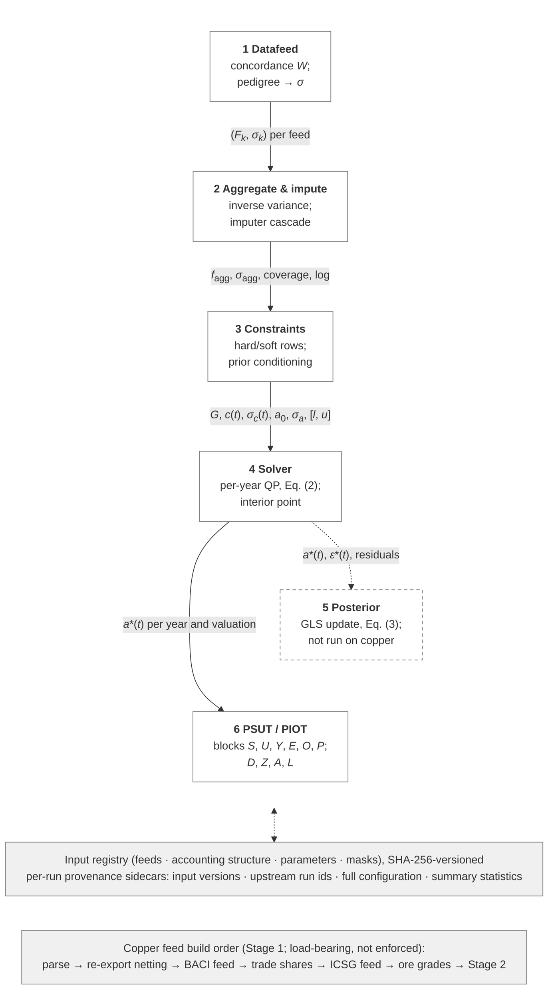
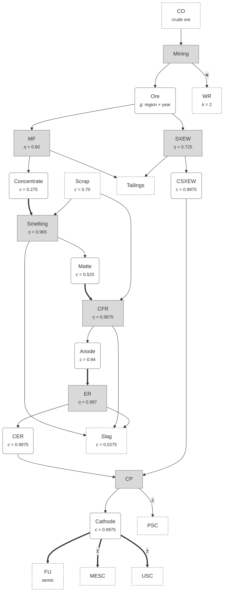

<!--
Method section of the pySUTO model paper. Markdown is the source since
2026-09-30 (converted from main.tex + method.tex on 2026-09-29; the TeX files
were retired). Method is numbered Section 3, as in the paper; equations,
figures and tables keep their numbers. Figures 1 and 2 are Mermaid drawings.
Structure: 3.1 framework (six stages, each closing with its copper instance)
/ 3.2 application to copper / 3.3 evaluation / 3.4 availability.
Word budgets (approx.): 3.1 1,400 / 3.2 1,250 / 3.3 250 / 3.4 150.
Every number is from the reference chain, the final chain of the
manuscript-ready-2 milestone,
  opt_20261021_131744_58504ad3 <- const_20261021_130426_c5331a7f
  <- imp_20261021_125954_b112b170
  <- feed_icsg_20261021_125725_b033ebc4 (icsg v17, trade_shares v39),
     feed_baci_20261021_125615_bc691704 (baci v31, netted from gross v28),
     feed_crude_ore_20260603_095651_558f7369 (crude_ore v3);
  acc copper v4; params conc v10, eff v4, stripping_ratio v2, ore_grade v8,
  stock_bounds v6, scrap_share v3; PSUT psut_20261022_081135_823c49b0,
re-derived from the run sidecars and arrays on 2026-10-22 (manuscript-ready-2
milestone) with scripts/report/manuscript_numbers.py; the limitation numbers
of 3.2.8 from scripts/explo/final_limitations_diag.py on the same run, the
cited REPs (#31/#96 via #97, #95, #98) and #111. Common-set comparisons are against the base re-solved at the
ADR 0039 tolerance (opt_20260930_093914_523d57d7) and the base as originally
solved (opt_20260916_124721_c4d1d944). A number attributed to an ADR or a
round is that record's own measurement. Stage-5 (posterior) numbers are from
uncprop_20261021_134829_ad7e8d62 on the same chain (issue #27, ADR 0044), the
calibration and ablation (#87) from it and uncprop_20261022_081020_2176b072.
"ADR nnnn" points to docs/adr/ in the repository and to SI Table S13.

Positioning paragraph (state of the art) moved out of Method on 2026-09-24;
it belongs in the Introduction:
  This design joins two strands that industrial ecology software has kept
  separate. System-definition frameworks such as ODYM (Pauliuk & Heeren
  2020) and the general socioeconomic-metabolism data model (Pauliuk et al.
  2019) structure material-system data but do not reconcile it; the
  constrained-balancing lineage of AISHA, large-scale matrix balancing and
  the PIOLab (Geschke et al. 2011, 2019; Lenzen et al. 2009; Wieland et al.
  2022) reconciles large accounts but does not carry per-source data quality
  through to the result. pySUTO does both by treating sigma as a first-class
  artifact of every stage, and reaches the physical input-output table
  (Suh 2004; Wieland et al. 2022) only at the end, as a derived view of the
  reconciled account.
-->

# pySUTO: uncertainty-carrying compilation and reconciliation of physical supply–use tables

*(Method section draft — working title)*

## 3 Method

Section [3.1](#sec-framework) describes pySUTO, the generic framework, stage by stage, each stage closing with what it does to the copper account; Section [3.2](#sec-application) gives the copper parametrisation and the modelling decisions a reader needs in order to interpret the results; Section [3.3](#sec-evaluation) defines the quantities the Results report; Section [3.4](#sec-availability) states what is available for replication.

### 3.1 The pySUTO framework

#### 3.1.1 Architecture

pySUTO organises the compilation and reconciliation of physical supply–use tables into six sequential stages (Figure [1](#fig-pipeline)): datafeed assembly, aggregation and imputation, constraint building, per-year constrained optimisation, posterior uncertainty propagation, and the derivation of supply–use and input–output views. Each stage consumes the persisted output of its predecessor and writes a registered run of its own, and the quantity exchanged at every interface is the same: for each *edge* — one directed flow between two nodes of the accounting graph, resolved by period and valuation — a value with its standard deviation $\sigma$. No transformation may drop $\sigma$; that is what distinguishes the framework from system-definition tools that do not reconcile ([Pauliuk and Heeren, 2020](#ref-pauliuk2020odym)) and from balancing tools that do not carry per-source quality through ([Lenzen et al., 2009](#ref-lenzen2009matrix); [Wieland et al., 2022](#ref-wieland2022piolab)). The copper graph has 1,081 nodes (23 sectors in 47 regions), two valuations and 30 years: 14,241 edges per valuation and year, 854,460 in all.

**Figure 1.** The pySUTO pipeline. Six sequential stages transform per-source raw data into reconciled flows and derived tables; every inter-stage artifact carries values and standard deviations together. Solid arrows show the data artifacts handed between stages; Stage 6 reads the reconciled flows $a^*$ of Stage 4 directly. Stage 5 (dashed) is implemented and tested but has not been executed on the copper chain (Section [3.1.7](#sec-stage5)). The substrate is the content-hashed input registry and the per-run provenance sidecars that link every result to exact input versions, upstream runs and configuration; the bottom strip is the copper-specific feed build order.

*Redrawn in Mermaid from the TikZ figure in method.tex; the stages run top to bottom.*

#### 3.1.2 Uncertainty treatment

Uncertainty enters once, at the source. Each feed is scored on five data-quality indicators — reliability, completeness, and temporal, geographical and other correlation — on a four-point scale; the scores map to coefficients of variation (CV) through the exponential model of [Laner et al. (2016)](#ref-laner2016), in the pedigree tradition of [Weidema and Wesnæs (1996)](#ref-weidema1996pedigree), and their quadrature sum is the feed's CV (SI S2). Every later $\sigma$ operation instantiates one composition rule, the power-mean combiner

$$
\sigma_{\oplus} \;=\; \Bigl(\sum\nolimits_k \lvert w_k\,
\sigma_k\rvert^{\,p}\Bigr)^{1/p},
\tag{1}
$$

which merges weighted contributions $w_k \sigma_k$ into one standard deviation. At $p=2$ it is the Gaussian quadrature of independent errors; pySUTO uses $p=1.3$ throughout, which grants less diversification credit because the contributions that meet on one edge — parallel sources, fanned-in sub-flows, chained imputations — rarely err independently. For $p \ge 1$ relative uncertainty never grows under mass-preserving aggregation or disaggregation (SI S2).

#### 3.1.3 Stage 1: Datafeed assembly

Each source enters through its own concordance: raw records are cast as directed source edges and projected onto the root accounting structure by a sparse weight matrix  , whose outgoing weights sum to one per source edge so that every fan-out conserves mass (a guard rejects a projection off the matched raw total by more than 1%). A record that names only one endpoint is fanned across the matching root edges by external split information — for copper, bilateral trade shares — and never by a uniform $1/N$ split, which would fabricate structure the source does not contain (ADR 0008). The feed's pedigree CV attaches here, re-scored at the worst geographical level on edges touching the rest-of-world aggregate (ADR 0003), and propagates through $W$ in CV form by Eq. [(1)](#eq-lp) with the value shares of the contributing source edges as weights: fan-in diversifies, fan-out leaves the CV unchanged. For copper, three feeds leave Stage 1 (Table [1](#tab-sources)): ICSG industry statistics, scored $(2,1,1,1,1)$, CV 0.068 (0.217 on the 5,155 rest-of-world edges); BACI bilateral trade, $(3,2,1,1,2)$, CV 0.209 (0.294 on 6,088 edges); and crude-ore extraction, $(2,3,2,2,2)$, CV 0.104 (0.230 on 28 edges).

#### 3.1.4 Stage 2: Aggregation and imputation

Where several feeds observe the same edge, their values are combined by inverse variance, the aggregate's $\sigma$ following from Eq. [(1)](#eq-lp) with the precision weights (SI S3); a coverage mask records which edges any feed observed. Bilateral trade legs then receive a size-damped $\sigma = \mathrm{CV}\, a_{\mathrm{ref}}^{\,1-\gamma} a^{\gamma}$, $\gamma = 0.5$, around a fixed per-product reference size, because a size-blind CV makes the largest legs the cheapest to delete per tonne (ADR 0017). In the copper run 61,223 edges (7.17%) are feed-observed: 32,414 in copper content from ICSG, 27,944 in gross mass from BACI, 865 from the ore series.

The uncovered edges are filled by plugin imputers in two phases: a *cascade*, swept in fixed order until a full sweep fills no new edge, and a single *terminal* pass (rules in SI S3). The cascade seeds bilateral import legs in copper content from their observed gross-mass twin ($f_{\mathrm{CC}} = \mathit{conc} \cdot f_{\mathrm{Mass}}$), closes process recipes — a process's product equals its recovery efficiency times its pooled inputs, secondary inputs and imports included, and its residual output receives the complement, waste rock excepted (a satellite flow that Stage 3 fixes; ADR 0038) — and applies the concentration, ore-grade and efficiency relations in reverse where only the downstream side is observed, with a regularised sensitivity that damps the inversion of near-zero coefficients. The terminal pass interpolates linearly in time on within-region edges only, because a bilateral trade matrix is complete by construction and a partner pair absent in one year is an observed zero, not a gap (ADR 0026); seeds the unreported user and exchange stock-change legs at zero, held there with the pricing of a feed-backed level — one per cent of the co-located cathode flow, floored at 0.3 kt — because a signed leg with a loose $\sigma$ is a sink for every contradiction of the cathode balance, and no other imputer may write them (ADR 0040), while an unreported producer stock change keeps the zero that the cathode pool's efficiency-free recipe gives it (issue #36); and gives every still-empty edge a flat prior, value zero with $\sigma = 10^{6}$, a noisy zero re-anchored in Stage 3. Fills are write-once and logged with method, source edges and coefficients. In the copper run the cascade converges in two passes; relational and temporal imputation extend informative priors to 112,267 edges (13.14%, mostly by recipe closure and stock-change seeds; SI S12), and 680,970 edges (79.7%) carry the flat prior.

#### 3.1.5 Stage 3: Constraint building

The aggregated prior is next confronted with what must, and what should, hold. Builder plugins emit rows of a sparse matrix $G$, each with its year, target $c(t)$ and target uncertainty $\sigma_c(t)$: *hard* rows must hold exactly, *soft* rows may be violated at a cost weighted by $\sigma_c^{-2}$, in the $\sigma$-weighted-residual tradition of accounting-matrix reconciliation ([Byron, 1978](#ref-byron1978); [van der Ploeg, 1982](#ref-vanderploeg1982); [Lenzen et al., 2009](#ref-lenzen2009matrix)) and of data reconciliation in material flow analysis ([Cencic and Rechberger, 2008](#ref-cencic2008stan)). The copper configuration registers, in build order (SI S4): hard mass balances per process and product node, region, year and valuation, waste rock excluded from the mining balance as a *satellite* mass flow whose mass a hard stripping relation $\mathrm{WR} = k\,\mathrm{Ore}$ sets (ADR 0038); soft *scale totals* that tie each node's total output to its own aggregated prior — self-anchored, adding no information but preserving the prior's scale against homogeneous shrinkage (ADR 0006) — with $\sigma_c = \max(0.01\,|c|,\ 0.3\ \mathrm{kt})$ on feed-backed groups (ADR 0025); soft level anchors on the observed scrap inputs of smelters and refineries (ADR 0031); soft ratio rows for concentration, in-situ ore grade and recovery efficiency, the last pooling all inputs of a process; hard one-sided bands on the same ratios and on regional scrap shares; soft zero-centred net-stock rows on the producer stock change (the user and exchange stock-change legs are held by their prior $\sigma$ alone, ADR 0040); and one hard non-negativity row per edge whose structural lower bound is zero — every edge but the three signed stock changes (ADR 0039); upper bounds and the flat-prior zero pin are stored for the feasibility probe only. Prior $\sigma_a$ is then floored through Eq. [(1)](#eq-lp), and the noisy zeros are re-anchored: at $\sigma = 10^{6}$ their prior pull is nil, so the solver could route arbitrary mass through data-free subgraphs; the anchor sets their $\sigma$ to 5% of the median prior magnitude among their sector–valuation siblings, exempting slag and producer stock change, and the extraction chain only in the 887 region-years where an ore-grade relation sets its magnitude; in a country that mines nothing the chain is anchored like any other no-data edge (ADR 0013). A build-time check verifies that no row couples different years, so $G$ partitions into yearly blocks. For copper this yields 1,687,240 rows, 56,151–56,296 per year: 1,226,444 hard (39,480 mass balances, 1,410 stripping relations, 598,994 bands, 586,560 non-negativity rows) and 460,796 soft (28,982 scale totals and scrap anchors, 431,814 ratio rows).

#### 3.1.6 Stage 4: Solver

Each year is reconciled by one quadratic program over the flows $a$ and the soft residuals $\varepsilon$,

$$
\min_{a,\;\varepsilon}\;
(a - a_0)^{\top} \Sigma_a^{-1} (a - a_0)
\;+\; \varepsilon^{\top} \Sigma_c^{-1} \varepsilon
\quad \text{s.t.} \quad
G_s\, a - \varepsilon = c_s, \qquad
G_h\, a = c_h, \qquad
G_b\, a \le c_b,
\tag{2}
$$

where $a_0$ is the prior, $\Sigma_a = \mathrm{diag}(\sigma_a^2)$ and $\Sigma_c = \mathrm{diag}(\sigma_c^2)$ carry the accumulated uncertainties as inverse-variance weights, and the rows of $G$ split into soft equalities ($G_s$), hard balances ($G_h$) and hard bands ($G_b$), with $c = c(t)$. Clarabel, an interior-point solver for conic programs with quadratic objectives ([Goulart and Chen, 2024](#ref-goulart2024clarabel)), solves it with the three row groups on two zero cones and one non-negative cone (SI S5). The band group $G_b$ carries the non-negativity of every flow but the signed stock changes, so a data conflict surfaces as a residual on a soft row or as a flow held at zero, never as a negative flow. Until Round W.1 the bounds reached only a pre-solve feasibility probe of the hard subsystem (which on failure reports the most violated rows; the stored upper bounds still act there), and the residual mass edges served as signed slack: on the last reference run before it the world waste-rock output had a posterior of $-257{,}667$ kt against a prior of $+292{,}395$ kt, and 1,108 mass edges of the mine chain sat more than 1 kt below zero (issue #28); the reference run has none (smallest flow $-5.6\times 10^{-9}$ kt). The termination rule matters as much as the rows. Solved for the flows, the solver's cost is the misfit less the prior-only constant $\sum (a_0/\sigma_a)^2$, an order of magnitude larger than the misfit $\sum z^2$, so its relative duality gap is measured against the wrong number: the gap of $10^{-3}$ that every run before Round W.1 stopped at admitted about 1,000 objective units and left loosely weighted flows hundreds of kilotonnes from the optimum, and a gap of $10^{-6}$ still stopped 496–4,362 units above it in every year (SI S5, ADR 0039). The reference run therefore solves each year for the defects $d = a - a_0$, whose cost is the misfit itself, to relative and absolute gaps of $10^{-8}$ (a year that stalls is accepted at $10^{-4}$, which none needs), with the cold prior $a_0(t) = f_{\mathrm{agg}}(t)$; solved this way, each of six probed years came within 0.2 units of a Lagrange-dual lower bound. All 30 copper years return *Solved* in 60–75 iterations and 17–22 s each, 588 s in all, or 529 s of wall-clock time with the years solved concurrently.

#### 3.1.7 Stage 5: Posterior uncertainty propagation

The optimum $a^*$ is a point estimate; Stage 5 restores its distribution. Modelling the prior as Gaussian with covariance $\Sigma_a$ and the constraints as observations with covariance $\Sigma_c^{\mathrm{full}} = \operatorname{blkdiag}(0, \Sigma_c)$ — zero variance on hard rows — Gaussian conditioning gives the closed-form posterior covariance

$$
\Sigma_{a^*} \;=\; \Sigma_a \;-\; \Sigma_a G^{\top} S^{-1} G\, \Sigma_a,
\qquad S = G\, \Sigma_a G^{\top} + \Sigma_c^{\mathrm{full}},
\tag{3}
$$

the generalised-least-squares update of the reconciliation lineage ([Byron, 1978](#ref-byron1978); [van der Ploeg, 1982](#ref-vanderploeg1982)). Eq. [(3)](#eq-posterior) assumes equality constraints, so Stage 5 linearises the QP where it stands (ADR 0044): a band that binds at $a^*$ ($G a^* - c \ge -10^{-6}$ kt) enters as an equality, a binding lower bound pins its edge ($\sigma_{a^*} = 0$), slack rows drop out, and hard rows linearly dependent on the others are dropped. Only the marginal variances are extracted, each edge's contraction read off a QR factorisation of the whitened system $[G\,\Sigma_a^{1/2},\ \Sigma_c^{1/2}]$ per year — forming $S$ squares its condition number, and with $\sigma_a$ spanning $10^{-8}$ to $10^{6}$ kt an LU of $S$ puts the contraction outside $[0, 1]$ on hundreds of edges a year; intervals $a^*_i \pm z\,\sigma_{a^*\!,i}$ are clipped at the structural lower bound (SI S6). Tests enforce monotone shrinkage, positive semidefiniteness and the hard-only limit of [Byron (1978)](#ref-byron1978). On the reference chain every year completes: 8,481–9,830 edges a year are pinned at a binding lower bound, 13,406–13,938 bands bind, 59–101 dependent hard rows are dropped, and $\sigma_{a^*} \le \sigma_a$ holds on every edge-year. The posterior is the estimator's sensitivity under the stated $\sigma$, not a calibrated interval. Checked against the model's own residuals (issue #87), the stated $\sigma$ are too small by $\sqrt{R} \approx 2.3$ on average (Birge ratio $R = \sum z^2/\mathrm{dof} = 5.21$), and the shifts are not a scaled normal: their core is narrower and their tail heavier than predicted, with 13.0% of the feed-observed contained-copper edges beyond $3$ standardised units against 0.27%. Intervals in this paper are therefore Birge-scaled, $a^*_i \pm 1.96\sqrt{R}\,\sigma_{a^*\!,i}$, and remain lower bounds in the tail; the scale totals, which reuse the prior, carry 0.10 of the 0.93 mass-weighted contraction of those edges (SI S6).

#### 3.1.8 Stage 6: Supply–use and input–output views

Stage 6 materialises $a^*$ as a tidy physical supply–use table, every edge of a period and valuation classified into a supply, use or final-use block or a boundary block (extraction, secondary input, residual output); aggregation over regions and sectors is a pushforward of that table that preserves border crossings. The physical input–output table is a derived view built on demand (ADR 0037): the market-share construct $D = S\,\hat{q}^{-1}$ turns each use of a product into an edge between its producer and its consumer ([Miller and Blair, 2009](#ref-millerblair2009)), and the industry-by-industry calculus — $Z$, $A = Z\hat{x}^{-1}$, $L = (I-A)^{-1}$, footprints $e\,L\,\hat{y}$, embodied trade, economy-wide MFA indicators, multipliers and structural decomposition — follows [Wieland et al. (2022)](#ref-wieland2022piolab) and [Suh (2004)](#ref-suh2004pio), residual outputs being final outputs ([Altimiras-Martin, 2014](#ref-altimirasmartin2014piot)); waste rock is carried as a satellite flow, so in gross mass the mining process's outputs exceed its crude-ore input by exactly the waste rock (ADR 0038). With one producer per product, as in copper, this coincides with the product-by-product construct. Stage 6 propagates point estimates only.

#### 3.1.9 Implementation and provenance

Every number above is reproducible from the repository. Inputs of four kinds — feeds, accounting structure, parameter tables and masks — live in a content-hashed registry: load-bearing files are SHA-256-hashed, any change creates a new immutable version, and runs may pin old ones. Each stage writes its outputs under a run identifier with a sidecar recording the exact input versions, the upstream run identifiers, every configuration knob and summary statistics, so that the chain from raw feed to table is reconstructable from any run directory ([Pauliuk et al., 2024](#ref-pauliuk2024traceability); [Stodden and Miguez, 2014](#ref-stodden2014best); [Wilkinson et al., 2016](#ref-wilkinson2016fair)). The package comprises 22,052 lines of Python in 68 modules with 1,284 tests and four extension seams — feeds, imputers, constraint builders and posterior propagators subclass a common interface ([Pauliuk et al., 2015](#ref-pauliuk2015transparency); [Pauliuk, 2020](#ref-pauliuk2020cumulative)).

### 3.2 Application to the global copper supply chain

The framework is parametrised for copper by an accounting structure, three data feeds with their pre-processing, six parameter tables and a set of modelling decisions, each recorded in the repository as an architecture decision record (ADR) with the measurement that motivated it; SI S11 lists all 39.

#### 3.2.1 System definition

The account (Figure [2](#fig-system), SI S8) has 23 sectors in each of 47 regions: seven processes from mining to a cathode pool, seven products from ore to cathode, and nine boundary nodes — crude ore in the ground on the extraction side; waste rock, tailings, slag, scrap and producer stock change on the socio-economic side; final use (semis fabrication) and user and exchange stock changes as final demand. The 27 sector pairs of the process chain define the edges. Four products are traded — concentrate, matte, anode and cathode — so their six use pairs exist between every ordered pair of regions; the other 21 pairs exist within a region only. Every edge exists in gross mass (kt) and in contained copper (kt CC), linked per product by a concentration coefficient; only the three stock-change edges may be negative, which the solver enforces (ADR 0039). Waste rock is a satellite flow: it has mass but no copper, sits outside the mining balance, and equals $k = 2$ times the ore mass (ADR 0038). The 46 named regions cover every producer the ICSG reports separately; a rest-of-world region absorbs 48 ICSG labels and 183 BACI partner codes, while BACI's “Other Asia, not elsewhere specified”, which is Taiwan's trade, is booked to Taiwan. The period is 1995–2024.

**Figure 2.** System definition of the copper account, one region shown. Grey rectangles are processes (with their nominal recovery efficiency $\eta$), rounded boxes products (with their nominal copper content $c$; the ore grade $g$ is region- and year-specific), dashed boxes boundary nodes: crude ore in the ground (extraction), waste rock, tailings, slag, scrap and producer stock change (socio-economic side), and final use and the two stock changes (final demand). The 27 arrows are the sector pairs; double arrows mark the four traded products, whose six use pairs exist between all $47 \times 47$ regions, single arrows exist within each of the 47 regions. $\pm$ marks the three edges that may be negative, the only ones the non-negativity rows of Stage 3 exempt; $\ast$ marks waste rock, a satellite mass flow outside the mining balance, $k = 2$ times the ore mass and free of copper (Section [3.1.5](#sec-stage3)). Every edge exists in gross mass and in copper content: 14,241 edges per valuation and year, 854,460 over 1995–2024.

*Redrawn in Mermaid from the TikZ figure in method.tex; the chain runs top to bottom, and thick arrows stand for the double arrows.*

#### 3.2.2 Data sources

Three sources feed the account (Table [1](#tab-sources)). Industry statistics come from four editions of the ICSG yearbook ([International Copper Study Group, 2005](#ref-icsg2005yearbook), [2014](#ref-icsg2014yearbook), [2023](#ref-icsg2023yearbook), [2025](#ref-icsg2025yearbook)), combined newest-wins where they overlap: mine, smelter and refinery production, refined usage, secondary feed and stock changes, in copper content. Bilateral trade comes from BACI HS92, release V202601 ([Gaulier and Zignago, 2010](#ref-gaulier2010baci); [CEPII, 2026](#ref-cepii2026baci)), for concentrate (HS 260300), matte (740110, 740120), anode (740200) and refined copper (740311, 740312, 740313, 740319), in gross mass, on cross-region edges only (ADR 0014). Crude-ore extraction comes from the materialflows.net series ([Kroiss, 2024](#ref-kroiss2024crudeore)), a price-allocated ore mass to 2022, so every ore grade in the model is on the allocated basis, not a mill-head grade (ADR 0015); after 2022 the last grade is carried forward and the ore mass follows production (ADR 0023). No further source enters.

| Feed (version) | Source and release | Quantity, valuation, edges | Years | Pedigree $(R,C,T,G,O)$ $\to$ CV | Pre-processing (ADR) |
| --- | --- | --- | --- | --- | --- |
| ICSG (v17) | Copper Bulletin Yearbooks 2005, 2014, 2023 and 2025; the newest edition wins where they overlap | mine, smelter and refinery production, refined usage, secondary feed, stock changes; kt Cu $\to$ CC; 32,414 edges | 1995–2024 | $(2,1,1,1,1) \to 0.068$; 0.217 on 5,155 ROW edges | row-label fix (0035), rename collisions summed (0036), one territory one label (0032), SX-EW counted once, production $\to$ consumed input (0021, 0030), usage fanned by trade shares (0002, 0024, 0018), unweighted fans undistributed (0008) |
| BACI (v31) | CEPII BACI HS92 V202601 (January 2026); HS6 260300, 740110, 740120, 740200, 740311, 740312, 740313, 740319 | bilateral trade in tonnes $\to$ kt gross mass; 27,944 edges | 1995–2024 | $(3,2,1,1,2) \to 0.209$; 0.294 on 6,088 ROW edges | zero-quantity rows dropped; quantity rebuilt from value on 874 legs above and 119 below the band (0033); re-exports netted (0027); cross-region edges only (0014) |
| Crude ore (v3) | materialflows.net, global crude metal ore extraction 1970–2022, price-allocated | ore mass in tonnes $\to$ kt on CO→Mining; 865 edges | 1995–2022 | $(2,3,2,2,2) \to 0.104$; 0.230 on 28 ROW edges | allocated basis (0015); grade carried to 2023–24 (0023) |
| *Derived tables (parameter registry)* |  |  |  |  |  |
| Trade shares (v39) | netted BACI $\times$ concentration; ICSG production | fan weights per product, consumer and year; 150,635 rows | 1995–2024 | — | import leg $=$ conc $\cdot$ mass; domestic leg $=$ usage $-$ imports, capped at own production (0024) |
| Ore grade (v8) | ICSG production $\div$ allocated ore mass | in-situ grade, 887 region-years, 35 regions | 1995–2024 | sd $=$ envelope/4 | series envelope $\pm10\%$ as hard band, $\pm20\%$ for carried years (0015, 0023, 0028) |
| Scrap share (v3) | ICSG scrap and concentrate feed | 94 hard bands (smelting and CFR $\times$ 47 regions) | 1995–2024 | — | $[p_5 - 0.05,\ p_{95} + 0.05]$ of the ICSG share where a series exists (44), $[0, 0.25]$ otherwise |
| Stock bounds (v6) | ICSG stock series | 47 soft bands (PSC $\times$ 47) | 1995–2024 | $\sigma = p_{95}/1.645$ | producer stock change over refined-cathode output, on root region labels; the user and exchange stock-change legs carry no band and are held at their prior (ADR 0040) |
| Concentration (v10), efficiency (v4) | [Schlesinger et al. (2022)](#ref-schlesinger2022extractive); [Davenport et al. (2002)](#ref-davenport2002extractive) | 16 concentration and 5 recovery rows | all | sd, or range/4 | pooled recoveries (0005, 0022); one scrap commodity (0012) |
| Stripping ratio (v2) | [Nassar et al. (2022)](#ref-nassar2022rocktometal), Fig. 2, copper operations | 1 row: WR mass $= k \cdot$ ore mass, $k = 2.0$ | all | range 1.5–2.5, $\sigma = 0.25$ | hard relation; waste rock a satellite flow outside the mining balance (0038) |

**Table 1.** Data sources of the copper application and the tables derived from them. Pedigree scores are reliability, completeness, temporal, geographical and other correlation on a 1–4 scale (all sensitivities medium); the CV after the arrow is the feed's, the second value the rest-of-world-penalised CV and the number of edges it applies to. Edge counts are feed-observed edges over 1995–2024. Versions are those of the reference chain; ADR numbers refer to the repository's decision records (SI S11).

#### 3.2.3 Industry statistics: parsing and pre-processing

Defects of the yearbooks found by the reconciliation are fixed at the input, never by loosening a constraint (SI S9; Table S11 lists them all). Three show the pattern. In the 2014 edition the country name sits on the middle row of a block, so a naive parse handed each block's total to the next country: 16 rows and 11,558 kt CC of mine production that never existed (ADR 0035). A type renamed between editions is a second stream, not a restatement; summing instead of deduplicating restored 1,038 kt of Zambian primary smelting in 2004–07 (ADR 0036). And one territory carries one label before any region-keyed step (ADR 0032). Production is then converted into the input it consumed, because the account books flows into a process: smelter output divided by the smelting recovery becomes concentrate and scrap into smelting, refined output divided by the electrolytic recovery becomes anode into refining (ADR 0021). The secondary series required care: secondary refined production already contains the copper that came through secondary smelters, and booking both ICSG series counted 70 Mt of scrap twice over 30 years; direct-to-refinery scrap is therefore $\max\bigl(0,\, S_{\mathrm{ref}} - S_{\mathrm{sm}}\,\eta_{\mathrm{CFR}} \eta_{\mathrm{ER}}\bigr)/ (\eta_{\mathrm{CFR}}\eta_{\mathrm{ER}})$, so secondary copper enters the chain once (ADR 0030). Finally, ICSG usage names only the consumer; each such record is fanned across supplying regions by trade shares built from the netted BACI matrix, with the domestic leg capped at the region's own production (ADR 0024).

#### 3.2.4 Trade statistics: reconstruction and re-export netting

Two corrections rebuild the trade matrix's quantities before it enters; its partner and product mappings are corrected in the concordance (SI Table S11). First, BACI's quantity field contradicts its own value field on a set of concentrate legs: with the cathode unit value of the same release as the copper price, the value-implied copper fraction leaves the physical band. Where both the leg and the exporter-year imply more than 35% copper and the leg is at least 1 kt, the quantity is rebuilt from the intact value, $q = v/(P_{\mathrm{Cu}}\, g_{\mathrm{ref}})$, and the inference is carried in $\sigma$: 874 of 18,105 legs, 54 exporters, 82,250 kt of export mass over 30 years, 58,475 of them Chilean. The same rule applies an order of magnitude below the band's floor, where the recorded mass is far more than the value buys: a leg implying less than 2% copper in an exporter-year below 20% is rebuilt downwards, never above its recorded quantity. The leg threshold sits a decade under the floor because a traded value is net of payables and treatment charges, so real concentrate trades at 15–20%. This removes kilograms booked as tonnes: 119 legs, 115,854 kt rebuilt to 390 kt over 30 years, 111,809 kt of it Papua New Guinea's exports in 2019–2022 (ADR 0033). Second, bilateral statistics record gross border crossings, so a consignment re-exported unchanged through a warehouse economy is counted twice, and the second crossing asks the account for production the hub does not have. For each product, hub and year we read imports $I$ and exports $X$ from the trade matrix and intake $U$ and production $P$ from the industry statistics, all in copper content, and net the re-exported volume

$$
T = \min\bigl(X,\, I,\, \max(R, E)\bigr), \qquad
R = \max(0,\, I-U), \qquad
E = \max(0,\, X-P),
\tag{4}
$$

where $R$ is the surplus-import reading of the same physical fact and $E$ the uncovered-export reading, domestic production being taken to supply exports first. $T$ is moved from the hub's legs to the direct origin–destination legs in proportion to the observed inbound and outbound shares; re-imports are dropped, the rest-of-world aggregate is never a hub, and the caps $T \le X$ and $T \le I$ leave producers with thin industry rows untouched. Over 1995–2024 the rule moves 14,217 kt CC; arrivals without a recorded outbound leg stay in a residual ledger for the reconciliation to judge (ADR 0027, SI S9).

#### 3.2.5 Ore grade and feed build order

Ore is coupled to concentrate through a region-by-year in-situ grade, $g = (\mathrm{Conc}_{\mathrm{CC}}/\eta_{\mathrm{MF}} + \mathrm{SXEW}_{\mathrm{CC}}/\eta_{\mathrm{SXEW}})$ over the allocated ore mass, stated for 887 region-years in 35 mining regions (median 1.12%, 10th–90th percentiles 0.61–2.45%); its hard band is the region's series envelope widened by 10%, and its $\sigma$ is stated separately from the band (ADR 0028). The feeds are built in a fixed order (Figure [1](#fig-pipeline)): parse, re-export netting, the BACI feed, the trade shares, the ICSG feed, the ore grades, then Stage 2. The order is load-bearing — the trade shares read the netted matrix and the ICSG feed's own production — and nothing enforces it; one skipped rebuild cost 6.2 percentage points of objective. On the reference chain every derived input — the netted matrix, the trade shares, the ore grades and the stock bounds — is built on the last yearbook and trade corrections (issues #30, #37); none is stale.

#### 3.2.6 Parameters

Six parameter tables carry the physics (SI S10). Concentrations are global: concentrate 0.275 with $\sigma$ 0.0375 and hard band $[0.20, 0.35]$, matte 0.525 $[0.30, 0.75]$, anode 0.94 $[0.90, 0.98]$, cathodes 0.9975 $[0.995, 1.0]$, slag 0.0275, and scrap as one blended commodity, 0.70 in $[0.40, 0.98]$, because two grade classes on one node would give the solver a free switch (ADR 0012). Recovery efficiencies are the medians of the literature ranges ([Schlesinger et al., 2022](#ref-schlesinger2022extractive); [Davenport et al., 2002](#ref-davenport2002extractive)): flotation 0.80 $[0.70, 0.90]$, leaching 0.725 $[0.60, 0.85]$, smelting 0.965 $[0.95, 0.98]$, converting and fire refining 0.9875 $[0.98, 0.995]$ and electrolytic refining 0.997 $[0.995, 0.999]$. The last three are *pooled*: a smelter's ratio row relates its matte to concentrate and scrap from every origin, a refinery's relates its cathode to anode from every source region (ADR 0005, 0022). The stripping ratio, waste-rock mass per ore mass, is one global $k = 2.0$ (range 1.5–2.5) read from the copper operations of [Nassar et al. (2022)](#ref-nassar2022rocktometal); it enters as a hard relation because a soft row left waste rock at $1.04 \times$ ore — an edge held only by weak soft terms is never pinned down by the interior-point stopping rule (ADR 0038). Before refining was pooled, imported anode was not an input of any recipe and the solver deleted 96% of the observed anode trade rather than violate the node; pooling cut the scale-total objective by 26.4% in one step, the largest single improvement of the study. Per-region scrap-share bands are the 5th–95th percentiles of the ICSG share widened by 0.05; the producer net-stock rows are bounded at the 95th percentile of observed stock change over refined-cathode output (2.8%, on the repaired stock series; issue #37); the user and exchange stock-change legs carry no band but are held at their prior — a reported change where ICSG reports one at that exchange location, otherwise zero — with $\sigma$ of one per cent of the co-located cathode flow or 0.3 kt, because the previous band (the 95th percentile over a region's own semi use, 910% for the exchange locations Netherlands, Singapore and United Kingdom, times a 100 kt scale floor) priced those legs at $\sigma \approx 553$ kt and the solver routed 9.7 Mt of unexplained cathode surplus into them over 30 years (ADR 0040). One property of the $\sigma$ scaling must be stated: the soft ratio rows apply the parameter $\sigma$, given in ratio units, relative to the ratio, $\sigma/\lvert r\rvert$, before a 2% floor, so the concentrate row is weighted at 13.6% (ADR 0028 amendment, issue #29).

#### 3.2.7 Critical modelling choices

Table [2](#tab-choices) collects the choices a reader needs in order to interpret the results, each with the alternative that was measured and rejected. Three deserve a sentence. Scale totals are self-anchored, not external control totals: the yearbook figures enter as edge observations with their pedigree $\sigma$, and no total outranks them (ADR 0006); their 0.3 kt floor applies to feed-backed totals only, because a global floor let fabricated small chains grow and cut Chile's concentrate export retention by 8 percentage points (ADR 0025). $\sigma$ is never loosened to repair a contradiction between sources: loosening the fabricated totals collapsed world ore retention from 0.66 to 0.41, and loosening contradicted nodes repriced the disagreement while 0.46% of the mass moved (ADR 0016, 0019); the input is fixed instead. And the concentrate grade stays global, because the between-region signal (sd 0.0117) is a third of the $\sigma$ the single row already carries, and half of the deletion a regional grade was meant to relieve is forced by missing export mass, which no grade can repair (ADR 0029).

| Choice | What it does to the copper account | Alternative rejected, and what measured it | ADR |
| --- | --- | --- | --- |
| Recovery efficiencies pooled over all inputs of a process | smelter and refinery recipes close on concentrate plus scrap, and on anode from every source region; one soft ratio row and one hard band per node | per-route rows: imported anode was no recipe input and 96% of observed anode trade was deleted; pooling cut the scale-total objective by 26.4% | 0005, 0022 |
| Scale totals self-anchored to the Stage-2 prior | each node's total output keeps its prior scale; no external total outranks the edge observations | external control totals: covered seven hand-listed families and left every other node to collapse | 0006 |
| 0.3 kt $\sigma$ floor on feed-backed totals only | totals below 30 kt cannot be known better than the feeds report them; fabricated totals keep 1% | global floor: small fabricated chains grew ($p_{90}$ posterior/prior 1.06 $\to$ 2.33), Chile concentrate export retention 0.601 $\to$ 0.523 | 0025 |
| Unweighted fans undistributed; domestic leg capped at own production | a usage record without trade shares is left to imputation; a fan's domestic leg cannot exceed the region's production, the rest goes to import legs | uniform $1/N$ split: fabricated partner structure; uncapped domestic leg: India concentrate cell 112,955 $z^2$ $\to$ 12,353 | 0008, 0018, 0024 |
| No-data anchor at 5% of the sibling median; extraction chain exempt only where an ore-grade relation sets it | noisy zeros are pulled softly to zero at a sector-appropriate scale; a hard balance can still force flow at visible cost | free noisy zero: arbitrary mass routed through data-free subgraphs; a hard zero pin reaches only the feasibility probe; a sector-wide exemption let countries without mines run free mine chains (817 negative mass edges $\to$ 149) | 0013 |
| Waste rock a satellite mass flow, fixed by a hard stripping relation | the mining balance reads crude ore $=$ ore; waste rock is $2\times$ the ore mass and carries no copper; world waste rock $-257{,}667$ kt before ADR 0038, $+124{,}792{,}587$ kt on the reference run | waste rock inside the balance: the slack that absorbed the crude-ore/ore gap, negative in 225 region-years; a soft stripping row: waste rock settled at $1.04\times$ ore | 0038 |
| Lower bounds enforced in the QP; each year solved to its numerical floor | no flow but the three stock changes can be negative | bound-free QP: 1,108 mass edges below zero; termination at a $10^{-3}$ relative gap: objective 9,052 above the optimum in 2015, Chile export retention 0.66 instead of 0.97 | 0039 |
| Scrap is one blended commodity, 0.70 in $[0.40, 0.98]$ | one hard grade band per commodity | two grade classes on one node: the solver switches freely between them | 0012, 0028 |
| Region×year in-situ grades on the allocated-ore basis, carried past 2022; $\sigma$ stated, not band-derived; concentrate grade global | ore and concentrate are coupled per region and year; 2.5 Mt/yr of ore restored in 2023–24; grades are allocated, not mill-head, grades | global 1% grade (Chile 1.66%, impossible); truncating ore at 2022; year-local and narrowed bands (they relocate the deletion); regional concentrate grade (no signal: sd 0.0117 against $\sigma$ 0.0375) | 0015, 0023, 0028, 0029 |
| Bilateral legs never time-interpolated | a partner pair absent in a year is an observed zero | interpolation invented 20,252 kt of trade, 15,266 kt of which the solver kept | 0026 |
| Re-exports re-attributed at feed time | hub crossings become origin–destination legs; 14,217 kt CC moved; hub-class objective $-77\%$ | leaving hubs: phantom refineries in Germany, Korea, France and Portugal; shipped over a failed Chile/Peru retention check (0.636 $\to$ 0.574) | 0027 |
| Size-damped leg $\sigma$ ($\gamma = 0.5$) | large legs relatively tighter, small legs looser; the biggest legs stop being the cheapest to delete | size-blind CV: deleted share rose with leg size; $\gamma = 0.7$ measured and not adopted; an unpinned reference size measured 1.7% worse | 0017 |
| $\sigma$ never loosened to repair a contradiction; defects fixed at the input | the yearbook and trade defects above are corrected before the feeds enter | loosening fabricated totals: world ore retention 0.66 $\to$ 0.41; loosening contradicted nodes: 0.46% of mass moved, collapses untouched | 0016, 0019, 0030, 0032, 0033, 0035, 0036 |
| PIOT as a derived view under the market-share construct | the input–output table is computed from the reconciled PSUT on demand and never persisted | an external IO-library dependency; persisting a second table class | 0007, 0037 |

**Table 2.** Critical modelling choices of the copper application, in pipeline order, with the alternative that was measured and rejected. Objective figures are scale-total $\sum z^2$ over 30 years unless stated; retention is $\sum a^*/\sum a_{\mathrm{prior}}$ of the named category (Section [3.3](#sec-evaluation)). The full list of 44 decisions with their evidence runs is SI Table S13.

#### 3.2.8 Limitations of the application

Several limitations stand. Concentrate is produced where ICSG reports no mine output — in 21 regions, led by Belgium, the United Arab Emirates, Malaysia, Italy, the Netherlands and Taiwan — 1,601 kt CC over the period, 60% of it exported: these chains supply ICSG usage that recorded production and imports cannot meet, and holding them at an observed zero raised the common-set scale-total objective by 37.8%, so the no-data anchor prices them instead (issues #31, #96; ADR 0024). Where two ICSG anchors disagree, the solver pays with trade and ore, because a trade leg's CV (0.069 at the median leg) exceeds an anchor's (0.017). Four regions carry a third of the scale-total objective: the D.R. Congo (10.1%) and South Africa (9.5%), whose recorded anode output is placed at a few percent of its prior (South Africa 2021: 4.5 of 137 kt CC), Zambia (7.8%) and Uzbekistan (7.3%, most of it in its 1995–1998 refinery rows); these contradictions between the sources are not resolved here (issue #111). Kazakhstan's refined exports exceed the refinery output ICSG's 2025 yearbook reports and are booked as stock draws beyond $5\sigma$, $-348.2$ kt CC over 1995–2024 (issue #95). Producer stock changes follow ICSG where it reports them; the world posterior departs from ICSG's by 101.7 kt CC summed over 1996–2024, in territories ICSG does not report (issue #98), and a cathode pool without a recovery efficiency holds its producer stock change at zero (issue #36). Austria's 2006–2012 smelter values are a superseded yearbook vintage (issue #63). Each year is solved to a gap of $10^{-8}$, where hard rows still close only to $1.1\times10^{-6}$ kt, and Stage 5 reads the binding set from a slack threshold rather than from the multipliers (issue #99). Stage 6 carries point estimates only.

### 3.3 Evaluation

Each run is judged with a fixed set of quantities (formulas in SI S13). The *defect* of an edge is $a^* - a_{\mathrm{prior}}$, standardised as $z = (a^* - a_{\mathrm{prior}})/\sigma_a$; the *residual* of a soft row is its slack $\varepsilon$, standardised as $z = \varepsilon/\sigma_c$. The objective of Eq. [(2)](#eq-qp) is $\sum z^2$ over edges and soft rows, so an item's *objective share* $z^2/\sum z^2$ within its family — edge defects, scale-total residuals, soft-ratio residuals — is what it cost the optimiser; the ranking of identities by share across years is the primary defect diagnostic. *Retention* is $\sum a^*/\sum a_{\mathrm{prior}}$ over the edges of one category in one valuation and year: 1 keeps the prior scale, below 1 is deletion. Deletion at a mine node splits into a *forced* part, $\sum \max(0,\, P - 0.35X - U)$, which no optimiser could avoid because copper leaves the node only as domestic intake $U$ or as export mass $X$ at a grade capped at 0.35, and a *discretionary* remainder that $\sigma$ and anchoring can move. Runs are compared on a *common set*, $\sum z^2$ over the scale-total rows present in every run compared, over all 30 years. Every change is one round, one ADR and one report, measured against its predecessor and the base run of the study; a $\sigma$ or repricing change ships only under a stop rule — objective by anchor band, mass moved, world retention of ore, concentrate and cathode not falling by more than 0.01, the posterior-to-prior mass ratio of small nodes within 0.05, and the concentrate export retention of Chile, Peru and Indonesia within 0.01. On the reference run the common-set objective is 710,639, 52.2% below the base run re-solved at the ADR 0039 tolerance (57.5% below the base as originally solved, a figure that mixes the modelling rounds with the solver's termination); 8,043 kt CC of mine output is deleted over 30 years in the region-years that lose output, 3,270 of them (40.7%) forced, and gains elsewhere more than offset it, so mine output rises by 4,080 kt CC net; world concentrate retention over 1995–2024 is 1.010; and 254 region-years sit on the export-grade cap.

### 3.4 Data and code availability

pySUTO is developed at <https://github.com/florihu/pySUTO> and will be archived with a DOI at Zenodo at submission [DOI and licence to be inserted]. The archive includes the parse and feed scripts, the accounting structure, the parameter tables and every run of the reference chain — the three feed runs, the imputation, constraint and optimisation runs with their sidecars, priors, $\sigma$, constraint tables and results — so that every number in this paper can be recomputed or traced to a file. BACI is open data and is cited; the ICSG yearbook tables and the S&P-derived ore allocation are licensed and are not redistributed, but the published parse scripts rebuild the feeds from the originals. The scrap-share, stock-change and ore-grade tables are statistics derived from those sources, and their release is subject to the same licence check. The study uses published statistics only and involved no human participants.

## References

Aleix Altimiras-Martin. Analysing the structure of the economy using physical input–output tables. *Economic Systems Research*, 26(4):463–485, 2014. doi: [10.1080/09535314.2014.950637](https://doi.org/10.1080/09535314.2014.950637). verify: issue/pages (PDF in docs/ref/).

Ray P. Byron. The estimation of large social account matrices. *Journal of the Royal Statistical Society. Series A (General)*, 141(3):359–367, 1978. doi: [10.2307/2344807](https://doi.org/10.2307/2344807).

Oliver Cencic and Helmut Rechberger. Material flow analysis with software STAN. *Journal of Environmental Engineering and Management*, 18(1):3–7, 2008. verify: all fields (no PDF).

CEPII. BACI HS92, release V202601. <https://www.cepii.fr/CEPII/en/bdd_modele/bdd_modele_item.asp?id=37>, 2026. Released 22 January 2026; verify: URL/DOI and licence (Etalab Open Licence 2.0).

William G. Davenport, Matthew King, Mark Schlesinger, and A. K. Biswas. *Extractive Metallurgy of Copper*. Pergamon, Oxford, 4th edition, 2002. verify: author list/publisher.

Guillaume Gaulier and Soledad Zignago. BACI: International trade database at the product-level. The 1994–2007 version. Working Paper 2010-23, CEPII, Paris, 2010. verify: all fields (from the BACI Readme).

Paul J. Goulart and Yuwen Chen. Clarabel: An interior-point solver for conic programs with quadratic objectives. [arXiv:2405.12762](https://arxiv.org/abs/2405.12762), 2024.

International Copper Study Group. *Copper Bulletin Yearbook 2005*. International Copper Study Group, Lisbon, 2005. verify: exact series title and edition year against the PDF in data/input/raw.

International Copper Study Group. *Copper Bulletin Yearbook 2014*. International Copper Study Group, Lisbon, 2014. verify: exact series title and edition year.

International Copper Study Group. *Copper Bulletin Yearbook 2023*. International Copper Study Group, Lisbon, 2023. verify: exact series title and edition year.

International Copper Study Group. *Copper Bulletin Yearbook 2025*. International Copper Study Group, Lisbon, 2025. verify: exact series title and edition year.

Nikolaus Kroiss. Global crude metal ore extraction 1970–2022. materialflows.net, Vienna University of Economics and Business, 2024. Version 07.2024 (`Global_crude_metal_ore_extraction_1970-2022_07.2024.xlsx`); verify: author(s), version, licence and the S&P price-allocation method.

David Laner, Julia Feketitsch, Helmut Rechberger, and Johann Fellner. A novel approach to characterize data uncertainty in material flow analysis and its application to plastics flows in Austria. *Journal of Industrial Ecology*, 20(5):1050–1063, 2016. doi: [10.1111/jiec.12326](https://doi.org/10.1111/jiec.12326).

Manfred Lenzen, Blanca Gallego, and Richard Wood. Matrix balancing under conflicting information. *Economic Systems Research*, 21(1):23–44, 2009. doi: [10.1080/09535310802688661](https://doi.org/10.1080/09535310802688661).

Ronald E. Miller and Peter D. Blair. *Input–Output Analysis: Foundations and Extensions*. Cambridge University Press, Cambridge, 2nd edition, 2009. verify: edition/year.

Nedal T. Nassar, Graham W. Lederer, Jamie L. Brainard, Abraham J. Padilla, and Joseph D. Lessard. Rock-to-metal ratio: A foundational metric for understanding mine wastes. *Environmental Science & Technology*, 56(10):6710–6721, 2022. doi: [10.1021/acs.est.1c07875](https://doi.org/10.1021/acs.est.1c07875). verify: author list, pages and the production-weighted copper waste-to-ore ratio.

Stefan Pauliuk. Making sustainability science a cumulative effort. *Nature Sustainability*, 3(1):2–4, 2020. doi: [10.1038/s41893-019-0443-7](https://doi.org/10.1038/s41893-019-0443-7).

Stefan Pauliuk and Niko Heeren. ODYM—An open software framework for studying dynamic material systems: Principles, implementation, and data structures. *Journal of Industrial Ecology*, 24(3):446–458, 2020. doi: [10.1111/jiec.12952](https://doi.org/10.1111/jiec.12952).

Stefan Pauliuk, Guillaume Majeau-Bettez, Christopher L. Mutel, Bernhard Steubing, and Konstantin Stadler. Lifting industrial ecology modeling to a new level of quality and transparency: A call for more transparent publications and a collaborative open source software framework. *Journal of Industrial Ecology*, 19(6):937–949, 2015. doi: [10.1111/jiec.12316](https://doi.org/10.1111/jiec.12316).

Stefan Pauliuk, Christoph Helbig, Richard C. Lupton, Peter Paul Pichler, Simon Schulte, Konstantin Stadler, Peng Wang, and Dominik Wiedenhofer. Guidelines and good practice examples for complete traceability of workflows and reproducibility of results in industrial ecology research. Working Paper, Industrial Ecology Freiburg, University of Freiburg, Freiburg, Germany, July 2024.

Mark E. Schlesinger, Kathryn C. Sole, William G. Davenport, and Gerardo R. F. Alvear Flores. *Extractive Metallurgy of Copper*. Elsevier, Amsterdam, 6th edition, 2022. verify: author list/edition.

Victoria Stodden and Sheila Miguez. Best practices for computational science: Software infrastructure and environments for reproducible and extensible research. *Journal of Open Research Software*, 2(1):e21, 2014. doi: [10.5334/jors.ay](https://doi.org/10.5334/jors.ay).

Sangwon Suh. A note on the calculus for physical input–output analysis and its application to land appropriation of international trade activities. *Ecological Economics*, 48(1):9–17, 2004. doi: [10.1016/j.ecolecon.2003.09.003](https://doi.org/10.1016/j.ecolecon.2003.09.003). verify: volume/pages (PDF in docs/ref/).

Frederick van der Ploeg. Reliability and the adjustment of sequences of large economic accounting matrices. *Journal of the Royal Statistical Society. Series A (General)*, 145(2):169–194, 1982. verify: volume/pages.

Bo P. Weidema and Marianne Suhr Wesnæs. Data quality management for life cycle inventories—an example of using data quality indicators. *Journal of Cleaner Production*, 4(3–4):167–174, 1996. doi: [10.1016/S0959-6526(96)00043-1](https://doi.org/10.1016/S0959-6526(96)00043-1).

Hanspeter Wieland, Manfred Lenzen, Arne Geschke, Jacob Fry, Dominik Wiedenhofer, Nina Eisenmenger, Johannes Schenk, and Stefan Giljum. The PIOLab: Building global physical input–output tables in a virtual laboratory. *Journal of Industrial Ecology*, 26(3):683–703, 2022. doi: [10.1111/jiec.13215](https://doi.org/10.1111/jiec.13215).

Mark D. Wilkinson, Michel Dumontier, IJsbrand Jan Aalbersberg, Gabrielle Appleton, Myles Axton, Arie Baak, Niklas Blomberg, Jan-Willem Boiten, Luiz Bonino da Silva Santos, Philip E. Bourne, et al. The FAIR guiding principles for scientific data management and stewardship. *Scientific Data*, 3:160018, 2016. doi: [10.1038/sdata.2016.18](https://doi.org/10.1038/sdata.2016.18).
