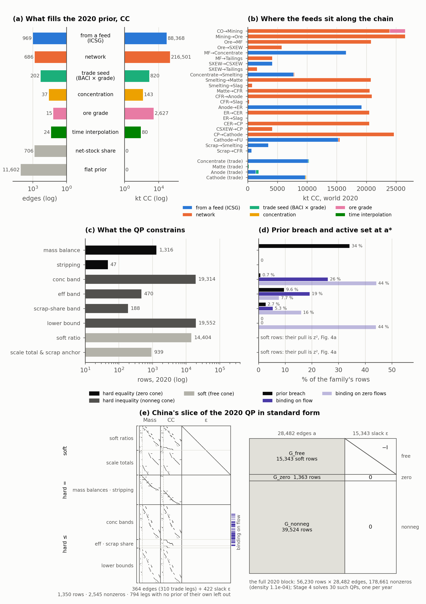
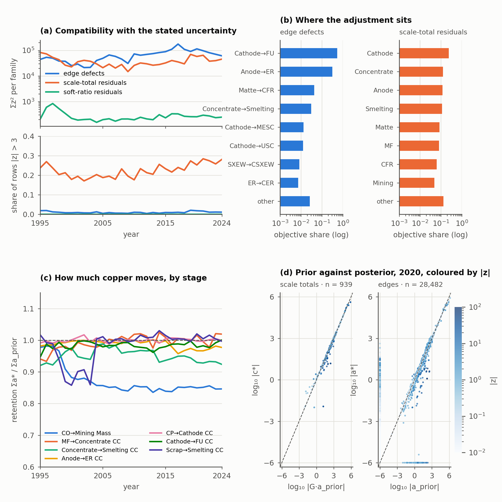
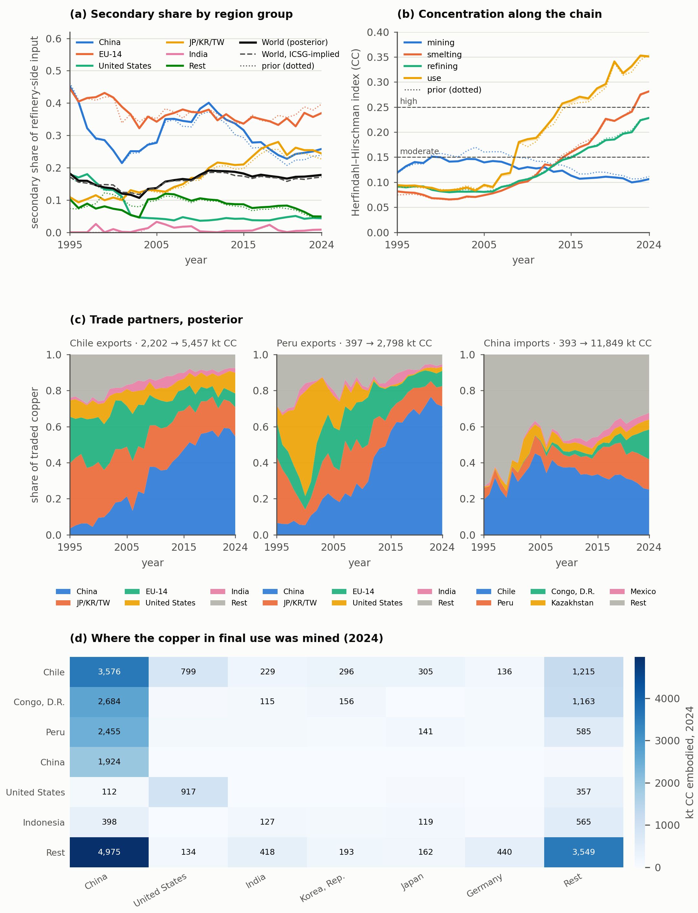

<!--
Results section of the pySUTO model paper. Markdown is the source (2026-09-30).
Numbered Section 4, after the Method (method.md); display items continue the
main-text numbering (Figures 3–5, Table 3).

Every number is read from docs/manuscript/figs/numbers.json, generated by

  python scripts/report/results_figs.py opt_20261019_171746_3272682b \
      --psut-run-id psut_20261019_172448_9cfdd6a9 \
      --tol-pair opt_20260916_124721_c4d1d944 opt_20260930_093914_523d57d7

on the final chain of the manuscript-ready milestone (opt_20261019_171746_3272682b <-
const_20261019_170151_13460e94 <- imp_20261019_165706_dd1ae143; PSUT run
psut_20261019_172448_9cfdd6a9; re-rendered 2026-10-19). The tolerance pair of H-A5 is the base
constraint run const_20260916_123437_8e8e9676 solved at the former production
tolerance (opt_20260916_124721_c4d1d944, gap_rel 1e-3) and at the tolerance of
Table S5 (opt_20260930_093914_523d57d7, gap_rel 1e-6): the same QP, only the
termination rule differs. The eight expectations of Table 3 and their
thresholds were fixed before the numbers were read (SI S15) and are reported
whichever way they fall. No Stage-5 (posterior sigma) number is quoted: none
exists for the copper chain (issue #27). Re-running the script on a later run
regenerates the figures, Table 3 and numbers.json; the prose then needs its
numbers refreshed by hand against numbers.json.

Word budget: <= 1,000 words of prose (headings, captions and Table 3 excluded).

Literature comparisons belong in the Discussion, one per insight; targets to
set each against (all "verify:" — none is in refs.bib yet):
  Insight 1 (secondary share): ICSG yearbook secondary-refined share (in
    refs.bib: icsg2023yearbook / icsg2025yearbook); verify: Gloeser, Soulier &
    Espinoza 2013 (dynamic global copper cycle, secondary share and EoL
    recycling rate); verify: Soulier et al. 2018 (China's copper cycle).
  Insight 2 (concentration): verify: USGS Mineral Commodity Summaries (mine
    and refinery production shares); verify: a copper trade-network study with
    concentration measures (e.g. Dong et al. 2020).
  Insight 3 (embodied vs direct trade): wieland2022piolab (PIOLab embodied
    flows); verify: a copper footprint / RMC study for China.
-->

## 4 Results

Section [4.1](#sec-results-reconciliation) asks whether heterogeneous copper statistics can be reconciled into one consistent PSUT, whether the adjustment this takes is compatible with their stated uncertainty, and where and how much copper moves (Figure [4](#fig-reconciliation), Table [3](#tab-ledger) rows A1–A5). Section [4.2](#sec-results-system) asks what the reconciled, uncertainty-weighted account shows that the source statistics cannot show separately (Figure [5](#fig-copper-system), rows B1–B3). Table 3 fixes each expectation, metric and threshold before the numbers were read (SI S15).

### 4.1 Reconciliation of the copper account

The reference run reconciles 28,482 edges per year against 1,685,939 constraint rows over 30 years; all 30 years return *Solved*. Consistency is exact: the largest hard mass-balance residual in any year is $1.7 \times 10^{-7}$ kt (A1), and no flow other than the three signed stock changes is negative.

<!-- By hand: the paragraph introducing Figure 3, from numbers.json["problem"]. -->

**Figure 3.** The problem the reconciliation is handed in 2020, one of the 30 yearly QPs. (a) Edges and their summed prior in contained copper per provenance: from a feed, or the imputer that filled them (log scales; the efficiency imputer filled none). Flat priors and net-stock shares give an edge no prior of its own and sum to 0 kt. Edges from a feed number 831–1,146 per year over 1995–2024. (b) The world prior per domestic sector pair in chain order and per traded commodity, stacked by provenance; the signed stock-change edges are left out. Feeds pin the commodity edges; the network imputer closes the process recipes between them. (c) Constraint rows per family, coloured by cone. (d) Share of each family's rows that the prior breaches, and of the inequality rows that bind at $a^*$ (the active set, $G a^* - c \geq -10^{-6}$ kt), split by whether any edge of the row carries flow; soft rows have no active set, their pull is the $z^2$ of Figure 4a. (e) China's slice of the QP in Clarabel's standard form $[G_{\mathrm{free}}\ {-I};\ G_{\mathrm{zero}}\ 0;\ G_{\mathrm{nonneg}}\ 0]$: its domestic edges and the trade legs that carry a prior of their own (the 794 legs with none left out), Mass then contained copper, and the slack columns $\varepsilon$ of the soft rows; rows by cone and family, a partner's balance shown by its single entry on a leg; ticks mark the rows binding on flow. Right: the full 2020 block to scale, the zero cone drawn at a minimum height.

Compatibility with the stated uncertainty is a property of the row family, not of the account (Figure 4a). Over the period the objective splits into 63% edge defects, 37% scale-total residuals and 0.3% soft-ratio residuals, but the families differ by an order of magnitude in how often a row is moved beyond its own $3\sigma$: 0.4–2.1% of edges in any year against 17–28% of scale totals, rising after 2010. The sources disagree at the level of reported totals, which ICSG, BACI and the ore allocation cannot all be right about, while individual flows mostly stay within their wider stated uncertainty. A2 fails its pre-registered form only because nine years of 2000–2010 fall to 0.17–0.20 on the scale-total clause.

The edge adjustment is localised on trade (Figure 4b, d). Two sector keys carry 86% of the edge objective, cathode to final use (54%) and anode to electrolytic refining (32%); 94% of it sits on cross-region legs and 74% on legs into the 13 regions that report no smelter, refinery or SX-EW production to ICSG (A3) — Switzerland, the Netherlands, Singapore, Luxembourg and BACI's other trading hubs, whose recorded imports the account cannot absorb. Among scale totals the residual concentrates on cathode (24%) and concentrate (13%) nodes; the ranked identities are in SI S16.

The copper that moves is small downstream and larger upstream (Figure 4c). Over 30 years the account retains 1.000 of the prior refined output, 0.996 of mine output in contained copper and 0.949 of concentrate intake, but only 0.864 of the crude-ore mass; scrap is retained at 0.991 into smelters and 1.016 into refineries. Chile's concentrate exports retain 1.013 over 2010–2019. A4 fails: the ore-mass step holds in 26 of 30 years, the cathode–concentrate step in nine, because both copper stages sit within 0.01 of the prior.

Termination accuracy is a first-order modelling choice (A5). Re-solving the base constraint set at the tightened tolerance, with nothing else changed, moves ore-mass retention from 0.779 to 0.861, concentrate output from 0.873 to 0.930, scrap into smelters from 0.995 to 0.772 and Chile's export retention from 0.574 to 0.893; five of nine stages move by more than 0.02. A retention figure from a $\sigma$-weighted reconciliation needs its termination rule beside it. No posterior $\sigma$ is reported, because Stage 5 has not run on the copper chain (issue #27); uncertainty enters these results only through $\sigma$ in $z$.

**Figure 4.** Reconciliation diagnostics of the reference run. (a) $\sum z^2$ per row family (top) and the share of rows moved beyond $3\sigma$ (bottom), per year. (b) Objective share by sector key, edges (left) and scale totals (right), top eight and other, log scale. (c) Retention $\sum a^*/\sum a_{\mathrm{prior}}$ per stage and year; the dashed line is the prior scale. (d) Prior against posterior in 2020, scale totals (left, $G a_{\mathrm{prior}}$ against $c^*$) and edges (right, $a_{\mathrm{prior}}$ against $a^*$), colour $|z|$; the column at $-6$ is the no-data floor, the row at $-6$ the enforced lower bound.

| id | expectation | metric and threshold (SI S15) | outcome |
| --- | --- | --- | --- |
| A1 | every hard identity closes | max $\lvert G a^* - c\rvert$ over hard mass balances $< 10^{-6}$ kt, all years | $1.7 \times 10^{-7}$ kt — pass |
| A2 | compatibility is family-specific | share of rows with $\lvert z\rvert > 3$: edges $< 0.05$ and scale totals $> 0.20$, every year | edges 0.004–0.021 (30/30); scale totals 0.171–0.284 (21/30) — fail |
| A3 | the adjustment localises on transit trade | share of edge $\sum z^2$ on cross-region legs into merchant hubs $\ge 0.50$ | 0.744 (all cross-region legs 0.937) — pass |
| A4 | the adjustment grows upstream | retention cathode CC $>$ concentrate CC $>$ ore Mass by $\ge 0.02$ per step in $\ge 25$ of 30 years | 6/30 (cathode–concentrate 9, concentrate–ore 26) — fail |
| A5 | termination accuracy does not move the answer | $\lvert\Delta\,\mathrm{retention}\rvert < 0.02$ per stage, base run at gap 1e-3 vs 1e-6 | 4/9 stages within; max 0.223 (scrap into smelters) — fail |
| B1 | secondary share: fidelity and regional order | pooled 2020–24: $\lvert$world posterior $-$ ICSG-implied$\rvert < 0.02$; EU-14 $>$ China $>$ US; EU-14 $\ge 2\times$ world | 0.007; 0.355 $>$ 0.246 $>$ 0.045; 2.06$\times$ — pass |
| B2 | concentration rises downstream and is reconciliation-invariant | HHI 2024: refining, use $>$ mining and $> 0.25$; mining $< 0.15$; $\lvert\mathrm{HHI}_{\mathrm{post}} - \mathrm{HHI}_{\mathrm{prior}}\rvert < 0.01$ | mining 0.106, smelting 0.281, refining 0.228, use 0.351; max $\lvert\Delta\rvert$ 0.005 (mining) — fail |
| B3 | embodied exceeds direct; Chile's exports turned to China | China's embodied mined Cu from Chile+Peru $\ge 1.10\times$ its direct concentrate imports from them (2024); Chile's export share to China $< 0.10$ (1995), $> 0.50$ (2024) | 6,031 / 4,222 kt CC $= 1.43$; 0.035 $\to$ 0.545 — pass |

**Table 3.** The pre-registered expectations of this section and their outcomes on the reference run. Thresholds were fixed before the numbers were read; definitions, the reason each benchmark is or is not independent of the inputs, and the per-row numbers are in SI S15.

### 4.2 The copper system in one consistent account

The three insights below are read from one account, so each quantity respects every balance of Figure 2 in every region and year and can be set beside its prior.

**Secondary copper.** On the input side of refining — scrap into smelters and refineries over scrap, concentrate intake and SX-EW cathode — the world posterior share is 0.173 pooled over 2020–2024, within 0.02 of the 0.165 implied by the ICSG feed and beside ICSG's published 0.178 for 2024 (B1; the benchmark is an input, so this is fidelity, not validation). The regional picture the world number hides is stable across prior and posterior (Figure 5a): the EU-14 refine at 0.355, twice the world share, lowered by 0.021 against their prior, the largest such move; Japan, Korea and Taiwan at 0.251; China at 0.246, lifted by 0.019; the United States at 0.045, because direct melt lies outside the boundary; India at 0.005; Chile and Peru at zero. The secondary share is a regional property of refining, not a global rate.

**Concentration along the chain.** The Herfindahl–Hirschman index of producer regions is drawn as a band whose width is the treatment of the rest-of-world aggregate (Figure 5b); it is 0.004 or less in 1995 and 2024. In 1995 every step was unconcentrated (0.08–0.12). By 2024 mining is still 0.106, with Chile at 0.23 of world output, while smelting stands at 0.281, refining at 0.228 and final use at 0.351, with China at 0.52, 0.45 and 0.58 of the respective totals. Concentration rises downstream of the mine and crosses the 0.25 line for smelting and use, but not for refining; B2 fails on that clause alone, since the reconciliation moves no step's index by more than 0.005.

**Trade relations.** Chile's exports of concentrate and cathode went from 2,202 kt CC in 1995, a third to Japan, Korea and Taiwan and a quarter to the EU-14, to 5,457 kt CC in 2024, 0.545 of them to China; Peru's from 397 to 2,798 kt CC, 0.712 to China; China's imports of concentrate, anode and cathode from 393 to 11,849 kt CC, 0.251 from Chile, 0.168 from Peru and 0.165 from the D.R. Congo (Figure 5c). The embodied view of Figure 5d is what a consistent PSUT adds. Propagating extraction through the process network, 16,123 kt CC of the copper in 2024's final use, 56% of world extraction, was consumed in China: 1,924 kt from Chinese mines, 3,576 from Chile, 2,684 from the D.R. Congo and 2,455 from Peru. Chile and Peru together supply 6,031 kt CC of China's consumption, 1.43 times the 4,222 kt CC they ship to China directly as concentrate; the rest arrives as cathode refined elsewhere or as anode through third countries (B3). Chile's share of exports going to China rose from 0.035 to 0.545.

**Figure 5.** The copper system in the reconciled account. (a) Secondary share of refinery-side input by region group, posterior (solid) and prior (dotted), with the world posterior and the ICSG-implied share; Chile+Peru (zero) omitted. (b) Herfindahl–Hirschman index of producer regions per step in contained copper, posterior with the ROW band (upper edge: ROW as one region; lower: ROW contributing nothing) and prior dotted; *use* is cathode into semis fabrication by destination, since the account has no fabrication process. (c) Posterior partner shares of the traded commodities for Chile and Peru (exports, by destination group) and China (imports, by origin; the five largest 2020–24 origins named). (d) Embodied extraction in 2024: kt CC mined in the row region and embodied in the final use of the column region, the six largest of each and Rest, from the market-share PIOT at level $L$.
