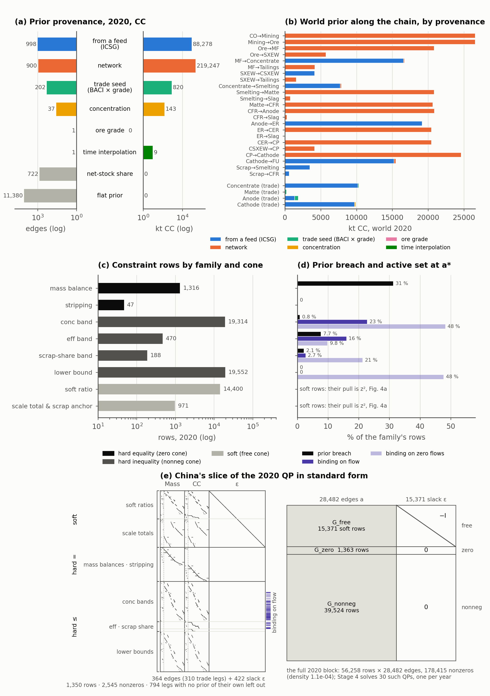
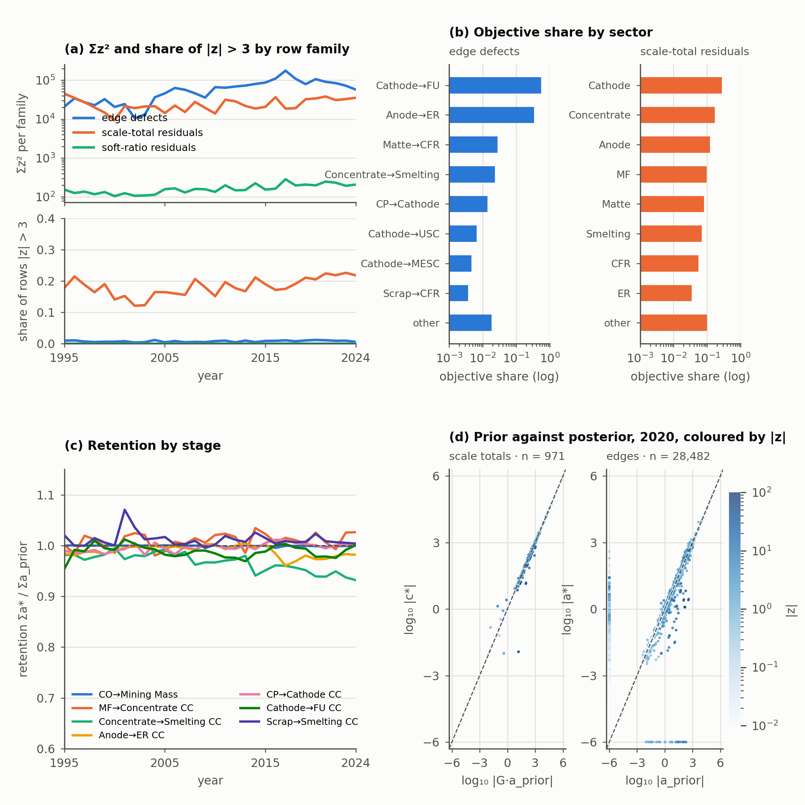
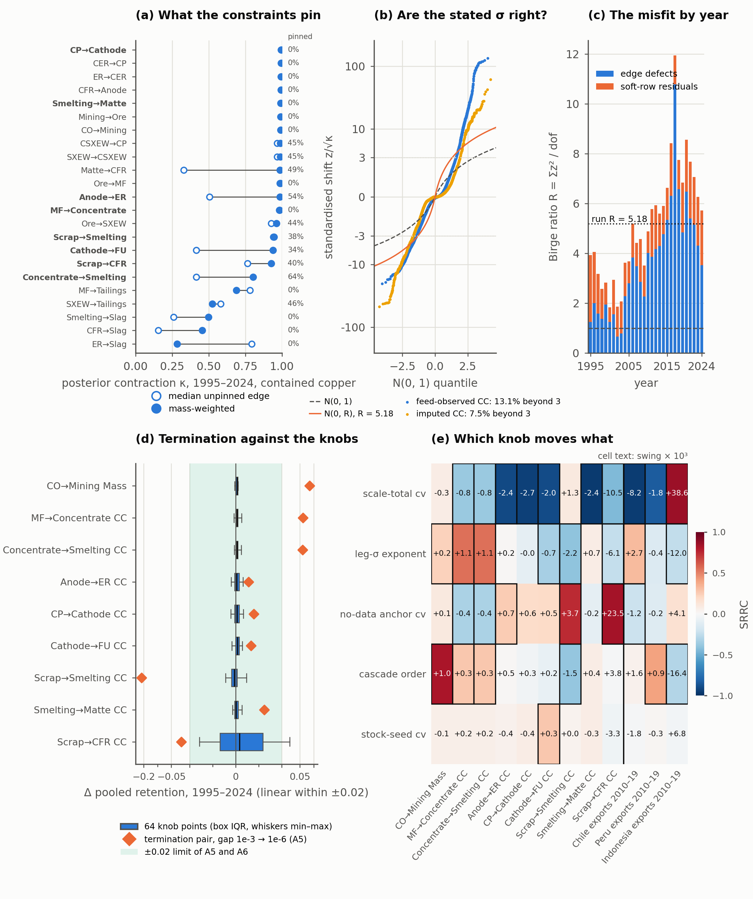
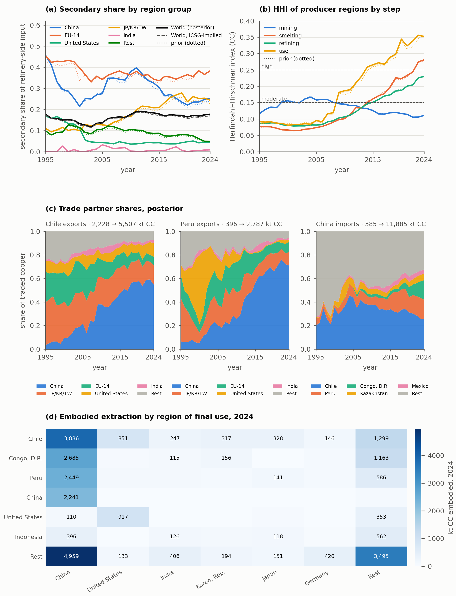

<!--
Results section of the pySUTO model paper. Markdown is the source (2026-09-30).
Numbered Section 4, after the Method (method.md); display items continue the
main-text numbering (Figures 3–6, Table 3). The whole section is drafted as
bullet points (Section 4.2 on 2026-11-10, Sections 4, 4.1 and 4.3 on 2026-11-12):
one result per bullet, stated with its quantity, valuation, window and base, then
its display item and ledger row. Prose follows once the content is agreed; the
captions are prose and describe what is drawn, never what it shows.

Every number is read from docs/manuscript/figs/numbers.json, generated by

  python scripts/report/results_figs.py opt_20261022_112855_928da10c \
      --psut-run-id psut_20261029_095807_61a70a1a \
      --tol-pair opt_20260916_124721_c4d1d944 opt_20260930_093914_523d57d7 \
      --uncprop-run-id uncprop_20261029_090754_0446e784 \
      --sweep-id sweep_20261102_145601_8413cace

on the final chain of the manuscript-ready-3 milestone (opt_20261022_112855_928da10c <-
const_20261022_111531_df61bf5c <- imp_20261022_111102_1b49a2b3; PSUT run
psut_20261029_095807_61a70a1a; re-rendered 2026-10-29). The tolerance pair of H-A5 is the base
constraint run const_20260916_123437_8e8e9676 solved at the former production
tolerance (opt_20260916_124721_c4d1d944, gap_rel 1e-3) and at the ADR 0039
tolerance (opt_20260930_093914_523d57d7, gap_rel 1e-6), both for the flows: the
same QP, only the termination rule differs. The reference run itself solves for
the defects at gap 1e-8 (Table S5, issue #33). The nine expectations of Table 3 and their
thresholds were fixed before the numbers were read (SI S15) and are reported
whichever way they fall. H-A6 is judged on the knob sweep sweep_20261102_145601_8413cace
(64 points around this run, issue #108): its numbers come from the sweep's diag tables
(scripts/sweep_diag.py), keyed in docs/manuscript/figs/manuscript_numbers.json (group 12 of
scripts/report/manuscript_numbers.py) and, since 2026-11-10, read again by results_figs.py
into numbers.json["sweep"] for Figure 5d–e. Stage-5 (posterior sigma) numbers are from
uncprop_20261029_090754_0446e784 (numbers.json["stage5"], Figure 5a–c), the calibration's
method from the #87 REP
(analysis_uncprop_20261021_134829_ad7e8d62_20261022_issue87-calibration.md), and the
Birge-scaled intervals beside Table 3 from scripts/report/table3_intervals.py on the same
two runs (#81, docs/manuscript/figs/table3_intervals.csv). Re-running the script on a later run
regenerates the figures, Table 3 and numbers.json; the prose then needs its
numbers refreshed by hand against numbers.json.

Word budget: <= 1,300 words of prose (headings, captions and Table 3 excluded; raised
from 1,000 on 2026-11-10 for Section 4.2's display item).

Literature comparisons belong in the Discussion, one per insight; targets to
set each against (all "verify:" — none is in refs.bib yet):
  Insight 1 (secondary share): ICSG yearbook secondary-refined share (in
    refs.bib: icsg2023yearbook / icsg2025yearbook); verify: Gloeser, Soulier &
    Espinoza 2013 (dynamic global copper cycle, secondary share and EoL
    recycling rate); verify: Soulier et al. 2018 (China's copper cycle).
  Insight 2 (concentration): verify: USGS Mineral Commodity Summaries (mine
    and refinery production shares); verify: a copper trade-network study with
    concentration measures (e.g. Dong et al. 2020).
  Insight 3 (embodied vs direct trade): wieland2022piolab (PIOLab embodied
    flows); verify: a copper footprint / RMC study for China.
Interpretations moved out of the Results on 2026-11-12, for the Discussion:
  A2: the scale-total share beyond 3 sigma says the sources disagree on reported
    totals (ICSG, BACI and the ore allocation cannot all hold), while single flows
    mostly stay within their wider stated sigma.
  A3: the recorded imports of the non-processing regions are more than the account
    can place, since nothing downstream of them processes copper.
  B2: the 2023 U.S. Merger Guidelines (refs.bib dojftc2023mg, verify:) put "highly
    concentrated" at 0.18 instead of the 2010 guidelines' 0.25; refining (0.230) is
    highly concentrated under the 2023 line. The pre-registered threshold stays 0.25.
-->

## 4 Results

- Section [4.1](#sec-results-reconciliation) tests consistency and the compatibility, location and size of the adjustment (Figures [3](#fig-problem)–[4](#fig-reconciliation); Table [3](#tab-ledger), rows A1–A4).
- Section [4.2](#sec-results-uncertainty) reports the posterior uncertainty and the sensitivity of retention to termination and to the judgement values (Figure [5](#fig-uncertainty); rows A5–A6).
- Section [4.3](#sec-results-system) reports what the reconciled account shows beyond the separate sources (Figure [6](#fig-copper-system); rows B1–B3).

### 4.1 Reconciliation of the copper account

<!-- Numbers: numbers.json top level and ["problem"] (Figure 3); the |z| > 3 means and the A2 years from manuscript_numbers.json group 9 (results:L60.*); the 0.864 -> 0.998 pair from the #33 REP (analysis_opt_20261020_112726_2f451f31_20261020_issue33-defects.md). -->

**Problem and consistency (Figure 3; A1).**

- The reference run reconciles 28,482 edges per year against 1,687,230 constraint rows over 1995–2024; all 30 yearly QPs return *Solved*.
- A1 fails at the numerical floor: the largest hard mass-balance residual is $1.1 \times 10^{-6}$ kt (threshold $10^{-6}$ kt). Only the three signed stock-change edges take negative values.
- In 2020, 998 of the 14,241 contained-copper edges carry a feed prior (88,278 kt CC summed) and 900 a network-imputer prior (219,247 kt CC); 12,102 carry none of their own (Figure 3a). Feed priors sit on the commodity edges, imputed priors on the process recipes between them (Figure 3b).
- The 2020 prior breaches 411 of the 1,316 hard mass balances. At $a^*$, 13,703 of the 19,314 concentration bands bind, 4,395 of them on rows with flow, and all 9,314 binding lower bounds hold an edge at zero (Figure 3d).

**Compatibility with the stated uncertainty (Figure 4a; A2).**

- Over 1995–2024 the objective splits into 70% edge defects, 29% scale-total residuals and 0.2% soft-ratio residuals.
- The share of rows with $\lvert z\rvert > 3$ is 0.004–0.012 for edges and 0.121–0.226 for scale totals in any year.
- A2 fails on its scale-total clause in 21 years, all before 2019 (0.121–0.197); the edge clause holds in all 30.

**Localisation of the adjustment (Figure 4b, d; A3).**

- Cathode→FU (56%) and Anode→ER (34%) carry 90% of the edge objective, and cross-region legs 95%.
- A3 passes: 79% lies on legs into the 13 non-processing regions, which report no smelter, refinery or SX-EW production to ICSG (SI S15.1), a set of trading economies, fabricators and three mine-only exporters.
- Among scale totals, cathode (27%) and concentrate (17%) nodes carry the largest shares (SI S16).

**Magnitude of the adjustment (Figure 4c; A4).**

- Pooled retention over 1995–2024 lies between 0.963 (Concentrate→Smelting CC) and 1.026 (Scrap→CFR CC) for all nine stages of Table S19; refined output retains 0.998, mine output 1.010 and crude-ore mass 0.999. Chile's concentrate exports retain 1.025 over 2010–2019.
- A4 fails in every year: with all three stages within 0.04 of 1 in each year, the concentrate–ore step reaches the 0.02 gradient in 10 years and the cathode–concentrate step in 1.
- The upstream deletion A4 anticipated, a crude-ore mass retention of 0.864 on the previous reference chain (`opt_20261019_171746_3272682b`), was a termination artefact: solved for the defects at a relative gap of $10^{-8}$, the same QPs retain 0.998 (`opt_20261020_112726_2f451f31`, issue #33).

**Figure 3.** Structure of the 2020 reconciliation problem of the reference run, one of its 30 yearly QPs. (a) Number of contained-copper edges (left) and their summed prior (right, kt CC) per provenance of the prior: a feed, or the imputer that wrote it; log scales. Flat priors and net-stock shares give an edge no prior of its own and sum to 0 kt CC; the efficiency imputer wrote no edge. (b) World prior in kt CC per domestic sector pair, in chain order, and per traded commodity, stacked by provenance; the signed stock-change edges are omitted. (c) Constraint rows per family, coloured by cone. (d) Per family, the share of rows the prior breaches, and the share of inequality rows that bind at $a^*$ (the active set, $G a^* - c \geq -10^{-6}$ kt), split by whether any edge of the row carries flow; soft rows have no active set, and their contribution is the $z^2$ of Figure 4a. (e) China's slice of the QP in Clarabel's standard form $[G_{\mathrm{free}}\ {-I};\ G_{\mathrm{zero}}\ 0;\ G_{\mathrm{nonneg}}\ 0]$. Columns: China's domestic edges and the trade legs that carry a prior of their own (the 794 legs without one are omitted), Mass then contained copper, followed by the slack columns $\varepsilon$ of the soft rows. Rows: grouped by cone and family; a partner's balance appears as its single entry on a leg; ticks mark the rows binding on flow. Right: the full 2020 block to scale, with the zero cone drawn at a minimum height.

**Figure 4.** Reconciliation diagnostics of the reference run, 1995–2024. (a) $\sum z^2$ per row family (top; edge defects, scale-total residuals, soft-ratio residuals; log scale) and the share of each family's rows with $\lvert z\rvert > 3$ (bottom), per year. (b) Objective share within the family over all years, by sector pair for edges (left) and by node sector for scale totals (right): the eight largest and the remainder (other), log scale. (c) Retention $\sum a^*/\sum a_{\mathrm{prior}}$ per stage of Table S19 and year; the dashed line marks retention 1, the prior scale. (d) Prior against posterior in 2020 on $\log_{10}$ kt axes, for scale totals (left, $\lvert G a_{\mathrm{prior}}\rvert$ against $\lvert c^*\rvert$) and edges (right, $\lvert a_{\mathrm{prior}}\rvert$ against $\lvert a^*\rvert$), coloured by $\lvert z\rvert$ (grey: no finite $z$); values below $10^{-6}$ kt are drawn at $-6$, so the column at $-6$ is the no-data floor and the row at $-6$ the enforced lower bound; dashed, the identity line.

### 4.2 Uncertainty of the edges and sensitivity to the knobs

<!-- Numbers: numbers.json["stage5"] (a–c), ["tolerance_pair_retention"] and ["sweep"] (d–e), ["link"] (the ρ bullet and the stages' κ); the breach range of the no-data anchor cv, the slag-leg ranges and the Round-E (c) counts from manuscript_numbers.json group 12 (results:L73.*, si:S15.4.*). -->

**Posterior contraction and calibration (Figure 5a–c).**

- Mass-weighted posterior contraction is 0.96–0.995 from ore to cathode, 0.93–0.95 on the scrap legs and Cathode→FU, 0.80 on Concentrate→Smelting, 0.53–0.69 on the tailings and 0.28–0.50 on the slag legs (Figure 5a).
- At trade-fed nodes the median over unpinned edge-years is lower, 0.41 for Concentrate→Smelting CC (64% of its edge-years pinned at a bound) and 0.51 for Anode→ER CC: the balances constrain a node's total more than its split over partners.
- The standardised shifts $z/\sqrt{\kappa}$ of the contained-copper edges have a narrower core and a heavier tail than $N(0,1)$ (Figure 5b): median 0.46 (feed-observed) and 0.16 (imputed) against 0.67, and 13.1% and 7.5% beyond 3 against 0.27%.
- The Birge ratio $R = \sum z^2/\mathrm{dof}$ is 5.18 over the run and 1.83 (2000) to 11.94 (2017) by year (Figure 5c). Intervals are therefore Birge-scaled, $a^* \pm 1.96\sqrt{R}\,\sigma_{a^*}$, and remain lower bounds in the tail: 4.1% of the feed-observed contained-copper edges lie beyond 3 scaled units, the source contradictions of Section 3.2.8.

**Termination and judgement values (Figure 5d–e; A5, A6).**

- A5 fails: re-solving the base constraint run of 2026-09-16, not the reference chain, at the tightened tolerance changes five of the nine stages by more than 0.02, Scrap→Smelting CC by 0.223 (Figure 5d).
- A6 fails: across the 64 points of the knob sweep no stage changes by more than 0.005 except Scrap→CFR CC, by up to 0.030 and by more than 0.02 at five points; A6 holds at 59 of 64 points- Two $\sigma$ knobs rank first on nine of the twelve outcomes (Figure 5e): the scale totals' coefficient of variation on smelting, refining, final use and the three exporters ($\lvert\mathrm{SRRC}\rvert$ 0.83–0.95), and the no-data anchor's on both scrap legs (+0.75, +0.84); ten of the 15 knobs are influential on none.
, and its five breaches occur at a no-data anchor coefficient of variation of 0.080–0.093, 1.6–1.9 times the shipped value.
- Indonesia's concentrate export retention (2010–2019) spans ±0.033, with the sign opposite to Chile's on the scale totals' coefficient of variation (SRRC +0.86 against −0.95); the Round-E (c) item of the stop rule holds at 18 of 64 points. The slag legs change most of any contained-copper category (CFR→Slag CC −0.052 to +0.039).
- Over the 23 contained-copper categories with a retention, the sweep's largest $\lvert\Delta\rvert$ and the mass-weighted $1-\kappa$ are rank-correlated (Spearman $\rho = 0.49$, $p = 0.02$; gross mass 0.20, $p = 0.35$): the slag legs lead both rankings, Scrap→CFR CC ($\kappa$ 0.93) is the exception. The sweep is local, around one chain (SI S15.4).

**Figure 5.** Posterior uncertainty of the edges and sensitivity of retention to the termination rule and to the knobs, reference run. (a) Posterior contraction $\kappa = 1 - \sigma_{a^*}^2/\sigma_a^2$ per contained-copper category (sector pair) over 1995–2024, for the 23 categories with a retention in the knob sweep, sorted by the mass-weighted mean (filled marker; weight $\max(\lvert a_{\mathrm{prior}}\rvert, \lvert a^*\rvert)$). Open marker: the median over the edge-years not pinned at a bound, a pinned edge-year's $\kappa$ being 1 by construction; margin: the pinned share; bold labels: the eight Table S19 stages in contained copper (the ninth, the ore stage, is in gross mass). The contraction per prior class and valuation is in SI S6.2 and Figure S2. (b) QQ plot of the standardised shift $z/\sqrt{\kappa}$ of the contained-copper edges that are not pinned at a bound, not flat and have $\kappa \ge 0.01$, by prior class, against $N(0,1)$ (dashed) and $N(0,R)$ at the run's Birge ratio (orange); symlog axes with both tails drawn in full; the legend gives each class's share beyond 3 (0.27% expected under $N(0,1)$). (c) Birge ratio per year, stacked by the shares of $\sum z^2$ on edge defects and on soft rows; dashed, $R = 1$; dotted, the run's $R$. (d) Change in pooled retention over 1995–2024 per stage: the 64 points of the knob sweep against the reference run (box: interquartile range; whiskers: minimum–maximum) and the termination pair (diamond: the base constraint run of 2026-09-16, an earlier chain whose retention differs from the reference run's, solved at relative gaps of $10^{-3}$ and $10^{-6}$; SI S15.3); the axis is linear within the ±0.02 limit of A5 and A6 and logarithmic beyond it. (e) Standardised rank regression coefficient (SRRC, colour) and swing (text, in thousandths of retention) of the five knobs influential on at least one criterion outcome, over the nine stages of A6 (left of the line) and the three exporters of Round-E (c); boxed cells are influential ($\lvert\mathrm{SRRC}\rvert \ge 0.2$ with $R^2 \ge 0.5$). Stage 5 and the design of the sweep are described in SI S6 and S15.4.

| id | expectation | metric and threshold (SI S15) | outcome |
| --- | --- | --- | --- |
| A1 | every hard identity closes | max $\lvert G a^* - c\rvert$ over hard mass balances $< 10^{-6}$ kt, all years | $1.1 \times 10^{-6}$ kt — fail |
| A2 | compatibility is family-specific | share of rows with $\lvert z\rvert > 3$: edges $< 0.05$ and scale totals $> 0.20$, every year | edges 0.004–0.012 (30/30); scale totals 0.121–0.226 (9/30) — fail |
| A3 | the adjustment localises on transit trade | share of edge $\sum z^2$ on cross-region legs into the 13 non-processing regions $\ge 0.50$ | 0.787 (all cross-region legs 0.947) — pass |
| A4 | the adjustment grows upstream | retention cathode CC $>$ concentrate CC $>$ ore Mass by $\ge 0.02$ per step in $\ge 25$ of 30 years | 0/30, also at the upper ends of the intervals (cathode–concentrate 1, concentrate–ore 10) — fail |
| A5 | termination accuracy does not move the answer | $\lvert\Delta\,\mathrm{retention}\rvert < 0.02$ per stage, base run at gap 1e-3 vs 1e-6 | 4/9 stages within; max 0.223 (scrap into smelters) — fail |
| A6 | judgement values do not move the answer | $\lvert\Delta\,\mathrm{retention}\rvert < 0.02$ per stage at every point of a 64-point sweep over 15 knobs | 59/64 points; max 0.030 (scrap into refineries), other stages $\le 0.005$ — fail |
| B1 | secondary share: fidelity and regional order | pooled 2020–24: $\lvert$world posterior $-$ ICSG-implied$\rvert < 0.02$; EU-14 $>$ China $>$ US; EU-14 $\ge 2\times$ world | 0.007 [0.005, 0.010]; 0.370 [0.367, 0.374] $>$ 0.240 [0.234, 0.245] $>$ 0.045 [0.044, 0.047]; 2.16$\times$ [2.12, 2.20] — pass |
| B2 | concentration rises downstream and is reconciliation-invariant | HHI 2024: refining, use $>$ mining and $> 0.25$; mining $< 0.15$; $\lvert\mathrm{HHI}_{\mathrm{post}} - \mathrm{HHI}_{\mathrm{prior}}\rvert < 0.01$ | mining 0.111 [0.108, 0.114], smelting 0.281 [0.275, 0.287], refining 0.230 [0.226, 0.234], use 0.352 [0.344, 0.361]; max $\lvert\Delta\rvert$ 0.003 (use; $\Delta$ [−0.012, 0.006]) — fail |
| B3 | embodied exceeds direct; Chile's exports turned to China | China's embodied mined Cu from Chile+Peru $\ge 1.10\times$ its direct concentrate imports from them (2024); Chile's export share to China $< 0.10$ (1995), $> 0.50$ (2024) | 6,335 / 4,254 kt CC $= 1.49$ [1.42, 1.55]; 0.034 [0.029, 0.040] $\to$ 0.548 [0.523, 0.572] — pass |

**Table 3.** The pre-registered expectations of Section 4 and their outcomes on the reference run. Thresholds were fixed before the numbers were read; definitions, the reason each benchmark is or is not independent of the inputs, and the per-row numbers are in SI S15; A6 is judged on a knob sweep around the reference run (SI S15.4). Brackets give Birge-scaled 95% posterior intervals ($\sqrt{R} = 2.28$), computed from the covariance the constraints induce between the flows of each total, by the delta method for ratios and indices and from 200 posterior draws for the embodied ratio (Section 3.1.7, issue #81); pinning or freeing the bounds the active set leaves ambiguous moves none of them by more than 0.002 (issue #99).

### 4.3 The copper system in one consistent account

<!-- Numbers: numbers.json Part B keys; the ratios (EU-14 / world, the largest lift, ΔHHI, China's footprint share, B3's comparator over all four traded goods) from manuscript_numbers.json group 9 (results:L95.*, results:L97.*, results:L99.*). -->

- All quantities below come from one reconciled account that satisfies every hard balance of Figure 2 and gives each a prior counterpart.

**Secondary copper (Figure 6a; B1).**

- The world posterior secondary share on the input side of refining (scrap over scrap, concentrate intake and SX-EW cathode, contained copper) is 0.172 pooled over 2020–2024, 0.007 [0.005, 0.010] above the 0.164 implied by the ICSG feed. B1's fidelity clause passes; the benchmark is an input, so this tests fidelity, not validation.
- Regional shares over 2020–2024 range from 0 to 0.370: EU-14 0.370 (2.16 times the world share), Japan, Korea and Taiwan 0.249, China 0.240, the United States 0.045, India 0.005, Chile and Peru 0. The low United States share reflects the boundary: scrap enters the account only into smelters and fire refineries (Figure 2), not as direct melt.
- The reconciliation keeps the regional order and moves no group's share by more than 0.014 (Japan, Korea and Taiwan). The world share is thus a mass-weighted mean over groups that differ by up to 0.370, not a common rate.

**Concentration along the chain (Figure 6b; B2).**

- The Herfindahl–Hirschman index (HHI) of producer regions per step (contained copper) moves by at most 0.004 with the treatment of the rest-of-world aggregate. In 1995 all four steps lay at 0.08–0.12, below the 0.15 threshold for moderate concentration ([U.S. DOJ and FTC, 2010](#ref-dojftc2010hmg)).
- In 2024 the HHI is 0.111 in mining (Chile 0.24 of world output) and 0.281 in smelting, 0.230 in refining and 0.352 in final use (China 0.52, 0.45 and 0.58).
- B2 fails on the refining clause: every downstream step exceeds mining, but only smelting and final use exceed the 0.25 threshold for high concentration, and refining's interval [0.226, 0.234] lies wholly below it. The invariance clause holds at the point estimates (largest $\lvert\Delta\rvert$ 0.003, final use), but the final-use interval [−0.012, 0.006] extends beyond −0.01.

**Trade relations (Figure 6c–d; B3).**

- Chile's exports of concentrate, matte, anode and cathode rose from 2,228 kt CC in 1995 to 5,507 kt CC in 2024, and China's share of them from 0.034 to 0.548. Peru's rose from 396 to 2,787 kt CC (0.710 to China in 2024), China's imports from 385 to 11,885 kt CC (Figure 6c).
- In the market-share PIOT of 2024, China's final use embodies 16,727 kt CC of extracted copper, 56% of world extraction (29,620 kt CC), 3,886 kt CC of it mined in Chile (Figure 6d).
- B3 passes: China's final use embodies 6,335 kt CC mined in Chile and Peru, 1.49 [1.42, 1.55] times its direct concentrate imports from them (4,254 kt CC). Against its direct imports of all four goods (4,996 kt CC) the ratio is 1.27, and 1,339 kt CC is matched by no direct import from the two countries.
- Only an account linking extraction to final use through every process and region attributes these 1,339 kt CC to China.

**Figure 6.** Secondary share, concentration and trade relations in the reconciled account of the reference run, 1995–2024, contained copper. (a) Secondary share of refinery-side input (SI S15.2) per region group and year, posterior (solid) and prior (dotted), with the world posterior and the ICSG-implied share; Chile and Peru (share zero) are omitted. (b) Herfindahl–Hirschman index of producer regions per step, posterior with the rest-of-world band (upper edge: ROW as one region; lower edge: ROW omitted) and prior (dotted); *use* is cathode into final use by destination, since the account has no fabrication process. (c) Posterior partner shares of the four traded goods (concentrate, matte, anode, cathode) for the exports of Chile and Peru, by destination group, and the imports of China, by origin (the five largest origins of 2020–2024 named). (d) Embodied extraction in 2024, in kt CC: copper mined in the row region and embodied in the final use of the column region, for the six largest regions of each and the remainder (Rest), from the Leontief inverse of the market-share PIOT.
