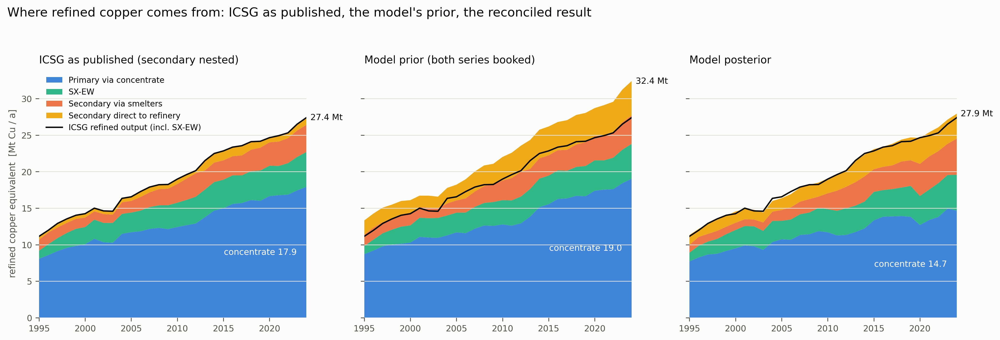
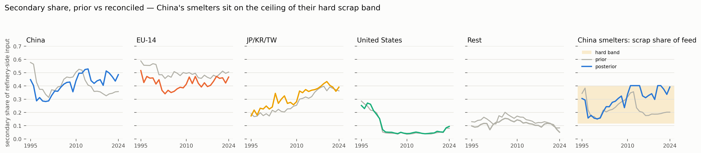
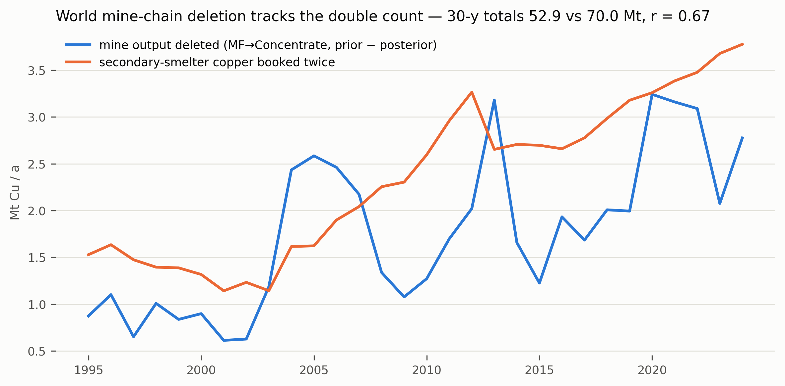
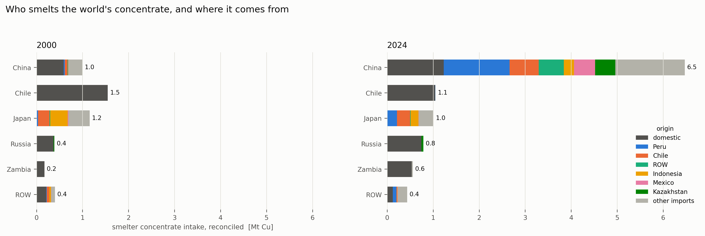
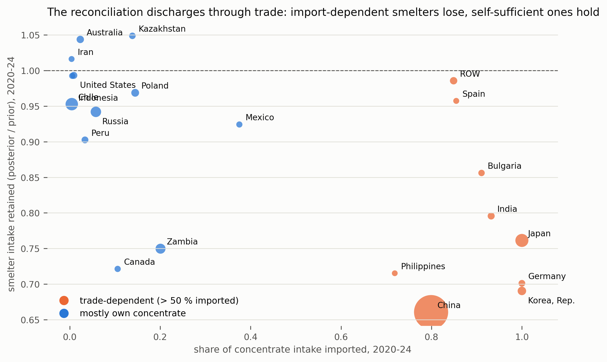
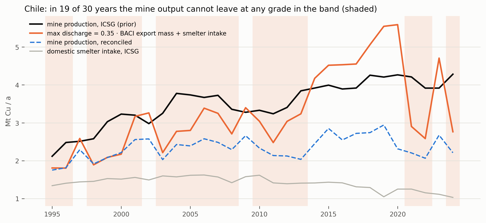
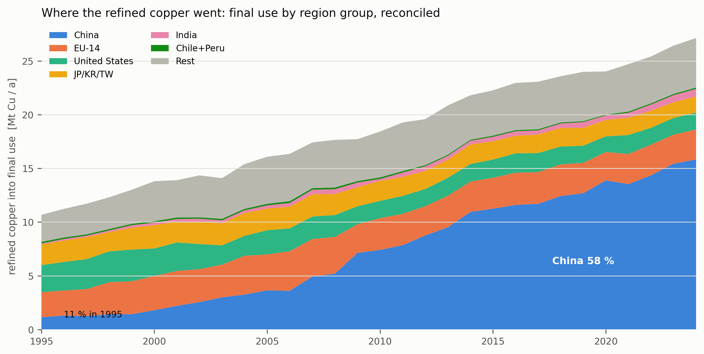
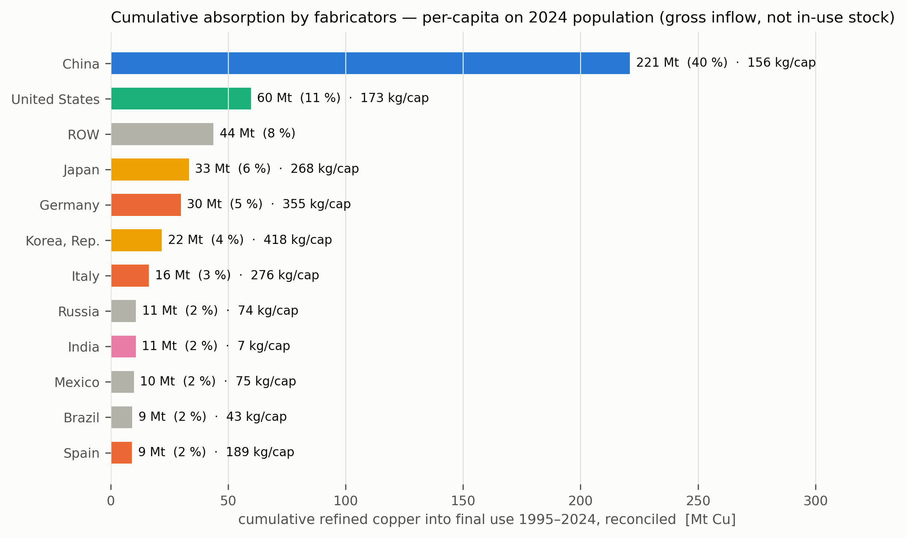
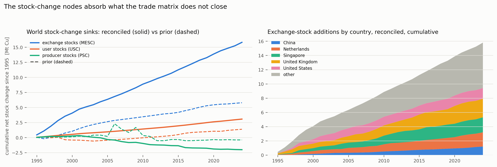
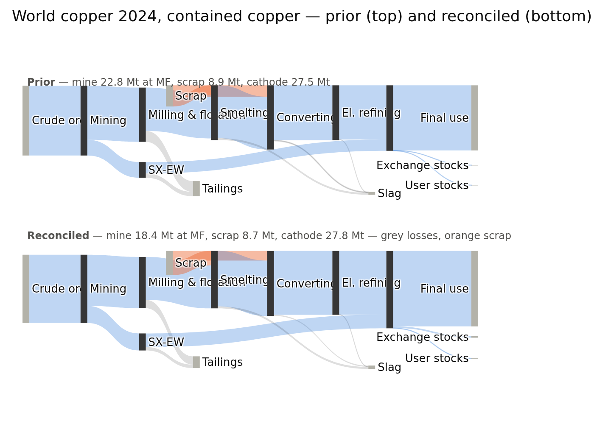

# Three insights into the global copper supply chain — what the reconciled model says, and where it is wrong

**Run analysed:** `opt_20260916_124721_c4d1d944` (`roundM_revert_verify` — the latest solve, on the
current params state) · const `const_20260916_123437_8e8e9676` · imp `imp_20260916_122935_c181bc96`
**Inputs:** acc copper v3 · params conc v8, eff v3, ore_grade v7, stock_bounds v4, scrap_share v1 ·
feeds icsg `20260915_125054_6a38584a`, baci `20260915_122645_ef721a4b` (v8, netted), crude_ore
`20260603_095651_558f7369` · **30/30 Solved**, Σ objective −27,029,228
**Equivalence:** the shipped Round L run `opt_20260915_131115_b8bf05a9` differs by 0.0017 % in
objective and gives the same headline numbers to three figures (posterior secondary share 0.301 vs
0.300; 30-y mine deletion 52,896 vs 52,871 kt). Everything below is reproduced by
`python scripts/report/copper_metabolism_insights.py [--opt <run>]`, which writes the tables,
figures and `data.json` under `docs/rep/figs/metabolism_<run>/`.
**Date:** 2026-09-17 · **Written for:** the project (internal REP). · **Interactive companion:** https://claude.ai/artifact/5wEVC6bUeMWbbyRnrU8Dhu

*Reading the numbers:* **prior** = the Stage-2 aggregate the QP starts from (feeds + imputation);
**posterior / reconciled** = the QP solution; **retention** = Σ posterior / Σ prior over an edge
set. All flows are contained copper (kt or Mt Cu) unless stated.

---

## The three insights in three sentences

1. **Secondary copper is 17 % of the world's refined output and has been flat at that share since
   2010** — and this model reported 30 % because ICSG's secondary-*smelter* series is already inside
   its secondary-*refined* series and the parse books both as inputs; that double count is,
   arithmetically, the mine-chain deletion this project has chased for nine rounds.
2. **The mine→smelter link has moved to China** (7 % → 42 % of world smelter intake, 81 % of it
   imported) **and the world's books do not close across it**: trade-dependent smelters lose
   20–35 % of their intake in reconciliation while self-sufficient ones hold.
3. **The in-use stock has moved east** — 40 % of all refined copper put into use since 1995 went to
   China, 58 % of the 2024 flow — and the secondary geography that follows from it is invisible to
   a model in which scrap is untraded and the stock-change nodes serve as buffers.

---

## Insight 1 — Secondary copper: 17 %, flat, and double-counted

### The world

Read straight from the ICSG feed (`data/input/feed/icsg/current/values.csv`, input rows converted
back to production with the eff nominals):

| 2024, kt Cu | |
|---|---|
| refined output incl. SX-EW | 27,397 |
| of which secondary refined (`Refinery Second.`) | **4,706 = 17.2 %** |
| of which secondary *smelter* production (`Smelter Second.`) | 3,958 |
| secondary share 2010 → 2024 | **0.170 → 0.172** |
| refined output 2010 → 2024 | **+44 %** |

Recycling has kept pace with the growth of refined output and has not gained on it in fifteen
years. That is consistent with everything published: ICSG's recycling input rate "averaged about
16 % over the last decade" ([Recycling Today on ICSG](https://www.recyclingtoday.com/news/icsg-copper-surplus-2025-rising-inventories-shanghai-china-recycling/));
UNCTAD puts 2023 secondary refined at 4.5 Mt, "nearly 20 %"
([UNCTAD Global Trade Update, May 2025](https://unctad.org/publication/global-trade-update-may-2025-critical-minerals-copper));
the RCR 2023 study of end-of-life recycling finds EoL-derived supply at 23 % of demand today and
no higher than 49.6 % by 2050 even under its most optimistic collection scenario, 33.4 % on average
over the next three decades
([Resources, Conservation & Recycling 2023](https://www.sciencedirect.com/science/article/pii/S0921344923004524));
the IEA's figure for the global EoL recycling rate is 40 %
([IEA via Fastmarkets](https://www.fastmarkets.com/insights/copper-recycling-must-accelerate-to-meet-green-energy-demand-iea-says/)).
The first break in the flat trend is only projected: ICSG expects secondary refined output +5.8 %
in 2025 and +6.4 % in 2026 against ~3 % primary
([ICSG forecast](https://www.recyclingtoday.com/news/copper-icsg-recycling-output-refining-supply-demand-2026-2027/)).

### The model

The posterior's secondary share of refinery-side input (scrap into Smelting + CFR over scrap +
concentrate + SX-EW) is **0.300 over 2020-24**, its prior 0.258 — both far above ICSG's 0.17, and
the posterior has been *rising* since 2020 (0.32 in 2020) while the published share is flat.

The cause is in `scripts/parse/icsg_parse/icsg_clean.py:18-22`. ICSG publishes two secondary
*production* series and the parse converts both into *inputs*:

```
Smelter Second.   → Scrap→Smelting = S_sm / eff_Sm
Refinery Second.  → Scrap→CFR      = S_ref / (eff_CFR · eff_ER)
```

But secondary refined production **includes** the copper that arrived at the refinery as blister
or anode from a secondary smelter. ICSG's own description: secondary smelters "reflect anode
production capacity or, in the absence of an anode furnace, blister capacity … The blister is fire
refined to anode copper for electro-refining"
([ICSG Directory description](https://icsg.org/wp-content/uploads/2024/01/Directory%20of%20Mines,%20Smelters%20and%20Refineries%20Description.pdf)).
The two series overlap by the entire secondary-smelter output.

**Austria is the proof.** Brixlegg is a 100 %-secondary smelter-refinery. ICSG 2024: 60 kt
secondary smelter production, 123 kt secondary refined, 123 kt total refined. The feed books
62 + 125 = **187 kt of scrap against an anode anchor of 123 kt — a 148 % "secondary share"**. The
solver deletes Austria's smelter scrap from 62.2 to **0.1 kt**, cuts scrap→CFR 125 → 73 and ER
intake 123 → 109. The nesting holds everywhere it can be checked (`t1b_nesting_test.csv`):

| 2024 | S_sm | S_ref | total refined | share, both booked | share, nested |
|---|---|---|---|---|---|
| Austria | 60 | 123 | 123 | **1.48** | 1.00 |
| Belgium | 103 | 153 | 371 | 0.69 | 0.41 |
| Germany | 167 | 244 | 597 | 0.68 | 0.41 |
| China | 2,411 | 2,985 | 12,374 | 0.43 | 0.24 |
| **World** | **3,958** | **4,706** | **22,623** | **0.314** (of refined + SX-EW) | **0.172** |

S_sm < S_ref in every region and every year, exactly as nesting requires and as an additive
reading would not.

**Why the double count is the deletion.** ADR 0021 anchors the anode entering ER on *total*
refined production and lets `Scrap→CFR` carry S_ref, so the anode-node balance reduces to
`Matte = P/(eff_CFR·eff_ER)` with `P = total − S_ref` — the matte may carry primary copper only.
The concentrate the world can then absorb is

```
conc_absorbable = P / (eff_Sm · eff_CFR · eff_ER) − Scrap→Smelting
```

| 2024, kt Cu | both series booked | nested (corrected) |
|---|---|---|
| concentrate the anode anchor can absorb | 14,758 | 18,859 |
| ICSG mine concentrate | 18,207 | 18,207 |
| **gap = concentrate with nowhere to go** | **3,450** | −652 |

Nested, the world's books close to within 0.65 Mt (a shortfall, where concentrate stocks and
statistical differences live). Both-booked, **3.45 Mt of mined concentrate cannot enter the chain**
in 2024 — and the posterior deletes 2.8 Mt of world mine output that year. Over the 30 years the
double count sums to **74.2 Mt** and the world MF→Concentrate deletion to **52.9 Mt** (ratio 0.71,
year-series correlation 0.64, fig 1c); the remainder of the surplus is discharged through scrap→CFR
(−4.6 Mt over 2020-24) and Austria-type deletions rather than through the mine.

**Who pays, 2020-24 (Δ = posterior − prior, kt Cu; `t1d_who_pays.csv`):**

| | Δ scrap→Smelting | Δ scrap→CFR | Δ concentrate intake | Δ mine output |
|---|---|---|---|---|
| China | **+7,000** | −3,465 | **−14,858** | −3,792 |
| Japan | −383 | −112 | −1,527 | 0 |
| Zambia | 0 | 0 | −939 | −716 |
| Korea | −441 | −83 | −837 | 0 |
| Germany | −345 | −9 | −508 | 0 |
| Chile | +49 | +41 | −274 | **−9,125** |
| Peru | +4 | 0 | −171 | −1,388 |
| **World** | +4,921 | −4,556 | **−21,595** | −14,342 |

The surplus is not paid where it arises. China's smelters lose 14.9 Mt of *imported* concentrate
and take on 7.0 Mt of additional scrap — their posterior scrap share sits at **0.34-0.40 against a
hard band ceiling of 0.402** (fig 1b, right panel) — and the exporters that fed those imports lose
the mine output: Chile 9.1 Mt, Peru 1.4 Mt. Round N's finding (ADR 0029) that half of the
mine-chain deletion is arithmetically forced by holes in the BACI export-mass matrix is the
*regional routing* of this world-level surplus, not an independent cause: the world needs 3-4 Mt/yr
less concentrate than it mines, and the QP drops it where a hard cone already makes it free.

### Concerns

- **ADR 0021's text says the secondary series is "the same copper measured at a different point of
  its path, not a double count".** That is true of S_ref against the total anchor. It was never
  checked for S_sm against S_ref, and ADR 0005 (which pooled scrap into the eff recipe) predates
  the question. The scrap-faucet fix of 2026-09-01 then made the double-counted scrap *stiff*
  (anchor cv 0.05, hard scrap-share bands), so the discharge falls on the soft side — concentrate.
- **Direct-melt scrap is outside the boundary.** ICSG's total scrap use is roughly twice its
  secondary refined production once fabricators' direct use is counted ("recycled copper already
  meets more than 30 % of demand", [IEA/Fastmarkets](https://www.fastmarkets.com/insights/copper-recycling-must-accelerate-to-meet-green-energy-demand-iea-says/)).
  The model has no fabrication node — `Semi` maps to `FU` — so "secondary share" here is
  refinery-side only, and the FU inflow understates total copper use by that direct-melt tonnage.
- **Scrap is an SB node, domestic only, and HS 7404 is not in the BACI sector map.** Regional
  secondary input is *where ICSG says scrap was used*, never where it arose (see Insight 3).
- **The posterior's rising secondary share since 2020 is an artefact**, not a trend: it is the
  reconciliation filling China's smelters with scrap up to the band ceiling as it deletes their
  concentrate imports.



*Fig 1a — refined copper by source, one scale. The prior over-supplies ICSG's total by the double count; the posterior meets it again by thinning the concentrate layer to 14.7 Mt against ICSG's 17.9.*


*Fig 1b — secondary share by region group, prior (grey) vs posterior; right: China's smelters sit on the ceiling of their hard scrap band.*


*Fig 1c — world mine output deleted by the reconciliation against the secondary-smelter copper booked twice.*

---

## Insight 2 — The hinge moved to China, and the books do not close across it

### The world

| share of world smelter concentrate intake (posterior) | 1995 | 2005 | 2015 | 2024 |
|---|---|---|---|---|
| China | **7.1 %** | 14.1 % | 31.6 % | **41.9 %** (prior 49.4 %) |
| Chile + Peru | 20.6 % | 17.9 % | 11.9 % | 8.9 % |
| JP/KR/TW | 14.5 % | 12.3 % | 9.7 % | 8.8 % |
| EU-14 | 9.7 % | 12.5 % | 10.6 % | 8.7 % |
| United States | 14.3 % | 4.9 % | 3.9 % | 2.7 % |

China's import dependence rose from **0.41 (2000) to 0.81 (2024)** while Chile and Peru's share
of *mining* stayed near 30 % — the concentrate now crosses the Pacific to be smelted. The IEA's
Global Critical Minerals Outlook 2026 gives the industrial picture: since 2005 China "accounted for
over 90 % of growth in global copper smelting, increasing its share of global capacity from around
15 % to 50 % by 2025"; benchmark smelter treatment charges "were settled at USD 0 per tonne in
2026, the lowest level ever agreed", spot charges negative since 2024; smelter utilisation "below
70 % outside China by 2025 while remaining around 85 % in China"
([IEA GCMO 2026](https://www.iea.org/reports/global-critical-minerals-outlook-2026/executive-summary)).
UNCTAD: China "imports 60 % of global copper ore and produces more than 45 % of the world's
refined copper" ([UNCTAD 2025](https://unctad.org/publication/global-trade-update-may-2025-critical-minerals-copper)).
Liu et al. (2026) find "over 75 % of global copper ores processed by at least two countries since
2018" and, for prominent mining countries, more than 80 % of the value added of copper ore mining
dependent on production and sales elsewhere
([J. Ind. Ecol. 30:39-50](https://link.springer.com/article/10.1007/s44498-026-00004-4)).

### The model

This link is exactly where the reconciliation discharges (fig 2b, `t2b_import_dependence.csv`):

| smelter intake retained, 2024 | | |
|---|---|---|
| **trade-dependent** | China 0.65 · Korea 0.65 · Germany 0.65 · Japan 0.74 · India 0.78 | |
| **self-sufficient** | Chile 1.02 · Poland 1.02 · Russia 0.98 · United States 0.97 | |

China's 2024 intake goes 9,903 → 6,470 kt. Pooled over 2020-24 the pattern is the same and the two
exceptions are instructive: Zambia (0.75) and Canada (0.72) import little yet lose, Zambia because
its own export mass is short of its production (a 76.5 % forced shortfall, ADR 0029).

Half of the world's mine-chain deletion is arithmetic before the solver starts: copper leaves a
mine node only as domestic intake or as export mass × a grade capped at 0.35, and in **144 of 965
producing region-years** ICSG production exceeds that ceiling — **25.9 Mt Cu, 49 % of all
mine-chain deletion**. Chile is hard-capped in **19 of 30 years** (fig 2c); its BACI concentrate
exports run 12.4 → 4.7 → 4.1 → 10.3 → 5.0 Mt over 2020-24 against flat mine output, absent from
both sides of the bilateral matrix (ADR 0029 §5).

The insight for the copper system: the concentrate trade is the hinge of the cycle *and* its
weakest statistical record. A model that trusts ICSG's mine totals, ICSG's smelter totals and
BACI's tonnage simultaneously must break one of them, and it breaks the hinge — first because
the world-level surplus of Insight 1 has to be discharged somewhere, then because the trade legs
are the softest thing in the neighbourhood (leg cv 0.069 after ADR 0017 damping against anchor
cv 0.017 — the standing "discharge path" item).



*Fig 2a — who smelts the world's concentrate and where it comes from, 2000 vs 2024.*


*Fig 2b — intake retained (posterior/prior) against the imported share of intake; bubble area = intake.*


*Fig 2c — Chile: ICSG mine production against the most copper that can leave (0.35 × export mass + domestic intake); shaded years are hard-capped.*

---

## Insight 3 — The stock moved east; the secondary geography cannot be read from production statistics

### The world

| share of refined copper into final use (posterior) | 1995 | 2005 | 2015 | 2024 |
|---|---|---|---|---|
| China | **10.7 %** | 22.7 % | 50.5 % | **58.3 %** (prior 53.9 %) |
| EU-14 | 21.9 % | 20.8 % | 12.9 % | 10.3 % |
| United States | 23.5 % | 14.0 % | 7.6 % | 5.8 % |
| JP/KR/TW | 18.0 % | 12.5 % | 7.6 % | 5.5 % |
| EU-14 + US + JP/KR/TW | **63.4 %** | 47.3 % | 28.1 % | **21.6 %** |

Cumulative 1995-2024: **221 of 559 Mt (40 %)** of the world's refined copper went into use in
China — 6.5 Mt in 1995-99, 37 Mt in the 2000s, **104 Mt in the 2010s**, 73 Mt in 2020-24 alone. As
a per-capita indicator on 2024 population that is 156 kg for China against 173 (US), 268 (Japan),
355 (Germany), 418 (Korea) and 7 (India) — *gross inflow to fabricators, not in-use stock*: semis
are re-exported, and the stock literature puts the global in-use average near 50 kg/cap
([Glöser, Soulier & Tercero Espinoza 2013](https://pubs.acs.org/doi/10.1021/es400069b)), the
high-income plateau near 180 kg/cap
([RCR 2023, sector-level copper demand](https://www.sciencedirect.com/science/article/abs/pii/S0921344923000782))
and the top population quintile holding ~62 % of the global stock
([J. Ind. Ecol., doi 10.1111/jiec.12926](https://onlinelibrary.wiley.com/doi/pdfdirect/10.1111/jiec.12926)).

The consequence for the secondary side is direct: the end-of-life scrap of the 2030s arises where
the copper was put into use, and that is increasingly China. China's 2019 import restrictions
already cut its scrap imports from 4.51 Mt (2012) to 1.35 Mt (2019) and re-routed the flows through
Malaysia, Vietnam and Thailand
([Liu et al. 2021, RCR](https://www.sciencedirect.com/science/article/abs/pii/S0921344921001324));
future demand studies expect ×2.5 refined demand by 2050
([Watari et al. 2021](https://www.sciencedirect.com/science/article/pii/S0921344921007266)), with
recycling unable to supply more than half of it (RCR 2023 above).

### The model

- **Scrap is untraded** (an SB node; `SB→Process` pinned domestic in the accounting rules; HS 7404
  absent from the BACI map). The model's regional secondary input is ICSG's *use* of scrap by
  country, so the geography of *arisings* — the thing that changes as the stock moves — is not
  represented at all, and the 2019 re-routing cannot appear.
- **The stock-change nodes are used as buffers.** Cumulative net additions 1995-2024, posterior vs
  prior: MESC (exchange stocks) **15.8 vs 5.8 Mt**, USC 3.1 vs 1.4, PSC −2.0 vs −0.4. The MESC
  additions sit in the LME warehouse countries — United Kingdom 2.6, Singapore 2.1, Netherlands
  2.0, United States 1.5 Mt (fig 3c) — where no exchange ever accumulated that much: LME stocks
  have oscillated between 0.1 and 1 Mt over the period and their net 30-year change is near zero.
  The buffers absorb cathode trade the netting does not close. This is stated as a concern, not a
  finding.



*Fig 3a — refined copper into final use by region group, reconciled.*


*Fig 3b — cumulative 1995-2024 by region; per-capita is gross inflow to fabricators on 2024 population, not in-use stock.*


*Fig 3c — the stock-change sinks, posterior (solid) vs prior (dashed), and exchange-stock additions by country.*

---

## Overview figure



*Fig 0 — the 2024 world system in contained copper, prior above and reconciled below: mine 22.8 → 18.4 Mt at milling, scrap 8.9 → 8.7 Mt, cathode 27.5 → 27.8 Mt. The reconciliation keeps the scrap, keeps the cathode, and takes the difference out of the mine.*

## Caveats

- **Ore grade and losses are left out of the insights on purpose.** The posterior world in-situ
  grade *rises* 1.10 → 1.24 % over 1995-2024 while the prior falls 1.09 → 1.01 % and the
  literature has copper ore grades declining ~25 % per decade
  ([Calvo, Mudd et al.](https://dc.engconfintl.org/lca_waste/4/)). The ore side is the most-deleted
  part of the chain (CO Mass retention 0.86; the Round M cone analysis) and its grades are on an
  allocated basis that CONTEXT warns not to read as head grades. Nothing here is a finding about
  ore grades.
- **The boundary.** No fabrication node, no semis trade, no direct-melt scrap, no EoL generation:
  `FU` is refined copper delivered to fabricators, not copper entering the in-use stock.
- **ROW** is an aggregate whose internal trade ADR 0014 folds away; its 92.6 % forced shortfall
  (ADR 0029) and its share of MESC additions should be read as artefacts of aggregation.
- **The BACI concentrate matrix has holes** (Chile 2021-22, 2024; Australia→China 2021) that no
  model choice can repair; the export-mass gap round (docs/TODO.md) owns them.

## What this sends next

**Round O — the secondary double count.** A parse-level fix: `Refining/Secondary` must carry only
the scrap charged *directly* to refineries,

```
Scrap→CFR = (S_ref − S_sm · eff_CFR · eff_ER) / (eff_CFR · eff_ER)
```

with `Scrap→Smelting = S_sm / eff_Sm` unchanged, so the secondary-smelter copper reaches ER once,
as matte. Acceptance, all measurable before a solver run: Austria's both-booked share → 1.0; the
world `conc_absorbable` gap → ≈ 0 (nested column above); then, on the chain: the mine-chain
deletion ≪ 12.8 %, the posterior secondary share → ≈ 0.17, China's smelters off their scrap-band
ceiling, and Chile's mine retention up *without* any change to the grade cones. Own ADR, own plan,
full-chain measurement; ADR 0021's "not a double count" sentence to be amended. Regions with
scrap→CFR that would go negative under the formula (S_sm·k > S_ref) are the check on the nesting
assumption and must be listed, not clipped silently.

**Then the export-mass gap** (docs/TODO.md), now understood as the routing of Round O's surplus —
re-measure it after O, since half of it may disappear with the surplus.

**Scrap trade as a feed** (HS 7404, gross weight × a grade band) is the structural gap behind
Insight 3 and would need a Scrap Flow node rather than an SB — a design change, not a round.

**The MESC buffer** needs a bound: exchange stocks are published (LME/SHFE/COMEX) and could anchor
the MESC nodes directly instead of leaving them as free sinks in the hub countries.

## Literature cited

- ICSG, *The World Copper Factbook 2025*; [ICSG copper recycling](https://icsg.org/copper-recycling/);
  [ICSG Directory description](https://icsg.org/wp-content/uploads/2024/01/Directory%20of%20Mines,%20Smelters%20and%20Refineries%20Description.pdf);
  ICSG forecasts via [Recycling Today (2025)](https://www.recyclingtoday.com/news/icsg-copper-surplus-2025-rising-inventories-shanghai-china-recycling/)
  and [(2026-27)](https://www.recyclingtoday.com/news/copper-icsg-recycling-output-refining-supply-demand-2026-2027/).
- UNCTAD, [Global Trade Update, May 2025 — critical minerals: copper](https://unctad.org/publication/global-trade-update-may-2025-critical-minerals-copper).
- IEA, [Global Critical Minerals Outlook 2026, executive summary](https://www.iea.org/reports/global-critical-minerals-outlook-2026/executive-summary).
- Liu, L., Wu, Z., Liu, Y. et al. (2026) *The flow patterns and global value chain dependence of copper*, J. Ind. Ecol. 30:39-50, [doi 10.1007/s44498-026-00004-4](https://link.springer.com/article/10.1007/s44498-026-00004-4).
- *The limitations of end-of-life copper recycling and its implications for the circular economy of metals*, Resour. Conserv. Recycl. (2023), [S0921344923004524](https://www.sciencedirect.com/science/article/pii/S0921344923004524).
- Glöser, S., Soulier, M., Tercero Espinoza, L. (2013) *Dynamic analysis of global copper flows*, Environ. Sci. Technol., [doi 10.1021/es400069b](https://pubs.acs.org/doi/10.1021/es400069b).
- Watari, T. et al. (2021) *Global copper cycles and greenhouse gas emissions in a 1.5 °C world*, Resour. Conserv. Recycl., [S0921344921007266](https://www.sciencedirect.com/science/article/pii/S0921344921007266).
- *Sector-level estimates for global future copper demand and the potential for resource efficiency*, Resour. Conserv. Recycl. (2023), [S0921344923000782](https://www.sciencedirect.com/science/article/abs/pii/S0921344923000782).
- Liu et al. (2021) *The impact of China's import ban on global copper scrap flow network and the domestic copper sustainability*, Resour. Conserv. Recycl., [S0921344921001324](https://www.sciencedirect.com/science/article/abs/pii/S0921344921001324).
- Calvo, G., Mudd, G. et al., *Decreasing ore grades in global metallic mining: a theoretical issue or a global reality?*, [ECI](https://dc.engconfintl.org/lca_waste/4/).
- IEA on copper recycling, via [Fastmarkets](https://www.fastmarkets.com/insights/copper-recycling-must-accelerate-to-meet-green-energy-demand-iea-says/).
