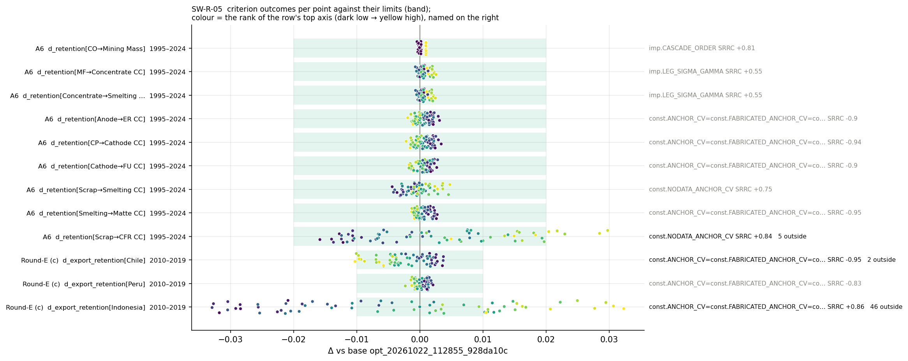
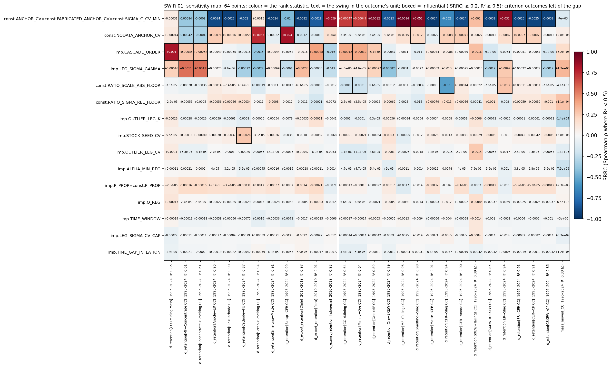
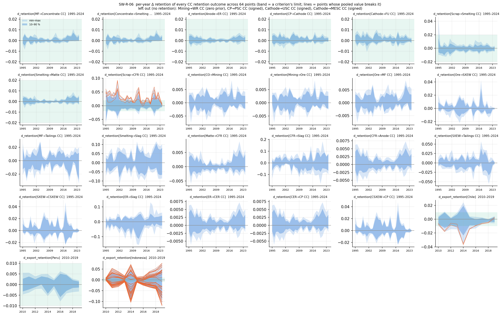
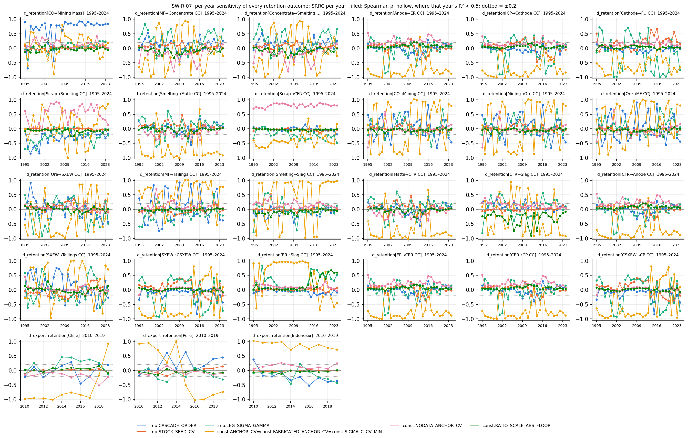
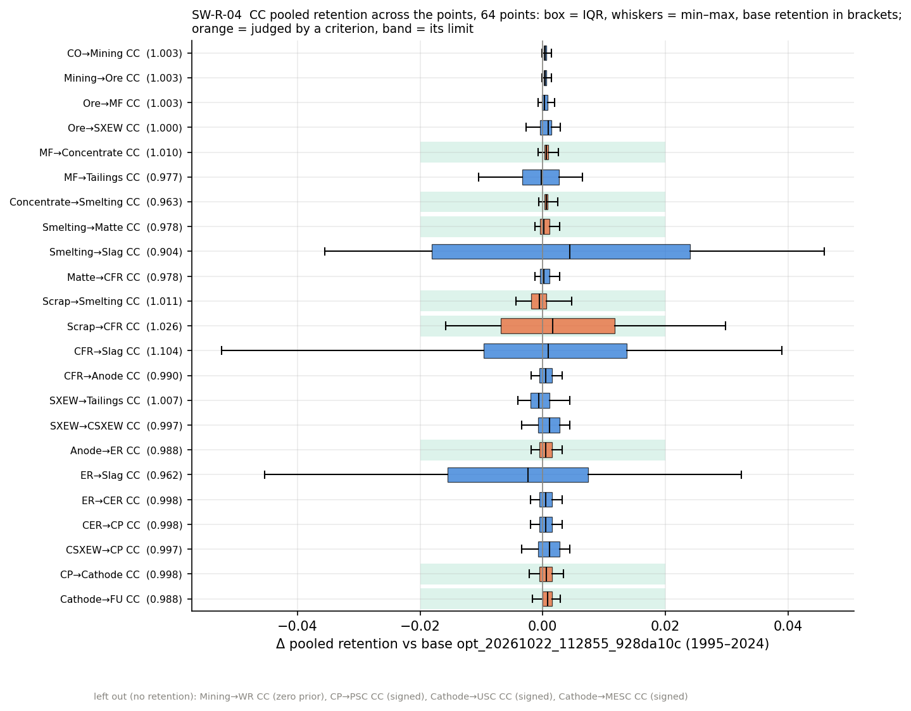

# #108: the judgement values move the answer far less than termination does; A6 fails narrowly, on scrap into refineries, and only where the no-data anchor is loosest

**Run:** `sweep_20261102_145601_8413cace` (label `knob study (#108)`).
- Design: 64 points of a Latin hypercube, seed 20261022, over 15 knobs.
- Steps: imp → const → opt. Only the opt runs are kept (imp and const pass through `/dev/shm/pysuto-sweep`, ADR 0045 am.).
- Fixed overrides: `opt.FEASIBILITY_CHECK = "none"`, `const.DIAG_PLOT = False`.
- Outcome: 64/64 points done, 2026-11-02 14:56 → 2026-11-03 01:07 UTC (10.2 h, median 9.5 min per point).

**Against:** the final reference chain `opt_20261022_112855_928da10c`, the base of every point:
- const run `const_20261022_111531_df61bf5c`;
- imp run `imp_20261022_111102_1b49a2b3`.

**Chain:** the reference's feeds `feed_icsg_20261022_110826_8a031806`, `feed_baci_20261022_110715_fdf3b4ac` and `feed_crude_ore_20260603_095651_558f7369`.
- The sweep ran in the main checkout at `e5ced0c` (clean), with nothing else running.
- It was scored by `scripts/sweep_diag.py` at `bb1956f` (the #117 library) on 2026-11-05.

**Feeds/params:** the reference's (acc copper v4; conc v10, eff v4, ore_grade v8, stripping_ratio v2, stock_bounds v6).

**Date:** 2026-11-05 · **Branch:** `diag/knob-study-rep` · **Issue:** #108 (library #117) · **ADR:** none (no decision changes; 0045 for the sweep's storage)

**Verdict: A6 fails on one stage at 5 of 64 points; Round-E (c) fails on Indonesia; no knob changes.**

- **A6.** Scrap into refineries (Scrap→CFR CC) reaches |Δ pooled retention| 0.0298 against the 0.02 limit. All five breaking points have the no-data anchor's coefficient of variation between 0.080 and 0.093, more than 1.6× its shipped 0.05. The other eight stages stay within 0.0048 at every point, two orders below A5's 0.223 for the termination rule.
- **The ranking.** Two σ knobs carry it:
  - the scale totals' coefficient of variation (`ANCHOR_CV`, tied) on smelting, refining, final use and all three exporters;
  - `NODATA_ANCHOR_CV` on both scrap legs.

  Ten of the 15 knobs are influential on none of the twelve criterion outcomes.
- **Round-E (c).** It holds for Peru (64/64), misses for Chile at two points (62/64) and fails for Indonesia (18/64). Indonesia's concentrate export retention moves ±0.033 with the scale-total cv.

The account is robust to the knobs, except for the scrap legs and Indonesia's exports.

## 1. Design

The grilling of 2026-10-22 recorded the design on #108 before the sweep ran.

**Axes and ranges.** SI Table S22b lists them with their shipped values.
- σ-scale knobs (cvs, floors, caps) are log-uniform over a factor 2 either side of the shipped value.
- Shape knobs are uniform over a stated interval around it.
- `CASCADE_ORDER` takes the shipped order or the reversed one.
- `TIME_WINDOW` takes 2, 3 or 4.
- Three knobs are tied as one axis (`ANCHOR_CV` = `FABRICATED_ANCHOR_CV` = `SIGMA_C_CV_MIN`), because below the σ_c cv floor an anchor would be inflated back up to it.
- `P_PROP` is tied across Stages 2 and 3.

**Held fixed**, with the reasons on #108:
- the structural modes, each with a measured A/B in its ADR;
- the knobs inert in the shipped configuration;
- the values calibrated to data (`LEG_SIGMA_AREF`, the feeds' resolution floors);
- the conditioning floors;
- all of Stage 4: termination is A5, `QP_VARIABLES` is #33, `DIRECT_SOLVE_METHOD` is #72.

**Outcomes.** These are scored after the run from the stored posteriors (GLOSSARY "Outcome", "Pooled retention"):
- the change in pooled retention over 1995–2024 against the base, for the nine Table S19 stages and for every CC category (`EveryCategory("CC")`);
- the concentrate export retention of Chile, Peru and Indonesia over 2010–2019;
- `d_total` per stage, `mass_moved_*` and `J_base_at_point` with its families.

Signed categories (the stock legs) and the zero-prior `Mining→WR CC` get no retention.

## 2. Decision items

These were pre-registered on #108 (2026-10-22), reported whichever way they fall, and are declared as criteria in `scripts/sweep_diag.py`.

| # | Rule | Result |
|---|---|---|
| A6 | max \|Δ pooled retention\| over the nine stages < 0.02 at every point | **fails**: 59/64. Worst 0.0298, at p047 on `d_retention[Scrap→CFR CC]`; the other eight stages ≤ 0.0048 |
| Round-E (c) | each exporter's \|Δ export retention\| (2010–19) < 0.01, reported per point | **fails**: 18/64 points meet it for all three exporters. Peru 64/64, Chile 62/64 (max 0.0103), Indonesia 18/64 (max 0.0329, at p030) |
| rank | a knob is influential on an outcome when \|SRRC\| ≥ 0.2 with R² ≥ 0.5; below R² 0.5 Spearman ρ is quoted | applied as registered; every one of the twelve criterion outcomes has R² ≥ 0.61 |

The five A6 breaches are p015, p047, p052, p060 and p062.
- **The no-data anchor's cv** is 0.0912, 0.0892, 0.0933, 0.0869 and 0.0803 at these points. Eight points lie in [0.0803, 0.0933], so a loose no-data anchor is necessary for a breach but not sufficient.
- **The scale-total cv** is low at four of the five breaches (0.0056–0.0074, against 0.0138 at p052). This fits its −0.44 SRRC on the stage.

## 3. Which knob, and by how much





| Outcome | Max \|Δ\| | Within | Top knob | SRRC (R²) | Swing | Other influential knobs |
|---|---|---|---|---|---|---|
| CO→Mining Mass | 0.0010 | 64 | `CASCADE_ORDER` | +0.81 (0.85) | +0.0010 | `LEG_SIGMA_GAMMA` +0.23 |
| MF→Concentrate CC | 0.0026 | 64 | `LEG_SIGMA_GAMMA` | +0.55 (0.61) | +0.0011 | scale-total cv −0.37, `NODATA_ANCHOR_CV` −0.31, `CASCADE_ORDER` +0.27 |
| Concentrate→Smelting CC | 0.0025 | 64 | `LEG_SIGMA_GAMMA` | +0.55 (0.61) | +0.0011 | as MF→Concentrate |
| Anode→ER CC | 0.0031 | 64 | scale-total cv | −0.90 (0.90) | −0.0024 | `NODATA_ANCHOR_CV` +0.25 |
| CP→Cathode CC | 0.0034 | 64 | scale-total cv | −0.94 (0.90) | −0.0027 | — |
| Cathode→FU CC | 0.0028 | 64 | scale-total cv | −0.90 (0.87) | −0.0020 | `LEG_SIGMA_GAMMA` −0.33, `STOCK_SEED_CV` +0.27 |
| Scrap→Smelting CC | 0.0048 | 64 | `NODATA_ANCHOR_CV` | +0.75 (0.94) | +0.0037 | `LEG_SIGMA_GAMMA` −0.40, `CASCADE_ORDER` −0.39 |
| Smelting→Matte CC | 0.0028 | 64 | scale-total cv | −0.95 (0.91) | −0.0024 | — |
| Scrap→CFR CC | 0.0298 | 59 | `NODATA_ANCHOR_CV` | +0.84 (0.99) | +0.0235 | scale-total cv −0.44, `LEG_SIGMA_GAMMA` −0.24 |
| Chile exports 2010–19 | 0.0103 | 62 | scale-total cv | −0.95 (0.97) | −0.0082 | `LEG_SIGMA_GAMMA` +0.31, `NODATA_ANCHOR_CV` −0.21 |
| Peru exports 2010–19 | 0.0023 | 64 | scale-total cv | −0.83 (0.91) | −0.0018 | `CASCADE_ORDER` +0.40 |
| Indonesia exports 2010–19 | 0.0329 | 18 | scale-total cv | +0.86 (0.98) | +0.0386 | `CASCADE_ORDER` −0.29, `LEG_SIGMA_GAMMA` −0.25 |

*Within* counts the points with |Δ| below the outcome's limit: 0.02 for the stages, 0.01 for the exporters. The swing is the outcome's mean over the top third of the knob's values minus its mean over the bottom third; for the cascade order it is the reversed order's mean minus the shipped order's.

**Influential knobs.** Five knobs are influential on at least one criterion outcome: the scale-total cv, `NODATA_ANCHOR_CV`, `LEG_SIGMA_GAMMA`, `CASCADE_ORDER` and `STOCK_SEED_CV`.
- **Never influential on a criterion outcome:** `P_PROP`, `Q_REG`, `ALPHA_MIN_REG`, `TIME_WINDOW`, `TIME_GAP_INFLATION`, `OUTLIER_LEG_K`, `OUTLIER_LEG_CV`, `LEG_SIGMA_CV_CAP`, `RATIO_SIGMA_REL_FLOOR` and `RATIO_SCALE_ABS_FLOOR`.
- **Over every CC retention outcome:** `RATIO_SCALE_ABS_FLOOR` becomes influential on four (CFR→Slag CC −0.54, ER→Slag CC +0.29, CO→Mining CC and Mining→Ore CC −0.21), so nine knobs remain never influential.

**The rank says which, the swing says how much.** The scale-total cv has SRRC −0.94 on CP→Cathode CC, yet its swing there is −0.0027: it dominates a small change. On Scrap→CFR CC the no-data anchor's swing is +0.0235, larger than the A6 limit's distance from the base. On Indonesia's exports the scale-total cv's swing is +0.039, four times Round-E (c)'s limit. Chile and Indonesia respond to that knob with opposite signs (−0.95 and +0.86), so a single scale-total cv cannot hold both exporters near the base.

**The cascade order moves gross mass, not copper.** It ranks first on `J_base_at_point` (SRRC +0.88, R² 0.89) and on `mass_moved_total` (+0.88). Under the reversed order the median `J_base_at_point` is 13.1 million, against 230 thousand under the shipped order, and 98 % of it sits on sum rows. In CC terms the same knob moves only CO→Mining Mass, by a swing of 0.001. `mass_moved_CC` (median 47,589 kt CC over 30 years, range 8,328–86,587) has no additive ranking (R² 0.33). Its largest |ρ| is `LEG_SIGMA_GAMMA`'s +0.33.

**Feasibility.** Every point meets the base's hard rows within 1.3e-6 kt; the base's own floor is 1.1e-6 kt. Every `J_base_at_point` is therefore a comparison at a feasible point.

## 4. When



**The Scrap→CFR CC breach shifts the whole series.** At the five breaking points the stage lies above 0.02 in 12, 17, 23, 23 and 24 of the 30 years. The largest single-year Δ over all points is 0.093, in 2001.

**Other stages, year by year.** No other stage leaves 0.02 in any year except scrap into smelters, in 1995 (four points, at most 0.043). On the other seven stages the largest single-year |Δ| is 0.011.

**The pooled rank can hide a year-to-year swap.** On CP→Cathode CC the scale-total cv's SRRC stays below −0.2 in 27 of 30 years. On CO→Mining CC its pooled SRRC is +0.70, yet per year it lies above +0.2 in 16 years and below −0.2 in 12, with R² ≥ 0.5 in all 30. The pooled coefficient on a mine-chain category is a net of opposite years, not a steady effect (SW-R-07).



## 5. Outside the criteria



**The slag legs are the most knob-sensitive CC flows**, and no criterion covers them. The scale-total cv ranks first on all three:

| Category | Δ range | Scale-total cv SRRC |
|---|---|---|
| CFR→Slag CC | −0.052 to +0.039 | −0.65 |
| Smelting→Slag CC | −0.036 to +0.046 | +0.92 |
| ER→Slag CC | −0.045 to +0.032 | +0.88 |

The slag legs are residual outputs of the process recipes, exempt from the no-data anchor (SI S4.2). That they absorb what a looser scale total releases is plausible, but this REP does not trace it.

**The next-widest category** is MF→Tailings CC, at −0.011 to +0.006.

**Seven categories get no retention:**
- `Mining→WR CC` (zero prior);
- `CP→PSC`, `Cathode→USC` and `Cathode→MESC`, each in both valuations (signed).

## 6. Into the manuscript

- **Results.** Table 3 gains row A6, "judgement values do not move the answer" (59/64; max 0.030; other stages ≤ 0.005; fail). §4.1 gains two sentences beside A5 contrasting the two (92 words; Results prose 1,036 → 1,128 words against the 1,000 budget). No main-text figure.
- **SI.** S15 gains A6's definition (Table S18) and outcome (Table S18b), and a new **S15.4 Knob study**:
  - Table S22b: the knobs and ranges;
  - Table S22c: the twelve criterion outcomes with their top knob, SRRC and swing;
  - **Figure S1**: SW-R-05, copied to `docs/manuscript/figs/si_s15_knob_criteria.png`.
- **Numbers.** Group 12 of `scripts/report/manuscript_numbers.py` reads the sweep's diag tables. Every A6 and S15.4 number is keyed in `docs/manuscript/figs/manuscript_numbers.json`.

## 7. What this does not show

- **Local, not global.** Every range is a factor 2 or a stated interval around the shipped value. A knob that matters only far from its shipped value would not show.
- **Main effects.** A 64-point hypercube ranks main effects. Interactions show only as a low R². Every criterion outcome has R² ≥ 0.61; `mass_moved_CC` (0.33) is the exception. Variance-based indices would need a Saltelli design of ≈ 1,090 points.
- **Mechanism.** Why a loose no-data anchor lifts scrap into refineries is not measured here. The no-data anchor prices data-free edges, so a looser one plausibly lets the solver route scrap through unreported refinery legs, but this REP does not trace it.
- **Not swept:** the structural modes, Stage 1 (#109) and the solver. Termination alone moves retention by up to 0.223 (A5).
- **One chain.** The ranking belongs to the reference chain; another acc or feed set could rank the knobs differently.

## Reproduce

```bash
python scripts/sweep.py --dry-run                                 # the 64 points, ≈ 634 min planned
python scripts/sweep.py                                           # 10.2 h; --resume <sweep_id> continues
python scripts/sweep_diag.py sweep_20261102_145601_8413cace       # ≈ 3.5 min: tables + SW-R-01, 02, 04–07
python scripts/report/manuscript_numbers.py opt_20261022_112855_928da10c   # group 12 reads the sweep's diag
```

The figures above are copies of the sweep's `diag/` (`docs/rep/figs/issue108/`). SW-R-02 (each criterion outcome against its top knob) is there too.
