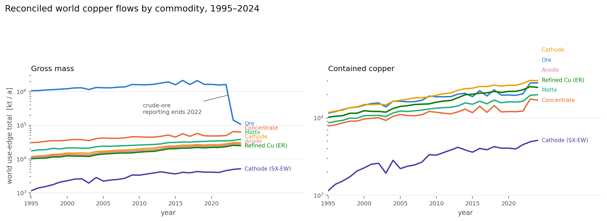
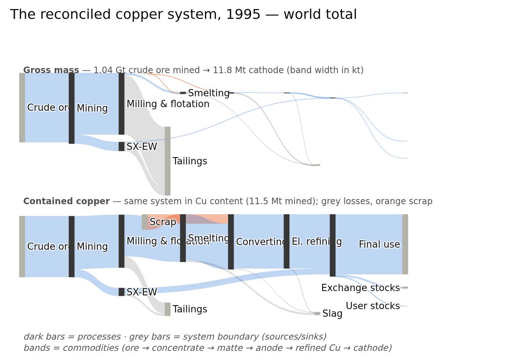
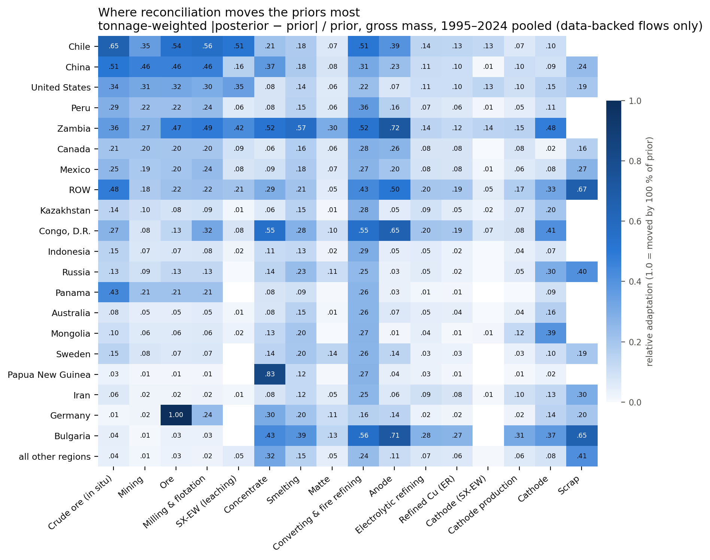

# pySUTO status — supervisor briefing, 2026-09-07

*Global copper supply–use model: 30 years (1995–2024) × 47 regions × full process chain,
~28,500 flows per year, reconciled in two valuations at once (gross mass + contained copper).*

---

## 1 · What happened since the start of September

One arc: **the model went from collapsing under its own data to trusting each number in
proportion to how good it is.** Five shipped fixes:

- **Feasibility.** Soft net-stock bounds and share-based imputation replaced brittle hard
  constraints — *all 30 years now solve* (before: 1995 was infeasible and mining flows
  collapsed systemically).
- **The scrap faucet closed.** The solver had discovered it could invent free scrap to
  satisfy refining balances. Anchor priors and hard scrap-share bands closed the loophole —
  primary share of refining now sits at a literature-consistent **83–92 %**.
- **Self-trade untangled.** Trade flows were being mapped into regions' own domestic chains;
  scoping bilateral trade cross-region restored China's and Japan's supply chains.
- **Physically consistent priors.** Region- and year-specific in-situ ore grades replaced a
  global 1 % placeholder — the prior system is now *exactly* mass-consistent, so any
  remaining tension is real data conflict, not construction error.
- **Trusting big flows (the September headline).** Data-pedigree uncertainty was
  *size-blind*: deleting a 21 Mt trade flow cost the solver the same penalty as deleting
  5 kt, so it preferentially deleted the largest, best-measured flows — Chile's concentrate
  exports were being zeroed. Size-damped uncertainty (plus a tailings fix and a plausibility
  screen for absurd trade records) ended that: deletion is now flat across flow sizes, and
  **Chile's exports survive at 51 % retention vs 16 % before**; the world cathode chain
  closes at 99 %.

## 2 · Where the model is

*Fig 1 — Reconciled world totals per commodity and year, in both valuations. Smooth,
plausible growth trajectories; the 2023–24 ore drop is a data artifact (crude-ore reporting
ends 2022), not model behaviour.*

*Fig 2 — What the model "is": the global copper system for one year (1995), all regions
aggregated. Top: gross mass — the upstream funnel (1.04 Gt ore mined, ~99 % of it leaving
as tailings). Bottom: the same year in contained copper — 11.5 Mt mined copper flowing through
smelting and refining to 11.8 Mt cathode (with scrap making up the difference), which
matches reported world refined production for 1995 almost exactly.*

- **Solves everywhere, cold.** 30/30 years, no warm-start tricks, dual-valuation mass
  balance holds by construction.
- **The chain retains its data.** World-level retention of observed tonnage (2015): mining
  65 %, concentrate 70 %, smelting 82 %, **cathode 99 %** — retention rises with data
  quality down the chain, as it should.

*Fig 3 — Where the reconciliation works hardest: relative adaptation of the priors per
region × chain stage (pooled 1995–2024, data-backed flows only; the metric is per-cell, so
small regions can show large values on small tonnages). The hot rows/cells are diagnostic,
and each has a story: Chile = the (now largely resolved) trade-deletion tension; Papua New
Guinea's 0.83 concentrate = a screened implausible trade record; Germany's 1.00 ore = an
implausible 5.9 Mt mining prior the model correctly rejects; Bulgaria/Congo anode = the
transit-hub signature below.*

- **Known limitations — diagnosed, not mysterious.** The remaining tension is localised to
  two structural causes: **(a) transit hubs** — trade statistics record re-exports
  (Singapore, Netherlands, Belgium…), but the model has no re-export concept, so it must
  invent domestic production chains behind those exports; **(b) demand-side slack** — flows
  into stocks/final use with no data absorb residual imbalances. Both are measured symptoms
  with a planned fix path (below). Plus the fig-1 ore-data cliff (2023–24), an input-data
  gap.

## 3 · What's next

- **This week (Round C, plan approved):** *measure before designing* — quantify how much of
  the remaining tension transit/re-exports explain (hub ranking, correlation with the
  fabricated-chain signal), plus one small screen fix so legitimate re-exporters (Japan,
  Spain) are not flagged as outliers.
- **Round D (decision pending Round-C evidence):** structural treatment of re-exports —
  either netting trade at the data-feed level or adding an explicit re-export flow class to
  the accounting structure.
- **Manuscript:** method section drafted; results section follows once the model freezes.

---

*Run underlying all figures: `opt_20260903_124655_4b23df2f` (shipped γ=0.5 chain, merged to
main 2026-09-03). Figure script: `scripts/report/supervisor_figs_20260907.py`.*
